# CS Fundamentals for Software Engineering Interviews

A study guide covering the computer science topics that come up most often in software engineering interviews: complexity analysis, data structures, algorithms, coding patterns, operating systems, concurrency, networking, databases, and system design fundamentals. Code samples are in Python for readability, and every section ends with practice questions you can use for self-testing.

*Last updated: 2026-10-21*

---

## Table of Contents

0. [How to Use This Guide](#0-how-to-use-this-guide)
1. [Complexity Analysis](#1-complexity-analysis)
2. [Data Structures](#2-data-structures)
3. [Core Algorithms](#3-core-algorithms)
4. [Coding Interview Patterns](#4-coding-interview-patterns)
5. [Operating Systems](#5-operating-systems)
6. [Concurrency](#6-concurrency)
7. [Computer Networking](#7-computer-networking)
8. [Databases](#8-databases)
9. [System Design Fundamentals](#9-system-design-fundamentals)
10. [Answering Well and a Four-Week Plan](#10-answering-well-and-a-four-week-plan)
[References](#references)

---

## 0. How to Use This Guide

Interviews rarely test everything. They test a small, predictable core very deeply. Prep guides consistently rank hash tables, trees, binary search, and breadth-first and depth-first search as the must-know foundation, and treat algorithms such as Dijkstra, A*, and knapsack as optional extensions beyond the basics [3]. Beyond coding, networking, operating systems, and database questions show up in backend, systems, and SRE loops, often paired together [7][8]. System design is a large interview topic in its own right [3].

The map below shows how the topics in this guide relate. Study the Tier 1 areas first, then widen.

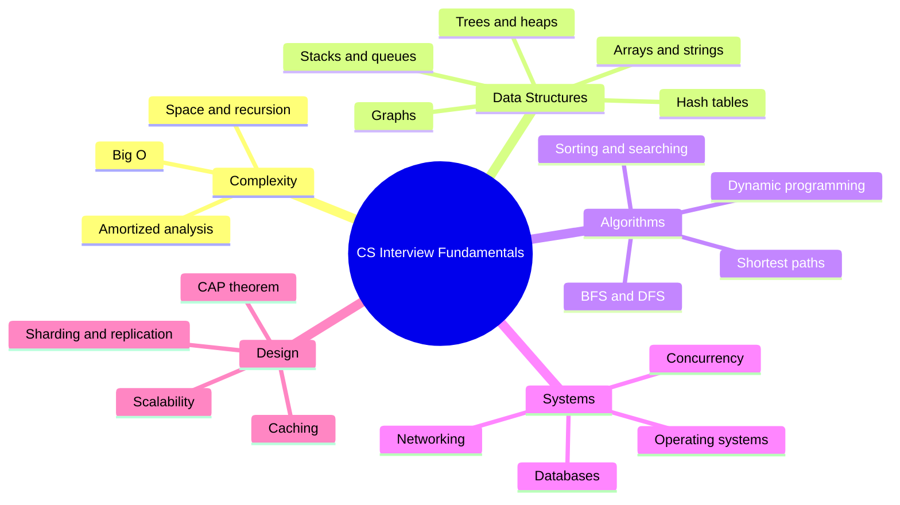

### Priority tiers

| Tier | Topics | Why |
|------|--------|-----|
| **Tier 1 (must know cold)** | Big O, arrays and strings, hash tables, linked lists, stacks and queues, trees, BFS and DFS, binary search, sorting basics, recursion, two pointers and sliding window | Appear in nearly every coding round [3][5] |
| **Tier 2 (know well)** | Heaps, graphs, dynamic programming, backtracking, tries, process vs thread, deadlock, TCP vs UDP, HTTP and TLS, ACID and indexes, caching, load balancing | Appear often in backend and senior loops [7][8] |
| **Tier 3 (know the idea)** | Dijkstra, topological sort, union-find, MVCC, consistent hashing, QUIC, CAP and PACELC, lock-free structures | Differentiators for senior roles |

### How to practice each concept

For every concept, aim to do four things: explain it in two sentences, state its complexity or trade-offs, write the canonical code from memory, and name two problems that use it. The "Practice questions" lists at the end of each section follow this format.

---

## 1. Complexity Analysis

Big O notation describes how an algorithm's running time or memory use grows as input size grows. It describes the shape of growth for large inputs, not exact timings [1].

### 1.1 The notations

- **O (Big O)** is an upper bound on growth. Saying an algorithm is O(n²) means it grows no faster than a constant times n².
- **Ω (Big Omega)** is a lower bound.
- **Θ (Big Theta)** is a tight bound: both O and Ω hold.

A common point of confusion: some cheat sheets pair Ω with best case and Θ with average case [1]. Strictly, these notations describe bounds on a function, while best, average, and worst case describe which input you analyze. You can state a Big O for the best case, the average case, or the worst case. In interviews, "O(n)" with no qualifier usually means the worst case; say so explicitly when average and worst differ (hash tables and quicksort are the classic examples).

### 1.2 Growth classes

| Class | Name | Typical example | Approx. operations at n = 1,000 |
|-------|------|-----------------|---------------------------------|
| O(1) | Constant | Array index, hash lookup (average) | 1 |
| O(log n) | Logarithmic | Binary search, balanced BST lookup | 10 |
| O(n) | Linear | Single scan of an array | 1,000 |
| O(n log n) | Linearithmic | Merge sort, heap sort | 10,000 |
| O(n²) | Quadratic | Nested loops over all pairs | 1,000,000 |
| O(2ⁿ) | Exponential | Naive recursive Fibonacci, all subsets | about 10³⁰¹ |
| O(n!) | Factorial | Brute-force permutations | astronomically large |

These classes and their typical examples are standard across Big O references [1][10]. Rule of thumb for interviews: with n up to about 10⁵, aim for O(n log n) or better; with n up to about 20, exponential solutions are fine; with n up to about 10,000, O(n²) is borderline.

### 1.3 Rules for deriving complexity

1. **Drop constants**: O(2n) is O(n).
2. **Drop lower-order terms**: O(n² + n) is O(n²).
3. **Sequential steps add**: two loops one after another is O(n + m).
4. **Nested steps multiply**: a loop inside a loop is O(n × m).
5. **Different inputs get different variables**: iterating two arrays of sizes a and b is O(a + b), not O(n).
6. **Halving the problem each step gives log n**.

```python
def example_a(arr):          # O(n): one pass
    total = 0
    for x in arr:
        total += x
    return total

def example_b(arr):          # O(n^2): all pairs
    count = 0
    for i in range(len(arr)):
        for j in range(i + 1, len(arr)):
            if arr[i] + arr[j] == 0:
                count += 1
    return count

def example_c(n):            # O(log n): halving
    steps = 0
    while n > 1:
        n //= 2
        steps += 1
    return steps
```

### 1.4 Amortized analysis

Some operations are usually cheap but occasionally expensive. **Amortized** cost is the average cost per operation over a worst-case sequence of operations. The standard example is a dynamic array (Python `list`, Java `ArrayList`, Rust `Vec`): appending is O(1) most of the time, and when capacity runs out the array doubles and copies all elements in O(n). Because doubling happens rarely, appends are **amortized O(1)** [2].

### 1.5 Space complexity and the recursion stack

Space complexity counts extra memory beyond the input. Recursion consumes stack space: a recursive function that goes n calls deep uses O(n) stack space, even if it allocates nothing else. Recursive DFS on a balanced tree uses O(log n) stack, but on a degenerate (linked-list-shaped) tree it uses O(n).

### 1.6 Recurrences you should recognize

| Recurrence | Result | Example |
|------------|--------|---------|
| T(n) = T(n/2) + O(1) | O(log n) | Binary search |
| T(n) = T(n-1) + O(1) | O(n) | Linear recursion, factorial |
| T(n) = 2T(n/2) + O(1) | O(n) | Tree traversal by halves |
| T(n) = 2T(n/2) + O(n) | O(n log n) | Merge sort |
| T(n) = T(n-1) + T(n-2) | O(2ⁿ) | Naive Fibonacci |

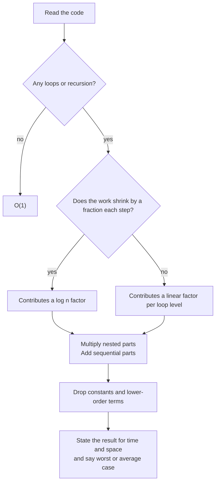

The flowchart condenses the process: identify loops and recursion, spot halving, combine by multiplying nested parts and adding sequential parts, then simplify.

### Practice questions: complexity

1. What is the time complexity of building a string by repeated concatenation in a loop in a language with immutable strings? (Hint: each concatenation copies.)
2. Why is `list.append` amortized O(1) but `list.insert(0, x)` O(n)?
3. What is the space complexity of recursive merge sort? Of heap sort?
4. An algorithm is O(n) in the average case and O(n²) in the worst case. Name two real examples.
5. Is O(n + m) the same as O(n)? When is it, and when not?

---

## 2. Data Structures

Most coding problems come down to picking the right data structure [9]. Know each structure's operations, costs, and typical traps.

### 2.1 Operation costs at a glance

| Structure | Access by index | Search | Insert | Delete | Notes |
|-----------|-----------------|--------|--------|--------|-------|
| Array | O(1) | O(n) | O(n) middle, O(1) end* | O(n) middle | *Dynamic array append is amortized O(1) [1][2] |
| Singly linked list | O(n) | O(n) | O(1) at known node or head | O(1) at known node | Needs the node reference, otherwise O(n) to find it [2] |
| Stack (array or list) | O(n) | O(n) | O(1) push | O(1) pop | LIFO [2] |
| Queue (linked list or ring buffer) | O(n) | O(n) | O(1) enqueue | O(1) dequeue | FIFO [2] |
| Hash table | n/a | O(1) average, O(n) worst | O(1) average | O(1) average | Unordered [1][2] |
| Balanced BST | O(log n) | O(log n) | O(log n) | O(log n) | Sorted order, range queries |
| Unbalanced BST | O(n) worst | O(n) worst | O(n) worst | O(n) worst | Degenerates to a list |
| Binary heap | n/a | O(n) | O(log n) | O(log n) extract top | Peek top is O(1); build-heap is O(n) |
| Trie | n/a | O(L) | O(L) | O(L) | L is the key length |

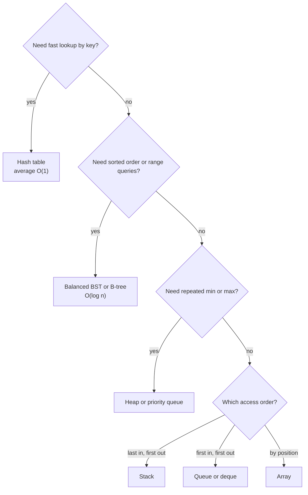

### 2.2 Arrays and strings

Arrays store elements in contiguous memory, which gives O(1) indexing and excellent cache locality. Insertion or deletion in the middle shifts elements, costing O(n). Many languages make strings immutable, so repeated concatenation is O(n²) overall; build a list of pieces and join once instead.

**Traps:** off-by-one errors, in-place modification while iterating, and forgetting empty-input and single-element cases.

### 2.3 Linked lists

A linked list stores nodes connected by pointers, so insertion and deletion are cheap once you hold the node, but access and search are O(n) [2]. Linked lists are rarely used in day-to-day application code, but interviews use them to test pointer manipulation [5].

Techniques worth memorizing: the **dummy head node** (avoids special-casing the head), **fast and slow pointers** (find the middle, detect cycles), and **in-place reversal**.

```python
class ListNode:
    def __init__(self, val=0, next=None):
        self.val, self.next = val, next

def reverse(head):                    # O(n) time, O(1) space
    prev = None
    while head:
        nxt = head.next
        head.next = prev
        prev, head = head, nxt
    return prev
```

### 2.4 Stacks and queues

A **stack** is last-in-first-out: push and pop at the same end. A **queue** is first-in-first-out, usually built on a linked list or ring buffer for O(1) enqueue and dequeue [2]. Stacks power undo systems, expression parsing, and DFS; queues power BFS, scheduling, and buffering.

Classic problems: valid parentheses, queue using two stacks, stack with O(1) `min`, and the **monotonic stack** (next greater element).

### 2.5 Hash tables

A hash table maps keys to values using a hash function to compute a bucket index, giving O(1) average insert, lookup, and delete [2]. Interviewers love collisions: two keys landing in the same bucket.

- **Chaining**: each bucket holds a list of entries.
- **Open addressing**: probe for the next free slot (linear, quadratic, or double hashing).
- **Load factor** (entries divided by buckets) drives resizing; when it crosses a threshold the table grows and rehashes, which is why inserts are amortized O(1).
- **Worst case** is O(n) when many keys collide.
- Keys must be hashable and, in practice, immutable.

Hash tables also appear inside more advanced techniques such as dynamic programming memoization, but they are unordered, so they are often combined with other structures [5].

```python
def two_sum(nums, target):            # O(n) time, O(n) space
    seen = {}
    for i, x in enumerate(nums):
        if target - x in seen:
            return [seen[target - x], i]
        seen[x] = i
    return []
```

### 2.6 Trees

A tree is a hierarchical structure of nodes. A **binary tree** gives each node at most two children; a **binary search tree (BST)** keeps left descendants smaller and right descendants larger than the node, so an in-order traversal visits values in sorted order [9].

| Traversal | Order | Typical use |
|-----------|-------|-------------|
| Pre-order | node, left, right | Copying a tree, serialization |
| In-order | left, node, right | Sorted output from a BST |
| Post-order | left, right, node | Deleting a tree, computing subtree results |
| Level-order (BFS) | level by level | Shortest depth, level problems |

A plain BST can degrade to O(n) if inserted in sorted order. **Self-balancing trees** (AVL, red-black) keep height at O(log n); know why they exist and that rotations restore balance, but you will rarely be asked to implement one.

```python
class TreeNode:
    def __init__(self, val=0, left=None, right=None):
        self.val, self.left, self.right = val, left, right

def max_depth(root):                  # O(n) time, O(h) stack
    if not root:
        return 0
    return 1 + max(max_depth(root.left), max_depth(root.right))

def lca(root, p, q):                  # lowest common ancestor, binary tree
    if not root or root is p or root is q:
        return root
    left, right = lca(root.left, p, q), lca(root.right, p, q)
    return root if left and right else (left or right)
```

Frequently asked tree problems include maximum depth, validate BST, lowest common ancestor [4], level-order traversal, and serialize and deserialize.

### 2.7 Heaps and priority queues

A **binary heap** is a complete binary tree stored in an array where each parent is smaller (min-heap) or larger (max-heap) than its children. For index i (0-based): parent is `(i - 1) // 2`, children are `2i + 1` and `2i + 2`. Insert and extract-top are O(log n); peek is O(1); building a heap from n items is O(n).

**Top-K pattern:** keep a min-heap of size k to find the k largest items in O(n log k).

```python
import heapq

def k_largest(nums, k):               # O(n log k)
    heap = []
    for x in nums:
        heapq.heappush(heap, x)
        if len(heap) > k:
            heapq.heappop(heap)
    return sorted(heap, reverse=True)
```

The "two heaps" pattern (a max-heap for the lower half and a min-heap for the upper half) solves the running median problem.

### 2.8 Tries

A trie (prefix tree) stores strings character by character along a path from the root, so lookups cost O(L) in the key length regardless of how many words are stored. Use it for autocomplete, prefix search, and word-search problems.

```python
class Trie:
    def __init__(self):
        self.root = {}

    def insert(self, word):
        node = self.root
        for ch in word:
            node = node.setdefault(ch, {})
        node["$"] = True              # end-of-word marker

    def starts_with(self, prefix):
        node = self.root
        for ch in prefix:
            if ch not in node:
                return False
            node = node[ch]
        return True
```

### 2.9 Graphs

A graph is a set of vertices connected by edges, which may be directed or undirected, weighted or unweighted, cyclic or acyclic [2]. Trees are a special case: connected, acyclic graphs.

| Representation | Space | Check edge | List neighbors | Best for |
|----------------|-------|------------|----------------|----------|
| Adjacency list | O(V + E) | O(degree) | O(degree) | Sparse graphs (most interview problems) |
| Adjacency matrix | O(V²) | O(1) | O(V) | Dense graphs, quick edge checks |

Grids are graphs too: treat each cell as a node and its four (or eight) neighbors as edges, as in "count islands" [5][6].

**Union-Find (disjoint set union)** tracks connected components with near-constant-time `find` and `union` using path compression. It is the tool for dynamic connectivity and cycle detection in undirected graphs.

```python
class DSU:
    def __init__(self, n):
        self.parent = list(range(n))

    def find(self, x):
        while self.parent[x] != x:
            self.parent[x] = self.parent[self.parent[x]]   # path compression
            x = self.parent[x]
        return x

    def union(self, a, b):
        ra, rb = self.find(a), self.find(b)
        if ra == rb:
            return False              # already connected: would form a cycle
        self.parent[ra] = rb
        return True
```

### 2.10 Design-a-structure classics

**LRU cache** (O(1) get and put) combines a hash table with a doubly linked list; in Python, `OrderedDict` does both jobs.

```python
from collections import OrderedDict

class LRUCache:
    def __init__(self, capacity):
        self.cap, self.data = capacity, OrderedDict()

    def get(self, key):
        if key not in self.data:
            return -1
        self.data.move_to_end(key)    # mark as most recently used
        return self.data[key]

    def put(self, key, value):
        if key in self.data:
            self.data.move_to_end(key)
        self.data[key] = value
        if len(self.data) > self.cap:
            self.data.popitem(last=False)   # evict least recently used
```

### Practice questions: data structures

1. Explain how a hash table handles collisions. What happens to performance as load factor rises?
2. Why can a BST degrade to O(n), and how do AVL or red-black trees prevent it?
3. Implement a queue using two stacks. What is the amortized cost of dequeue?
4. When would you pick an adjacency matrix over an adjacency list?
5. How do you find the k-th largest element in a stream? Compare a sort, a heap, and quickselect.
6. Why is an in-order traversal of a BST sorted, and how does that give you a "validate BST" solution?
7. How would you design an LRU cache with O(1) operations without using `OrderedDict`?

---

## 3. Core Algorithms

### 3.1 Sorting

You will rarely implement a sort from scratch in a real job, but interviewers use sorting to test complexity reasoning, trade-offs, and recursion. Know the table below, and be able to write merge sort and quicksort.

| Algorithm | Best | Average | Worst | Extra space | Stable | Notes |
|-----------|------|---------|-------|-------------|--------|-------|
| Bubble sort | O(n) | O(n²) | O(n²) | O(1) | Yes | Teaching only |
| Insertion sort | O(n) | O(n²) | O(n²) | O(1) | Yes | Fast on tiny or nearly sorted input |
| Selection sort | O(n²) | O(n²) | O(n²) | O(1) | No | Few swaps |
| Merge sort | O(n log n) | O(n log n) | O(n log n) | O(n) | Yes | Divide and conquer; good for linked lists |
| Quicksort | O(n log n) | O(n log n) | O(n²) | O(log n) stack | No | Worst case on bad pivots; randomize the pivot |
| Heap sort | O(n log n) | O(n log n) | O(n log n) | O(1) | No | In place, poor cache behavior |
| Counting or radix sort | O(n + k) | O(n + k) | O(n + k) | O(k) | Yes | Only for bounded integer keys |

A **stable** sort keeps equal elements in their original relative order, which matters when sorting by multiple keys. Production libraries use hybrids: Python and Java object sorts use Timsort (a stable merge and insertion hybrid), and many C++ and Rust unstable sorts use introsort or pattern-defeating quicksort variants.

```python
def merge_sort(a):                        # O(n log n) time, O(n) space
    if len(a) <= 1:
        return a
    mid = len(a) // 2
    left, right = merge_sort(a[:mid]), merge_sort(a[mid:])
    out, i, j = [], 0, 0
    while i < len(left) and j < len(right):
        if left[i] <= right[j]:           # <= keeps the sort stable
            out.append(left[i]); i += 1
        else:
            out.append(right[j]); j += 1
    out.extend(left[i:]); out.extend(right[j:])
    return out

import random
def quicksort(a, lo=0, hi=None):          # average O(n log n), worst O(n^2)
    if hi is None:
        hi = len(a) - 1
    if lo >= hi:
        return
    p = random.randint(lo, hi)            # random pivot defeats sorted-input worst case
    a[p], a[hi] = a[hi], a[p]
    pivot, i = a[hi], lo
    for j in range(lo, hi):
        if a[j] < pivot:
            a[i], a[j] = a[j], a[i]
            i += 1
    a[i], a[hi] = a[hi], a[i]
    quicksort(a, lo, i - 1)
    quicksort(a, i + 1, hi)
```

**Quickselect** uses the same partition step to find the k-th smallest element in O(n) average time by recursing into only one side.

### 3.2 Binary search

Binary search repeatedly halves a search range and therefore runs in O(log n), but it requires sorted data (or, more generally, a monotonic predicate) [5]. It is surprisingly common as the final step of a solution [3].

```python
def binary_search(a, target):             # classic: find exact match
    lo, hi = 0, len(a) - 1
    while lo <= hi:
        mid = lo + (hi - lo) // 2         # avoids overflow in fixed-width languages
        if a[mid] == target:
            return mid
        if a[mid] < target:
            lo = mid + 1
        else:
            hi = mid - 1
    return -1

def lower_bound(a, x):                    # first index with a[i] >= x
    lo, hi = 0, len(a)
    while lo < hi:
        mid = (lo + hi) // 2
        if a[mid] < x:
            lo = mid + 1
        else:
            hi = mid
    return lo
```

**Binary search on the answer** applies the same idea to a search space of possible answers whenever feasibility is monotonic: if speed k works, any faster speed also works.

```python
def min_eating_speed(piles, hours):       # smallest k so all piles finish within hours
    lo, hi = 1, max(piles)
    while lo < hi:
        mid = (lo + hi) // 2
        needed = sum((p + mid - 1) // mid for p in piles)   # ceil(p / mid)
        if needed <= hours:
            hi = mid
        else:
            lo = mid + 1
    return lo
```

Common bugs: infinite loops from `lo = mid` with the wrong midpoint rounding, off-by-one on the `lo <= hi` versus `lo < hi` choice, and forgetting that the input must be sorted.

### 3.3 Breadth-first and depth-first search

BFS and DFS are the two fundamental ways to explore a tree or graph, and both are interview musts [3]. BFS explores level by level using a queue and finds shortest paths in unweighted graphs. DFS goes as deep as possible along one branch before backtracking, using recursion or an explicit stack, and suits path enumeration, cycle detection, and structural problems [11].

Both visit each vertex and edge once, so the time is O(V + E). BFS needs O(V) memory for its queue in the worst case; DFS needs O(depth) stack space.

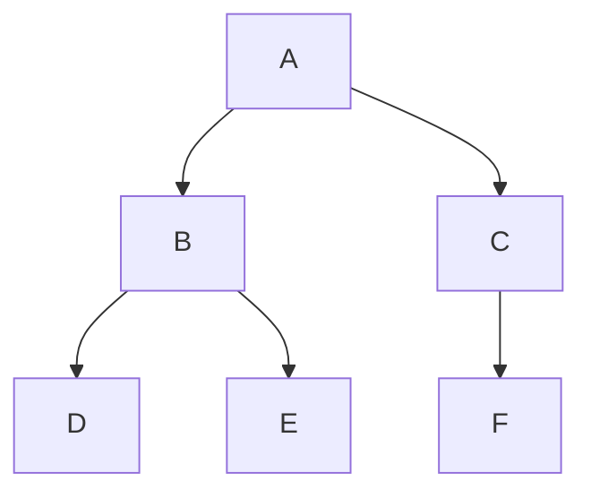

On this tree, BFS visits A, B, C, D, E, F (level by level), while DFS visiting the left child first visits A, B, D, E, C, F (deep first).

```python
from collections import deque

def bfs_shortest(graph, start, goal):     # unweighted shortest path length
    q, seen = deque([(start, 0)]), {start}
    while q:
        node, dist = q.popleft()
        if node == goal:
            return dist
        for nb in graph[node]:
            if nb not in seen:            # mark when enqueued, not when dequeued
                seen.add(nb)
                q.append((nb, dist + 1))
    return -1

def dfs_iterative(graph, start):
    seen, stack, order = set(), [start], []
    while stack:
        node = stack.pop()
        if node in seen:
            continue
        seen.add(node)
        order.append(node)
        stack.extend(reversed(graph[node]))
    return order

def num_islands(grid):                    # grid as a graph: count connected components
    if not grid:
        return 0
    rows, cols, count = len(grid), len(grid[0]), 0
    def dfs(r, c):
        if r < 0 or c < 0 or r >= rows or c >= cols or grid[r][c] != "1":
            return
        grid[r][c] = "0"                  # mark visited by sinking the land
        dfs(r + 1, c); dfs(r - 1, c); dfs(r, c + 1); dfs(r, c - 1)
    for r in range(rows):
        for c in range(cols):
            if grid[r][c] == "1":
                count += 1
                dfs(r, c)
    return count
```

Python's default recursion limit (about 1,000 frames) can break deep recursive DFS; mention an iterative version if the input could be a long chain.

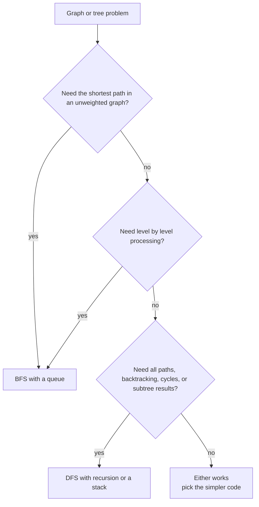

### 3.4 Shortest paths

| Algorithm | Handles | Time | Use when |
|-----------|---------|------|----------|
| BFS | Unweighted edges | O(V + E) | Every edge costs the same |
| Dijkstra (binary heap) | Non-negative weights | O((V + E) log V) | Single-source shortest path on weighted graphs |
| Bellman-Ford | Negative weights, detects negative cycles | O(V × E) | Negative edges |
| Floyd-Warshall | All pairs | O(V³) | Small graphs, all-pairs distances |
| A* | Non-negative weights plus a heuristic | Depends on heuristic | Pathfinding toward a known goal |

```python
import heapq

def dijkstra(graph, src):                 # graph[u] = [(v, weight), ...]
    dist = {src: 0}
    pq = [(0, src)]
    while pq:
        d, u = heapq.heappop(pq)
        if d > dist.get(u, float("inf")):
            continue                      # stale heap entry
        for v, w in graph[u]:
            nd = d + w
            if nd < dist.get(v, float("inf")):
                dist[v] = nd
                heapq.heappush(pq, (nd, v))
    return dist
```

Dijkstra fails with negative edge weights because it assumes a finalized vertex can never be improved later.

### 3.5 Topological sort and cycle detection

A topological ordering of a directed acyclic graph (DAG) places every vertex before the vertices it points to. It models dependency problems such as course prerequisites and build order. **Kahn's algorithm** repeatedly removes vertices with zero in-degree; if fewer than V vertices are removed, the graph has a cycle.

```python
from collections import deque, defaultdict

def topo_sort(n, edges):                  # edges = [(u, v)] meaning u before v
    adj, indeg = defaultdict(list), [0] * n
    for u, v in edges:
        adj[u].append(v)
        indeg[v] += 1
    q = deque(i for i in range(n) if indeg[i] == 0)
    order = []
    while q:
        u = q.popleft()
        order.append(u)
        for v in adj[u]:
            indeg[v] -= 1
            if indeg[v] == 0:
                q.append(v)
    return order if len(order) == n else []   # empty list signals a cycle
```

### 3.6 Recursion and backtracking

Recursion solves a problem by reducing it to smaller instances of itself. Every recursive function needs a **base case**, a **recursive step** that makes progress toward it, and awareness of the stack depth.

**Backtracking** is DFS over a decision tree: choose, explore, then undo the choice. It generates subsets, permutations, combinations, N-Queens, and Sudoku solutions. Pruning branches that cannot lead to a valid answer is what makes it practical.

```python
def subsets(nums):                        # O(n * 2^n)
    res, path = [], []
    def go(i):
        if i == len(nums):
            res.append(path[:])
            return
        go(i + 1)                         # skip nums[i]
        path.append(nums[i])              # choose
        go(i + 1)                         # explore
        path.pop()                        # undo
    go(0)
    return res

def permutations(nums):                   # O(n * n!)
    res, path, used = [], [], [False] * len(nums)
    def go():
        if len(path) == len(nums):
            res.append(path[:])
            return
        for i, x in enumerate(nums):
            if used[i]:
                continue
            used[i] = True; path.append(x)
            go()
            path.pop(); used[i] = False
    go()
    return res
```

### 3.7 Dynamic programming

Dynamic programming (DP) applies when a problem has **overlapping subproblems** (the same smaller problem is solved repeatedly) and **optimal substructure** (the best answer is built from best answers to subproblems). DP turns exponential brute force into polynomial time by solving each subproblem once.

There are two implementation styles. **Top-down** writes the recursion and caches results (memoization). **Bottom-up** fills a table from the smallest subproblem upward (tabulation) and often allows space optimization.

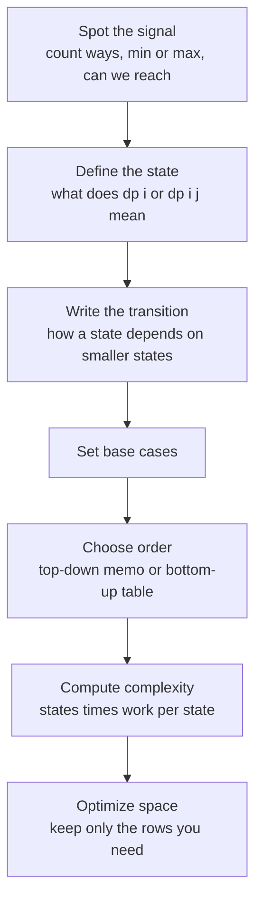

```python
from functools import cache

@cache                                    # top-down: O(n) instead of O(2^n)
def fib(n):
    return n if n < 2 else fib(n - 1) + fib(n - 2)

def coin_change(coins, amount):           # min coins to make amount; O(amount * len(coins))
    INF = amount + 1
    dp = [0] + [INF] * amount
    for a in range(1, amount + 1):
        for c in coins:
            if c <= a:
                dp[a] = min(dp[a], dp[a - c] + 1)
    return dp[amount] if dp[amount] != INF else -1

def lcs(a, b):                            # longest common subsequence; O(m * n)
    m, n = len(a), len(b)
    dp = [[0] * (n + 1) for _ in range(m + 1)]
    for i in range(1, m + 1):
        for j in range(1, n + 1):
            if a[i - 1] == b[j - 1]:
                dp[i][j] = dp[i - 1][j - 1] + 1
            else:
                dp[i][j] = max(dp[i - 1][j], dp[i][j - 1])
    return dp[m][n]

def knapsack(weights, values, cap):       # 0/1 knapsack in O(n * cap) time, O(cap) space
    dp = [0] * (cap + 1)
    for w, v in zip(weights, values):
        for c in range(cap, w - 1, -1):   # backwards so each item is used once
            dp[c] = max(dp[c], dp[c - w] + v)
    return dp[cap]
```

Classic DP problem families to recognize:

| Family | State | Examples |
|--------|-------|----------|
| 1D sequence | `dp[i]` = best answer ending at or up to i | Climbing stairs, house robber, longest increasing subsequence, word break |
| Grid | `dp[r][c]` | Unique paths, minimum path sum |
| Two strings | `dp[i][j]` over prefixes | Edit distance, longest common subsequence |
| Knapsack | `dp[i][capacity]` | Subset sum, partition equal subset, coin change |
| Intervals | `dp[l][r]` | Burst balloons, matrix chain multiplication |

### 3.8 Greedy algorithms and intervals

A greedy algorithm makes the locally best choice at each step and never reconsiders. It only works when a local choice is provably safe, typically shown with an exchange argument. Typical greedy problems: interval scheduling (sort by end time), jump game, and Huffman coding. If a greedy idea fails on a small counterexample, switch to DP.

```python
def merge_intervals(intervals):           # sort then sweep: O(n log n)
    intervals.sort(key=lambda x: x[0])
    out = []
    for start, end in intervals:
        if out and start <= out[-1][1]:
            out[-1][1] = max(out[-1][1], end)
        else:
            out.append([start, end])
    return out
```

### 3.9 Bit manipulation essentials

| Trick | Meaning |
|-------|---------|
| `x & (x - 1)` | Clears the lowest set bit; `x & (x - 1) == 0` tests for a power of two (x > 0) |
| `x & -x` | Isolates the lowest set bit |
| `a ^ a == 0`, `a ^ 0 == a` | XOR cancels pairs, so XOR of all items finds the one unpaired element |
| `x >> 1`, `x << 1` | Divide or multiply by 2 for non-negative integers |
| `(x >> i) & 1` | Read bit i |

### Practice questions: algorithms

1. Why is quicksort O(n²) in the worst case, and how does a random pivot help? When would you choose merge sort instead?
2. Implement binary search for the first occurrence of a value in an array with duplicates.
3. When does BFS find the shortest path and when does it not?
4. Why does Dijkstra's algorithm fail with negative edge weights, and what do you use instead?
5. Given course prerequisites, how do you detect that the schedule is impossible?
6. Turn the naive recursive Fibonacci into O(n) two ways, then reduce space to O(1).
7. Explain why the 0/1 knapsack inner loop runs backwards when using a 1D array.
8. Find the minimum number of meeting rooms for a list of intervals. (Hint: sort start and end times, or use a min-heap of end times.)

---

## 4. Coding Interview Patterns

Coding interview problems look different on the surface but are built from a small set of recurring techniques. Learning to recognize the pattern from the problem's signals within the first minute or two is what separates fluent candidates from those who start from scratch every time [11][12]. The patterns are stable over time, while the specific problems change [12].

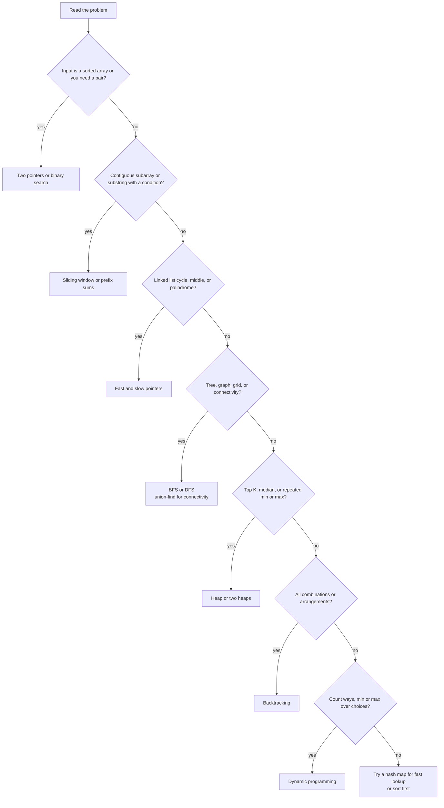

### 4.1 Pattern catalog

| Pattern | Signals in the problem | Typical complexity | Classic problems |
|---------|------------------------|--------------------|------------------|
| Hash map lookup | Pairs, counts, duplicates, complement search | O(n) | Two sum, group anagrams, longest consecutive sequence |
| Two pointers (opposite ends) | Sorted input, pair sums, palindromes, container | O(n) | Two sum II, 3Sum, container with most water [12] |
| Two pointers (same direction) | In-place removal, partitioning | O(n) | Remove duplicates, move zeroes |
| Fast and slow pointers | Cycle, middle, linked list structure | O(n), O(1) space | Linked list cycle, find the duplicate number |
| Sliding window | Longest or shortest contiguous range meeting a condition | O(n) | Longest substring without repeats, minimum window substring |
| Prefix sum | Many range sum queries, subarray sums | O(n) build, O(1) query | Subarray sum equals K |
| Monotonic stack | Next greater or smaller element, histograms | O(n) | Daily temperatures, largest rectangle in histogram |
| Binary search (including on answer) | Sorted data or monotonic feasibility | O(log n) | Search rotated array, capacity to ship packages |
| BFS | Shortest steps, level order, multi-source spread | O(V + E) | Word ladder, rotting oranges, level order traversal |
| DFS | Paths, components, tree recursion | O(V + E) | Number of islands, path sum, clone graph |
| Topological sort | Ordering with dependencies | O(V + E) | Course schedule, alien dictionary |
| Union-find | Dynamic connectivity, grouping | Near O(1) per op | Redundant connection, accounts merge |
| Heap or top K | K largest, median, merge sorted streams | O(n log k) | Kth largest, merge K sorted lists, find median from data stream |
| Intervals | Overlaps, merging, scheduling | O(n log n) | Merge intervals, meeting rooms |
| Backtracking | Generate all valid configurations | Exponential | Subsets, permutations, N-Queens |
| Dynamic programming | Count ways, optimize over choices, overlapping subproblems | States times transitions | Coin change, edit distance, knapsack |

### 4.2 Templates to memorize

```python
# Two pointers, opposite ends (sorted array)
def two_sum_sorted(a, target):
    l, r = 0, len(a) - 1
    while l < r:
        s = a[l] + a[r]
        if s == target:
            return [l, r]
        if s < target:
            l += 1
        else:
            r -= 1
    return []

# Variable-size sliding window: longest substring without repeating characters
def longest_unique(s):
    last, start, best = {}, 0, 0
    for i, ch in enumerate(s):
        if ch in last and last[ch] >= start:
            start = last[ch] + 1          # shrink the window past the duplicate
        last[ch] = i
        best = max(best, i - start + 1)
    return best

# Prefix sum plus hash map: number of subarrays summing to k
def subarray_sum_k(nums, k):
    count, prefix, seen = 0, 0, {0: 1}
    for x in nums:
        prefix += x
        count += seen.get(prefix - k, 0)
        seen[prefix] = seen.get(prefix, 0) + 1
    return count

# Fast and slow pointers: cycle detection (Floyd's algorithm)
def has_cycle(head):
    slow = fast = head
    while fast and fast.next:
        slow, fast = slow.next, fast.next.next
        if slow is fast:
            return True
    return False

# Monotonic stack: next greater element
def next_greater(nums):
    res, stack = [-1] * len(nums), []
    for i, x in enumerate(nums):
        while stack and nums[stack[-1]] < x:
            res[stack.pop()] = x
        stack.append(i)
    return res
```

```python
# Two heaps: running median (lo is a max-heap via negation, hi is a min-heap)
import heapq

class MedianFinder:
    def __init__(self):
        self.lo, self.hi = [], []

    def add(self, x):
        heapq.heappush(self.lo, -x)
        heapq.heappush(self.hi, -heapq.heappop(self.lo))
        if len(self.hi) > len(self.lo):
            heapq.heappush(self.lo, -heapq.heappop(self.hi))

    def median(self):
        if len(self.lo) > len(self.hi):
            return -self.lo[0]
        return (-self.lo[0] + self.hi[0]) / 2
```

Writing the bare template first, then adapting it to the details of the problem, is an effective practice habit [28].

### 4.3 Common mistakes

- Starting to code before restating the problem and agreeing on edge cases (empty input, one element, duplicates, negatives, overflow).
- Reaching for nested loops when a hash map or sort would remove a factor of n.
- Off-by-one errors in window lengths and binary search bounds [6].
- Mutating the input without saying so, or forgetting to copy when appending a path in backtracking.
- Stating the time complexity but forgetting space, including the recursion stack.

### Practice questions: patterns

1. For each of these, name the pattern and the complexity: longest substring with at most two distinct characters; the k most frequent words; the minimum number of steps to reach a target on a grid; whether a linked list is a palindrome.
2. Rewrite the O(n²) "maximum sum subarray of size k" brute force as an O(n) fixed window.
3. How would you detect a cycle in a directed graph versus an undirected graph?
4. Given a stream of numbers, return the median after each insertion. What are the complexities?
5. When does a sliding window fail and a prefix-sum with hash map approach succeed? (Hint: negative numbers.)

---

## 5. Operating Systems

Operating system questions appear in backend, systems, embedded, cloud, and SRE interview loops, and the aim is to connect theory to real symptoms such as a slow server or an out-of-memory kill, not to recite definitions [7]. The topics tested most are processes versus threads, virtual memory, scheduling, and deadlocks [7].

### 5.1 Processes and threads

A **process** is a program in execution with its own address space and resources. A **thread** is the smallest unit of execution within a process; threads in the same process share its memory (code, heap, globals, open files) but each has its own stack, registers, and program counter [7].

| Aspect | Process | Thread |
|--------|---------|--------|
| Address space | Separate | Shared with other threads in the process |
| Creation and switch cost | Heavier | Lighter |
| Communication | IPC (pipes, sockets, shared memory) | Direct shared memory (needs synchronization) |
| Stack | Own | Own per thread |
| Failure isolation | A crash is contained | A crash in one thread can kill the whole process [7] |

Chrome is a common example: a browser uses several processes for isolation, and each process runs multiple threads for rendering, networking, and UI work.

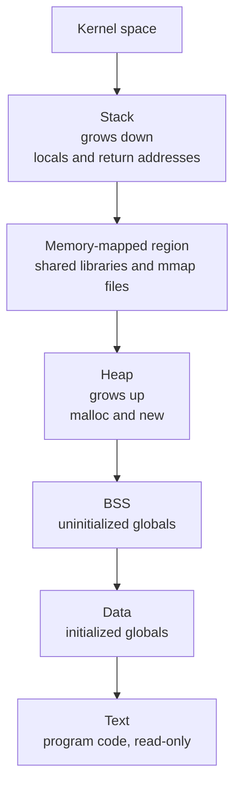

The layout matters for questions about stack overflow (deep recursion exhausts the stack), memory leaks (heap memory never freed), and why threads share the heap but not the stack.

### 5.2 Process states and context switching

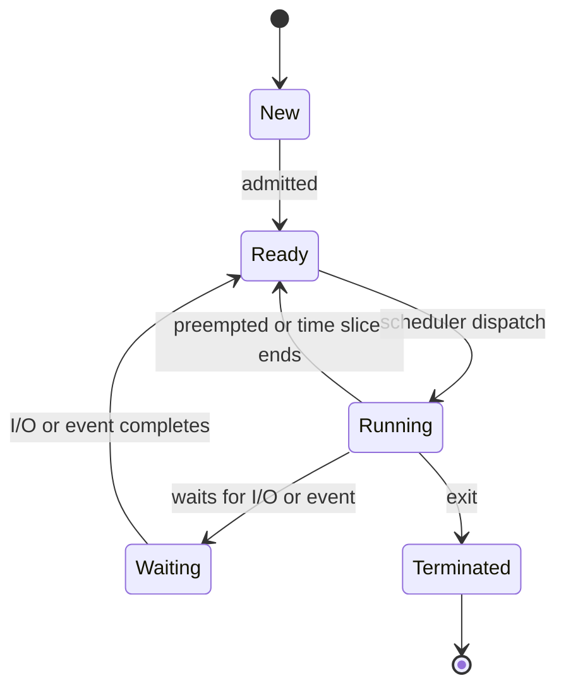

A **context switch** saves the running task's registers, program counter, and memory-management state, then restores another task's. The direct cost is the save and restore; the indirect cost is cache misses because the new task's data is cold, and a TLB flush when the address space changes between processes [7]. Switching between threads of one process is cheaper because the address space does not change.

### 5.3 CPU scheduling

The scheduler chooses which ready task runs next. Key metrics are **turnaround time** (submission to completion), **waiting time** (time spent in the ready queue), **response time** (time to first run), and throughput.

| Algorithm | Idea | Pros | Cons |
|-----------|------|------|------|
| FCFS | First come, first served | Simple | Convoy effect: a long job blocks short ones |
| SJF or SRTF | Shortest job (or remaining time) first | Minimizes average waiting time | Needs run-time prediction; can starve long jobs |
| Round Robin | Fixed time quantum, rotate | Fair, good for interactive time-sharing [7] | Quantum too small wastes time switching; too large behaves like FCFS |
| Priority | Highest priority first | Flexible | Starvation, fixed with aging |
| Multilevel feedback queue | Multiple queues, tasks move by behavior | Adapts to interactive versus CPU-bound jobs | More complex |

Modern general-purpose systems such as Linux use preemptive multitasking [7].

### 5.4 Virtual memory

**Virtual memory** gives each process the illusion of a large private contiguous address space. Memory is divided into fixed-size **pages** (virtual) mapped to **frames** (physical) by a **page table**; the hardware's **TLB** (translation lookaside buffer) caches recent translations. Benefits: isolation and protection between processes, the ability to run programs larger than RAM, and flexible allocation.

A **page fault** occurs when a process touches a page that is not currently mapped to a physical frame. The OS handles it, then restarts the instruction.

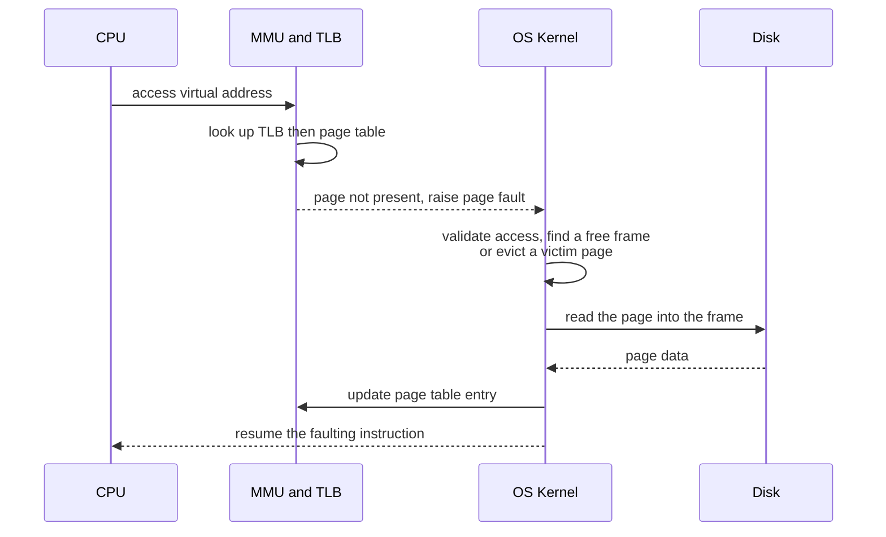

Related concepts to know:

- **Thrashing**: the system spends more time swapping pages than running code because the working set exceeds physical memory [7].
- **Page replacement**: FIFO, LRU, Clock (an LRU approximation). FIFO can exhibit Belady's anomaly, where more frames cause more faults.
- **Copy-on-write (COW)**: `fork()` duplicates the parent cheaply by sharing pages until either side writes, at which point the page is copied [7].
- **Paging versus segmentation**: paging uses fixed-size units and avoids external fragmentation; segmentation uses variable-size logical units.
- **Memory overcommit and the OOM killer**: Linux may promise more memory than exists and kills processes when it runs out, a frequent source of "my container disappeared" incidents.

### 5.4.1 Stack versus heap

| | Stack | Heap |
|--|-------|------|
| Allocation | Automatic, LIFO with function calls | Explicit or garbage-collected |
| Speed | Very fast (pointer bump) | Slower (allocator bookkeeping) |
| Lifetime | Until the function returns | Until freed or collected |
| Failure mode | Stack overflow | Leaks, fragmentation, use-after-free in unsafe languages |

### 5.5 System calls, interrupts, and process creation

User programs run in **user mode** and request privileged services (file I/O, networking, process control) through **system calls**, which switch into **kernel mode**. **Interrupts** are signals from hardware (or software traps) that make the CPU pause and run a handler.

On Unix-like systems, a new process is created with `fork()` (clone the caller) followed by `exec()` (replace the clone's program), and the parent collects the child's exit status with `wait()`. Two process states appear in interviews: a **zombie** is a terminated child whose exit status has not yet been collected by its parent, and an **orphan** is a child whose parent exited first (it is adopted by init or a subreaper).

**Inter-process communication (IPC)** options: pipes, named pipes (FIFOs), message queues, shared memory (fastest, needs synchronization), sockets (also work across machines), and signals (simple notifications).

### 5.6 I/O models and file systems

| I/O model | Behavior | Example |
|-----------|----------|---------|
| Blocking | The call waits until done | Plain `read()` |
| Non-blocking | Returns immediately if not ready | `O_NONBLOCK` plus polling |
| Multiplexed | One thread waits on many descriptors | `select`, `poll`, `epoll`, `kqueue` |
| Asynchronous | The kernel completes the I/O and notifies you | `io_uring`, Windows IOCP |

`epoll` and similar mechanisms are why event-driven servers can hold tens of thousands of connections with few threads. **DMA** (direct memory access) lets devices move data to and from memory without the CPU copying each byte.

For file systems, know: an **inode** stores file metadata and block pointers (not the name); a **directory** maps names to inodes; a **hard link** is another name for the same inode, while a **symbolic link** is a file containing a path; a **file descriptor** is a per-process handle to an open file, socket, or pipe; and a **journaling** file system logs changes first so it can recover after a crash.

### 5.7 Containers versus virtual machines

A **virtual machine** emulates hardware and runs a full guest operating system on a hypervisor, giving strong isolation at the cost of more memory and slower startup. A **container** isolates processes using kernel features (on Linux, namespaces for what a process can see and cgroups for how much it can use) while sharing the host kernel, so it starts in milliseconds and uses far less overhead, with a weaker isolation boundary.

### Practice questions: operating systems

1. What is the difference between a process and a thread, and why is a thread context switch cheaper?
2. Walk through what happens on a page fault. Which parts are hardware and which are the kernel?
3. What is thrashing, and how would you detect and fix it on a production server?
4. Explain how `fork()` stays cheap even for a process using gigabytes of memory.
5. What is the difference between a zombie and an orphan process? How would you find zombies?
6. Why can a program with a deep recursion crash with a stack overflow while the machine has plenty of free RAM?
7. Compare `select`, `poll`, and `epoll`. Why does `epoll` scale better?
8. What isolates a container from its neighbors, and what does it not isolate?

---

## 6. Concurrency

Concurrency questions test whether you can reason about shared state, ordering, and failure. A solid approach to any concurrency problem: identify the shared state, name the synchronization requirement (mutual exclusion, ordering, or bounded concurrency), and then pick the right primitive [22].

### 6.1 Concurrency versus parallelism

**Concurrency** is structuring a program as independently progressing tasks that may interleave, even on one core. **Parallelism** is running tasks literally at the same time on multiple cores. A single-threaded event loop is concurrent but not parallel; a multi-core numeric job is both [24]. Workload type matters: **I/O-bound** work benefits from concurrency (waiting overlaps), **CPU-bound** work needs parallelism.

### 6.2 Race conditions and critical sections

A **race condition** is a bug where the outcome depends on the timing of two or more threads touching shared data [24][25]. The standard example is `count += 1`, which is really read, add, write; two threads can interleave and lose an update [24]. A **check-then-act** race happens when you inspect state and act on it, but the state changes in between because the two steps are not atomic [24]. A **data race** (undefined behavior in languages like C++ and Rust's unsafe code) requires shared mutable data; immutable data cannot race [23].

```python
import threading

counter = 0
lock = threading.Lock()

def work():
    global counter
    for _ in range(100_000):
        with lock:                        # critical section: one thread at a time
            counter += 1

threads = [threading.Thread(target=work) for _ in range(4)]
for t in threads: t.start()
for t in threads: t.join()
print(counter)                            # always 400000 with the lock
```

Ways to avoid races: lock around shared data, use atomic operations, confine data to one thread (message passing), or use immutable data [23][25].

### 6.3 Synchronization primitives

| Primitive | What it does | Key point |
|-----------|--------------|-----------|
| Mutex | Mutual exclusion lock | Has ownership: only the thread that locked it may unlock it [24][25] |
| Semaphore | Counter allowing up to N holders | A signaling or permit mechanism with no ownership; a binary semaphore is not the same as a mutex [22][24][25] |
| Condition variable | Wait until a condition becomes true | Always used with a mutex; wait releases the mutex atomically, and you re-check the condition in a loop [22] |
| Monitor | Mutex plus condition variables bundled with the data | Java `synchronized` with `wait` and `notify` is a monitor [22] |
| Read-write lock | Many readers or one writer | Good for read-heavy data; beware writer starvation |
| Atomics | Hardware-supported indivisible operations | Lock-free counters, flags, compare-and-swap loops |
| Barrier | All threads wait until everyone arrives | Phased parallel algorithms |

### 6.4 Deadlock, livelock, and starvation

A **deadlock** is a state where a set of threads each wait for a resource held by another, so none can progress. It requires all four **Coffman conditions** simultaneously [22][23]:

1. **Mutual exclusion**: a resource can be held by only one thread at a time.
2. **Hold and wait**: a thread holds one resource while waiting for another.
3. **No preemption**: a resource cannot be forcibly taken away.
4. **Circular wait**: there is a cycle of threads each waiting for the next one's resource.

Prevention means breaking at least one condition; in practice the most common fix is a global **lock ordering** that eliminates circular wait [23]. Other approaches: acquire all locks at once or use try-lock with back-off (breaks hold and wait), and use timeouts. **Avoidance** (the Banker's algorithm) only grants requests that keep the system in a safe state. **Detection** builds a wait-for graph and looks for cycles, then recovers by killing or rolling back a participant.

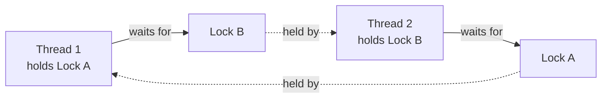

```python
import threading

a, b = threading.Lock(), threading.Lock()

def transfer_safe(first, second):
    # Always lock in a globally consistent order (here by object id)
    lo, hi = sorted((first, second), key=id)
    with lo:
        with hi:
            ...                           # critical section touching both resources
```

**Livelock**: threads keep reacting to each other and change state without making progress (two people stepping aside in a corridor). **Starvation**: a thread waits indefinitely because others are always favored; fixes include fair locks and aging [27].

### 6.5 Classic problems

**Producer-consumer (bounded buffer).** Producers add items to a fixed-size buffer, consumers remove them, and neither may overflow or underflow it. The standard solution uses one mutex and two condition variables, `not_full` and `not_empty` [22].

```python
import threading
from collections import deque

class BoundedBuffer:
    def __init__(self, capacity):
        self.q, self.cap = deque(), capacity
        self.lock = threading.Lock()
        self.not_full = threading.Condition(self.lock)
        self.not_empty = threading.Condition(self.lock)

    def put(self, item):
        with self.lock:
            while len(self.q) >= self.cap:        # loop guards against spurious wakeups
                self.not_full.wait()
            self.q.append(item)
            self.not_empty.notify()

    def get(self):
        with self.lock:
            while not self.q:
                self.not_empty.wait()
            item = self.q.popleft()
            self.not_full.notify()
            return item
```

An equivalent semaphore version uses a counting semaphore for free slots, another for filled slots, and a mutex around the buffer [25].

**Dining philosophers.** Five philosophers share five forks and each needs two to eat. If everyone grabs their left fork first, circular wait deadlocks. Fix it by ordering the forks and always taking the lower-numbered fork first, or by limiting how many philosophers may try at once with a semaphore [23].

**Readers-writers.** Allow concurrent readers but exclusive writers, deciding whether readers or writers get priority (reader priority can starve writers).

### 6.6 Threads, async, and language specifics

| Model | Good for | Caveat |
|-------|----------|--------|
| Threads plus locks | General parallel work | Shared mutable state invites races and deadlocks |
| Thread pool | Bounding resource use for many short tasks | Pool sizing, queue backlog |
| Event loop with async or await | Many concurrent I/O-bound connections | One blocking call stalls the loop; no CPU parallelism by itself |
| Message passing (actors, channels) | Avoiding shared state | Needs careful protocol design |
| Processes | Isolation, bypassing a global interpreter lock | IPC overhead |

Python's CPython interpreter has a global interpreter lock (GIL), so threads do not run Python bytecode in parallel; use processes or native extensions for CPU-bound parallelism, and threads or `asyncio` for I/O-bound work. If you interview in Rust, the ownership and borrowing rules plus the `Send` and `Sync` marker traits turn many data races into compile errors, but logic-level races, deadlocks, and lock-ordering bugs are still possible, so be ready to discuss `Mutex`, `RwLock`, channels, and atomics.

### Practice questions: concurrency

1. What is a race condition? Give an example that is not a simple counter.
2. What is the difference between a mutex and a binary semaphore?
3. State the four Coffman conditions and show how lock ordering breaks one of them.
4. Why must a condition variable wait sit inside a `while` loop rather than an `if`?
5. Implement a thread-safe bounded blocking queue.
6. How would you design a thread pool, and how do you choose its size for CPU-bound versus I/O-bound work?
7. What are the trade-offs between locks and lock-free (atomic) data structures?
8. Two services both call each other synchronously and the system freezes under load. How might this be a distributed deadlock, and what would you change?

---

## 7. Computer Networking

Networking fundamentals appear in almost every senior engineering interview, and the most reliable opener is a version of "what happens when you type a URL into a browser and press enter" because a complete answer touches DNS, TCP, TLS, and HTTP [13][14].

### 7.1 Layered models

| TCP/IP layer | OSI layers | Examples | Data unit |
|--------------|------------|----------|-----------|
| Application | Application, presentation, session | HTTP, DNS, TLS (often shown here), SSH | Message |
| Transport | Transport | TCP, UDP | Segment or datagram |
| Internet | Network | IP, ICMP | Packet |
| Link | Data link, physical | Ethernet, Wi-Fi | Frame |

The four-layer TCP/IP model is the practical one; the seven-layer OSI model is mostly used as shared vocabulary ("a layer 4 load balancer", "a layer 7 proxy") [8][26].

### 7.2 What happens when you type a URL

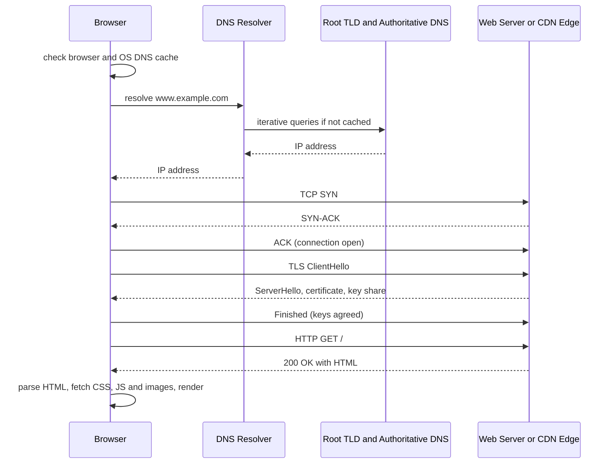

A strong answer covers: URL parsing and cache checks, DNS resolution, the TCP handshake (which costs a full round trip before any request bytes), the TLS handshake (one more round trip on TLS 1.3, two on TLS 1.2), the HTTP request and response, and then rendering, with notes on where real systems break: DNS failure or slowness, packet loss, certificate errors, load balancers, caches, and redirects [14].

### 7.3 DNS

The Domain Name System translates names into IP addresses. A client asks its **recursive resolver**; if the answer is not cached, the resolver queries a **root server**, which points to the **TLD server** (for example `.com`), which points to the domain's **authoritative server**, which returns the record [15]. Results are cached according to each record's **TTL**.

| Record | Purpose |
|--------|---------|
| A, AAAA | Name to IPv4, IPv6 address |
| CNAME | Alias to another name |
| MX | Mail servers |
| NS | Authoritative name servers |
| TXT | Free text (SPF, verification) |
| PTR | Reverse lookup, IP to name [13] |

DNS normally uses UDP port 53, falling back to TCP for large responses and zone transfers [15].

### 7.4 TCP and UDP

| Property | TCP | UDP |
|----------|-----|-----|
| Connection | Connection-oriented, handshake first | Connectionless |
| Reliability | Acknowledgements, retransmission | None built in |
| Ordering | Guaranteed in-order delivery | None |
| Flow and congestion control | Yes | No |
| Overhead and latency | Higher | Lower |
| Typical uses | HTTP/1.1 and HTTP/2, APIs, email, file transfer, databases | DNS, live audio and video, game state, QUIC and HTTP/3 [13][14] |

The naive answer "TCP good, UDP bad" is wrong often enough to be risky: real-time media, games, and DNS lean on UDP because a late packet is worse than a lost one, and QUIC was built on UDP so it could fix TCP's limitations without waiting for every router and operating system to change [14].

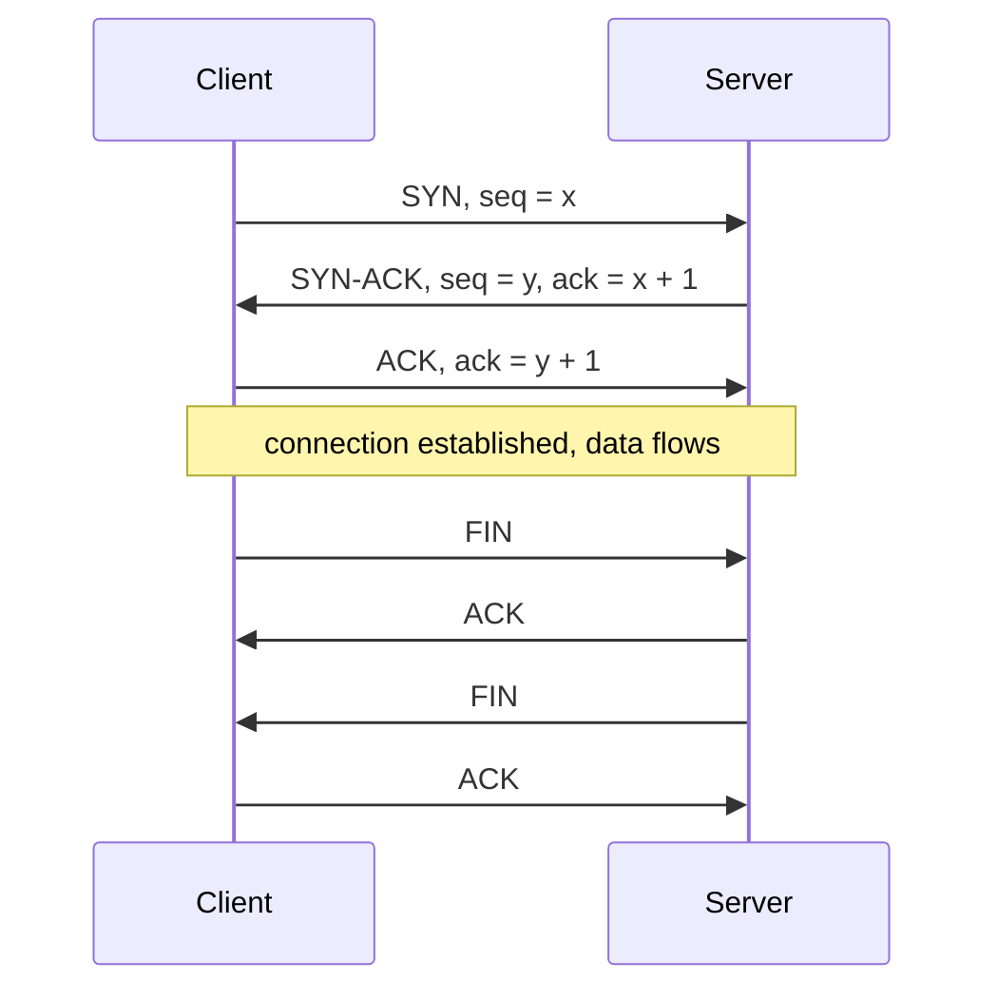

The handshake synchronizes the two sides' initial sequence numbers [14]. Connection termination uses a four-way exchange (FIN, ACK, FIN, ACK), and a **SYN flood** attack exploits the handshake by never completing it, leaving the server with half-open connections [15].

How TCP achieves reliability: sequence numbers and acknowledgements, retransmission on timeout or repeated duplicate ACKs, **flow control** (the receiver advertises a window so a fast sender does not overwhelm it), and **congestion control** (slow start, then additive increase and multiplicative decrease, to avoid collapsing the network). **Head-of-line blocking** is when one lost packet stalls everything behind it on the ordered byte stream.

### 7.5 HTTP

HTTP is a request-response protocol over a reliable transport. Know the methods and which are safe (no side effects) and idempotent (repeating has the same effect as doing it once).

| Method | Typical use | Safe | Idempotent |
|--------|-------------|------|------------|
| GET | Read a resource | Yes | Yes |
| HEAD | Headers only | Yes | Yes |
| POST | Create or trigger processing | No | No |
| PUT | Replace a resource | No | Yes |
| PATCH | Partial update | No | Not guaranteed |
| DELETE | Remove | No | Yes |

| Status class | Meaning | Examples |
|--------------|---------|----------|
| 2xx | Success | 200 OK, 201 Created, 204 No Content |
| 3xx | Redirect | 301 permanent, 302 temporary, 304 Not Modified |
| 4xx | Client error | 400, 401 unauthenticated, 403 forbidden, 404, 429 too many requests |
| 5xx | Server error | 500, 502 bad gateway, 503 unavailable, 504 gateway timeout |

| Version | Key characteristics |
|---------|---------------------|
| HTTP/1.1 | Text protocol over TCP, persistent connections, one in-flight request per connection so browsers open several connections |
| HTTP/2 | Binary framing, many multiplexed streams on one TCP connection, header compression (HPACK); TCP-level head-of-line blocking remains [13] |
| HTTP/3 | Runs on QUIC over UDP, so loss on one stream does not block others; folds the TLS handshake into transport setup [13][14] |

Related topics: cookies and sessions (the server stores session state, the browser sends a session ID in a cookie), tokens such as JWTs (self-contained signed claims, stateless but hard to revoke), the `Cache-Control` and `ETag` headers for caching, and CORS (a browser rule controlling which origins may call an API). Common ports: HTTP 80, HTTPS 443, SSH 22, DNS 53, SMTP 25, PostgreSQL 5432, MySQL 3306, Redis 6379 [15].

Choosing between HTTP request-response and **WebSocket** (a persistent bidirectional channel started with an HTTP upgrade) depends on whether you need server push and low-latency two-way messages; the cost is stateful connections that are harder to load-balance and scale [16].

### 7.6 TLS and HTTPS

HTTPS is HTTP over TLS; it provides **confidentiality** (encryption), **integrity** (tamper detection), and **authentication** of the server through a certificate chain that the client validates against trusted certificate authorities [15][26]. The handshake uses asymmetric cryptography to authenticate and agree on a shared secret, then switches to fast symmetric encryption for the data. TLS 1.3 completes the handshake in one round trip, compared with two for TLS 1.2, and drops many older weak cipher suites [13][14].

### 7.7 Load balancers, NAT, and proxies

- A **layer 4 load balancer** forwards TCP or UDP connections using IPs and ports; a **layer 7 load balancer** understands HTTP and can route by path, header, or cookie, and terminate TLS.
- A **forward proxy** acts for clients; a **reverse proxy** sits in front of servers (caching, TLS termination, routing).
- **NAT** lets many private addresses share one public address by rewriting ports, which is why inbound connections to home networks need port forwarding.
- A **CDN** caches content at edge locations near users to reduce latency and origin load.

### Practice questions: networking

1. Describe everything that happens between typing a URL and seeing the page. Where can it fail, and how would you debug each stage?
2. Why does TCP need a three-way handshake rather than two messages?
3. When would you choose UDP over TCP? Why is HTTP/3 built on UDP?
4. What is the difference between HTTP/1.1, HTTP/2, and HTTP/3, and where does head-of-line blocking occur in each?
5. Explain how a TLS handshake establishes a secure channel. What does the certificate prove?
6. A site is slow only for the first request of each session. Which network-level costs could explain that?
7. What is the difference between a 502 and a 504, and what does each tell you about where to look?
8. Why must a `PUT` be idempotent and how do you make a `POST` payment endpoint safe to retry?

---

## 8. Databases

The predictable core of database interviews is keys, normalization, ACID, transactions, indexing, and joins, and what separates a good answer from an average one is a quick concrete example [17]. SQL screens then test whether you can connect queries to transactions, constraints, NULL semantics, execution plans, and indexing [29].

### 8.1 Relational model and keys

A relational database stores data in tables (relations) of rows and columns and enforces integrity through constraints.

| Term | Meaning |
|------|---------|
| Primary key | Uniquely identifies a row; not null |
| Candidate key | Any minimal column set that could be the primary key |
| Foreign key | A column referencing another table's key; enforces referential integrity |
| Composite key | A key made of several columns |
| Surrogate key | An artificial key (auto-increment or UUID) with no business meaning |

A many-to-many relationship is implemented with a junction table [17].

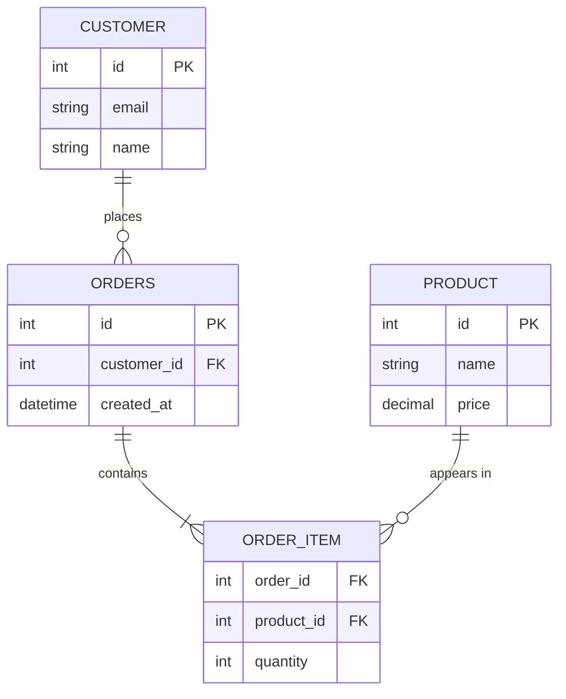

Here `ORDER_ITEM` is the junction table that resolves the many-to-many relationship between orders and products.

### 8.2 Normalization

Normalization organizes tables to reduce redundancy and update anomalies. The normal forms build on each other [18]:

| Form | Rule of thumb | Example violation |
|------|---------------|-------------------|
| 1NF | Atomic values, no repeating groups | A `phones` column holding "123, 456" |
| 2NF | 1NF and no partial dependency on part of a composite key | `order_items(order_id, product_id, product_name)` where `product_name` depends only on `product_id` |
| 3NF | 2NF and no transitive dependency (non-key columns depend only on the key) | `employees(id, dept_id, dept_name)` where `dept_name` depends on `dept_id` |
| BCNF | Every determinant is a candidate key | A stricter version of 3NF |

**Denormalization** deliberately duplicates data to speed up reads (fewer joins) at the cost of more complex writes and risk of inconsistency; it is common in analytics tables and read-heavy systems.

### 8.3 SQL essentials

The **logical order of evaluation** explains many "why doesn't this work" bugs: `FROM` and joins, then `WHERE`, `GROUP BY`, `HAVING`, `SELECT`, `DISTINCT`, `ORDER BY`, and finally `LIMIT`. That is why a column alias defined in `SELECT` cannot be used in `WHERE`, and why `HAVING` (not `WHERE`) filters on aggregates.

| Join type | Returns |
|-----------|---------|
| INNER JOIN | Rows with matches in both tables |
| LEFT JOIN | All left rows, with NULLs where the right side has no match |
| RIGHT JOIN | All right rows, with NULLs where the left side has no match |
| FULL OUTER JOIN | All rows from both sides |
| CROSS JOIN | Cartesian product |

**NULL semantics:** `NULL = NULL` is not true (it is unknown), so use `IS NULL`; `COUNT(col)` skips NULLs while `COUNT(*)` does not; and `NOT IN (subquery)` returns nothing if the subquery yields a NULL, so prefer `NOT EXISTS`.

```sql
-- Second highest salary
SELECT MAX(salary) FROM employees
WHERE salary < (SELECT MAX(salary) FROM employees);

-- Duplicate emails
SELECT email, COUNT(*) FROM users GROUP BY email HAVING COUNT(*) > 1;

-- Customers with no orders
SELECT c.id FROM customers c
LEFT JOIN orders o ON o.customer_id = c.id
WHERE o.id IS NULL;

-- Top 3 salaries per department using a window function
SELECT * FROM (
  SELECT e.*, DENSE_RANK() OVER (PARTITION BY dept_id ORDER BY salary DESC) AS rnk
  FROM employees e
) t
WHERE rnk <= 3;
```

Know the difference between `ROW_NUMBER`, `RANK` (gaps after ties), and `DENSE_RANK` (no gaps), plus `LAG` and `LEAD` for comparing with neighboring rows, and be able to explain a query using `EXPLAIN` output (scan type, index used, estimated rows). Without a unique secondary sort column, tied rows can come back in different orders on different runs [29].

### 8.4 Transactions and ACID

A **transaction** groups statements into one logical unit using `BEGIN`, `COMMIT`, and `ROLLBACK` [18]. The ACID properties [17][18]:

| Property | Guarantee | Bank transfer example |
|----------|-----------|-----------------------|
| Atomicity | All or nothing | Debit and credit both happen or neither does |
| Consistency | Moves the database from one valid state to another | Total money stays the same and constraints hold |
| Isolation | Concurrent transactions do not expose partial changes | Another reader never sees the debit without the credit |
| Durability | Committed data survives crashes | After commit, a power loss does not undo the transfer |

Durability and atomicity are typically implemented with a **write-ahead log (WAL)**: changes are appended to a sequential log and flushed before the data pages are updated, so the database can redo committed work or undo incomplete work after a crash.

### 8.5 Isolation levels and anomalies

Isolation levels trade performance for predictability: lower levels allow anomalies for speed, higher levels prevent them but increase contention [19].

| Anomaly | Description |
|---------|-------------|
| Dirty read | Reading another transaction's uncommitted change |
| Non-repeatable read | Reading the same row twice and getting different values because someone committed in between |
| Phantom read | Re-running a range query and seeing new or missing rows |
| Write skew | Two transactions read overlapping data and write disjoint rows, jointly violating an invariant |

| Isolation level (SQL standard) | Dirty read | Non-repeatable read | Phantom read |
|--------------------------------|------------|---------------------|--------------|
| Read uncommitted | Possible | Possible | Possible |
| Read committed | Prevented | Possible | Possible |
| Repeatable read | Prevented | Prevented | Possible in the standard |
| Serializable | Prevented | Prevented | Prevented |

The standard names are the baseline, but behavior differs between engines (for example, a database's repeatable read may be implemented as snapshot isolation, which prevents phantoms but still allows write skew), so always check your target database's documentation [19][29]. Two main mechanisms implement isolation: **locking** (two-phase locking: shared locks for reads, exclusive locks for writes) and **MVCC** (multi-version concurrency control: readers see a consistent snapshot, so readers do not block writers). Under contention, databases can **deadlock** and abort one transaction, so applications must be ready to retry. Use `SELECT ... FOR UPDATE` for pessimistic row locks, or a version column for **optimistic concurrency control**.

### 8.6 Indexes

An **index** is an auxiliary data structure that speeds up reads at the cost of extra storage and slower writes. **B-tree** (in practice B+ tree) indexes keep keys sorted, so they serve equality, range scans, and `ORDER BY`; **hash indexes** specialize in equality lookups only [19].

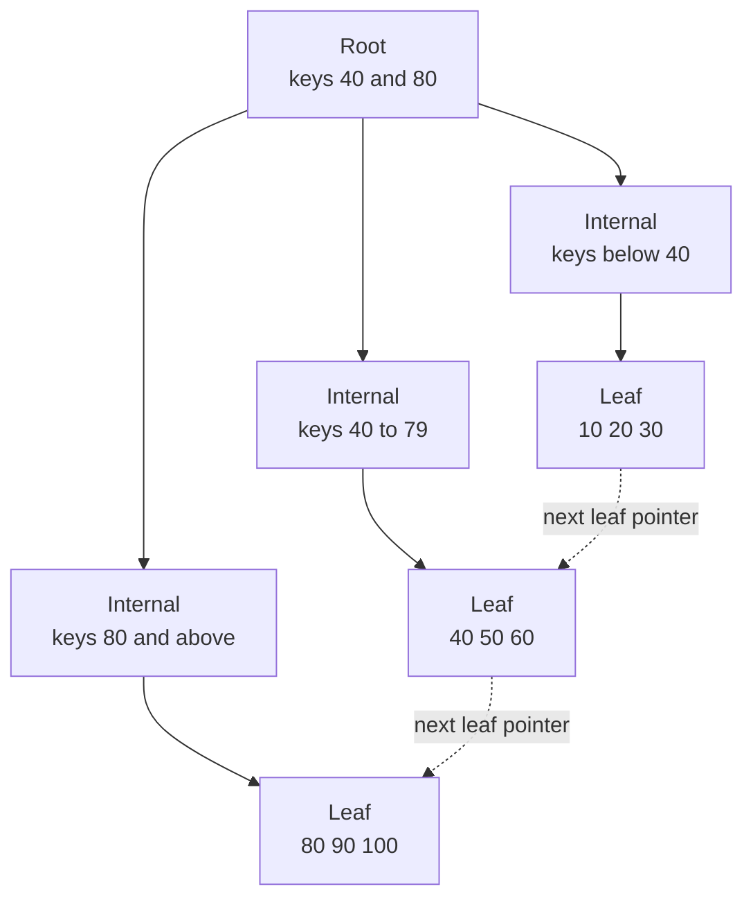

Leaves hold the entries and are linked together, which is why range scans are efficient: find the start in O(log n), then walk the leaf chain. Because each node holds many keys, the tree stays shallow (often 3 or 4 levels even for hundreds of millions of rows).

Practical rules:

- Index columns used in filters, joins, and ordering [18].
- **Composite indexes** follow the leftmost-prefix rule: an index on `(a, b, c)` helps queries on `a`, `a, b`, and `a, b, c`, but not on `b` alone.
- A **covering index** contains every column a query needs, so the table is never touched.
- **Selectivity** matters: an index on a low-cardinality column such as a boolean rarely helps.
- A **clustered index** defines the physical row order (one per table); secondary indexes point back to it.
- Indexes can be skipped when you wrap the column in a function (`WHERE LOWER(email) = ...`), use a leading wildcard (`LIKE '%abc'`), or compare mismatched types.
- Every index slows `INSERT`, `UPDATE`, and `DELETE`, so do not index everything.

### 8.7 SQL versus NoSQL

SQL databases are relational with predefined schemas, ACID transactions, and rich queries; NoSQL systems typically offer horizontal scaling and schema flexibility and often relax consistency toward eventual consistency [18]. Many modern NoSQL systems now offer some transactional guarantees, so the accurate answer is "it depends on the product and configuration".

| Type | Model | Typical use | Examples |
|------|-------|-------------|----------|
| Relational | Tables and joins | Transactions, structured data | PostgreSQL, MySQL |
| Key-value | Key to opaque value | Caching, sessions, counters | Redis, DynamoDB |
| Document | JSON-like documents | Flexible content and catalogs | MongoDB |
| Wide-column | Rows with sparse column families | Massive write-heavy data | Cassandra, HBase |
| Graph | Nodes and edges | Relationship traversal | Neo4j |

In practice, systems often use **polyglot persistence**: a relational database for core transactions, a document store for content, a graph store for relationship analytics, and a warehouse for BI [19].

### Practice questions: databases

1. Explain ACID using a bank transfer and say which mechanism provides durability.
2. What anomalies does read committed allow? What does MVCC change?
3. Why does an index on `(last_name, first_name)` not help a query filtering only on `first_name`?
4. When would you denormalize, and what do you give up?
5. Write a query for the top 3 earners per department. What changes if two people tie?
6. Why can `NOT IN` return no rows when the subquery contains a NULL?
7. A query suddenly became slow after a data load. How would you investigate?
8. Describe how a write-ahead log lets a database recover after a crash.

---

## 9. System Design Fundamentals

System design is a large interview topic in its own right [3]. Interviewers are not testing whether you can name components; they are testing whether you can clarify requirements, estimate scale, make reasoned trade-offs, and explain how the design behaves under failure [21]. Reading *Designing Data-Intensive Applications* is widely recommended as the deep reference [3].

### 9.1 A framework for the interview

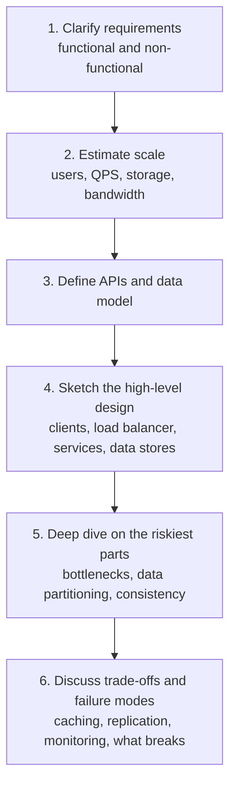

Spend the first minutes on requirements: who the users are, read versus write ratio, latency target, consistency needs, availability target, and data size. Then let the numbers drive the design; for example, estimates tell you early whether vertical scaling is enough or whether you need horizontal scaling, sharding, caching, CDNs, or queues [21].

### 9.2 Back-of-envelope estimation

These are order-of-magnitude rules of thumb (they vary by hardware, so treat them as orders of magnitude, and verify against a current reference before quoting them as facts).

| Quantity | Rough value |
|----------|-------------|
| Seconds per day | about 86,400 (round to 10⁵) |
| 1 million requests per day | about 12 requests per second on average |
| Read from CPU cache | about 1 ns |
| Read from main memory | about 100 ns |
| SSD random read | about 100 µs |
| Round trip within one datacenter | about 0.5 ms |
| Spinning-disk seek | about 10 ms |
| Round trip across continents | about 100 to 150 ms |

Worked example: 100 million daily active users each making 10 reads a day gives 10⁹ reads a day, about 11,600 reads per second on average, and a peak of 2 to 3 times that, roughly 25,000 to 35,000 per second. If each stored item is 1 KB and there are 1 billion items, raw storage is about 1 TB before replication and indexes.

### 9.3 Core building blocks

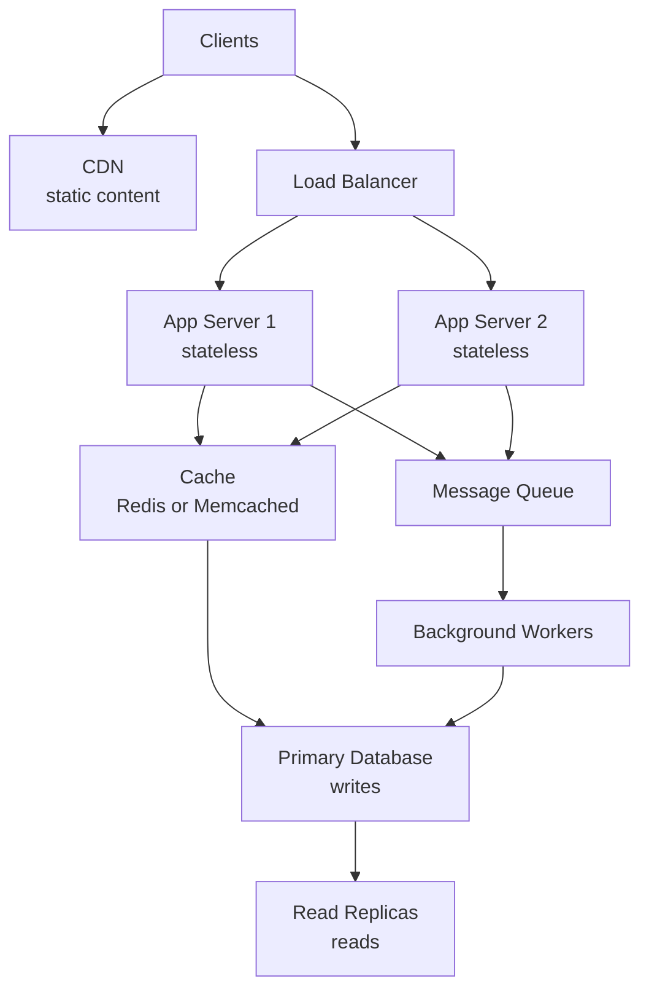

The diagram shows a common baseline: stateless application servers behind a load balancer, a cache in front of the database, replicas for read scaling, and a queue that moves slow work off the request path.

**Scalability.** Vertical scaling adds resources to one machine (simple, but bounded and a single point of failure); horizontal scaling adds machines (needs stateless services or externalized state). Availability is the fraction of time the system is up, often described in "nines" (99.9 percent allows about 8.8 hours of downtime a year; 99.99 percent about 53 minutes).

**Load balancing.** A load balancer spreads traffic across servers so no machine is overwhelmed and failures are routed around using health checks [20]. Common algorithms: round robin, weighted round robin, least connections, least response time, and hashing (IP or key hash) for stickiness or cache locality. Layer 4 balancers route on IP and port; layer 7 balancers route on HTTP details. The balancer itself must be redundant.

**Caching.** Caching stores frequently used data in fast memory to make slow operations fast, and a good answer always mentions freshness, eviction, and hit ratio [21].

| Strategy | How it works | Trade-off |
|----------|--------------|-----------|
| Cache-aside (lazy loading) | App checks the cache, on a miss reads the database and fills the cache | Simple and resilient; first read is slow; data can go stale |
| Read-through | The cache itself loads from the database on a miss | Cleaner app code; cache library must know the data source |
| Write-through | Writes go to cache and database together | Fresh cache, slower writes |
| Write-back (write-behind) | Writes go to cache first and are flushed to the database later | Fast writes; risk of data loss if the cache fails |

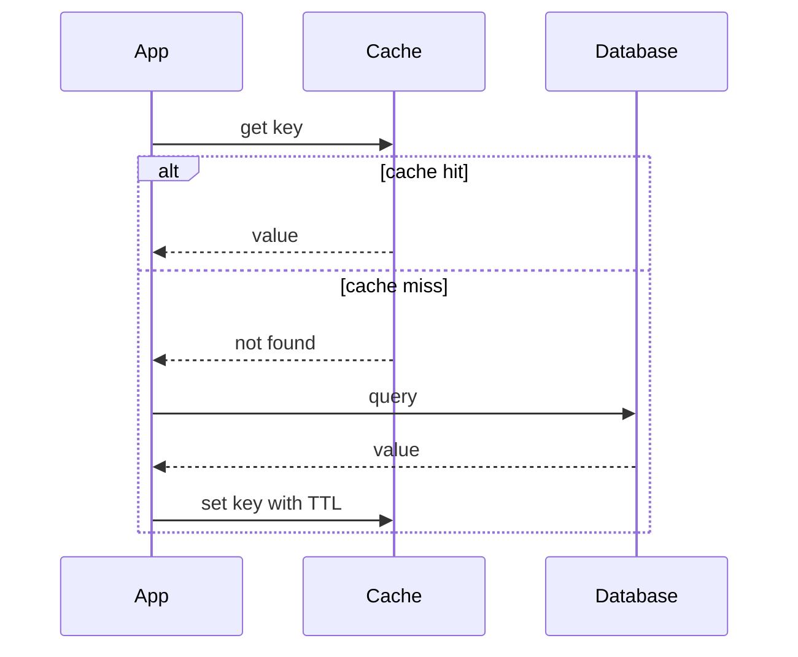

Eviction policies: LRU (least recently used), LFU (least frequently used), FIFO, and TTL expiry. Known failure modes: a **cache stampede** (a popular key expires and many requests hit the database at once; mitigate with request coalescing, locks, or TTL jitter), **cache penetration** (requests for keys that never exist bypass the cache; mitigate with negative caching or a Bloom filter), **stale data** (invalidation is hard; choose TTLs and invalidate on write), and **hot keys**.

**Replication.** Keep copies of data on several nodes for availability and read scaling. In **leader-follower** replication, writes go to the leader and are copied to followers; asynchronous replication is fast but followers can lag (stale reads) and a leader failure can lose recent writes, while synchronous replication is safer but slower.

**Sharding (partitioning).** Sharding splits data across multiple machines so no single node holds everything [20].

| Strategy | Idea | Watch out for |
|----------|------|---------------|
| Range-based | Key ranges per shard | Hot shards (for example, time-ordered keys) |
| Hash-based | `hash(key) mod N` | Resharding moves most keys when N changes |
| Consistent hashing | Keys and nodes placed on a ring; each key goes to the next node clockwise | Uneven load without virtual nodes |
| Directory-based | A lookup service maps keys to shards | The directory is a new bottleneck |

Sharding makes cross-shard joins and multi-shard transactions hard, so choose the shard key to match the dominant access pattern.

**Message queues and streams.** Queues decouple producers from consumers, absorb bursts, and let work retry. Delivery semantics: **at-most-once** (may lose), **at-least-once** (may duplicate, so consumers must be idempotent), and **exactly-once** (usually at-least-once plus deduplication). Use a **dead-letter queue** for messages that keep failing, and watch for backpressure when consumers fall behind.

### 9.4 Consistency, CAP, and quorums

The **CAP theorem** says a distributed system cannot guarantee all of consistency, availability, and partition tolerance at once; because network partitions will happen, the real choice is between consistency and availability while a partition lasts [20][21]. The key to a good interview answer is not naming CAP but explaining how your design behaves during failures [21]. A related framework, PACELC, adds that even without a partition there is a trade-off between latency and consistency.

| Model | Meaning |
|-------|---------|
| Strong (linearizable) consistency | Every read sees the latest committed write |
| Eventual consistency | Replicas converge if writes stop; reads may be stale meanwhile |
| Read-your-writes | A client always sees its own updates |
| Causal consistency | Causally related operations are seen in order |

In a quorum system with N replicas, a write waits for W acknowledgements and a read queries R replicas; if **R + W > N**, every read overlaps at least one up-to-date replica. Tuning R and W trades latency and availability against consistency.

### 9.5 Reliability patterns

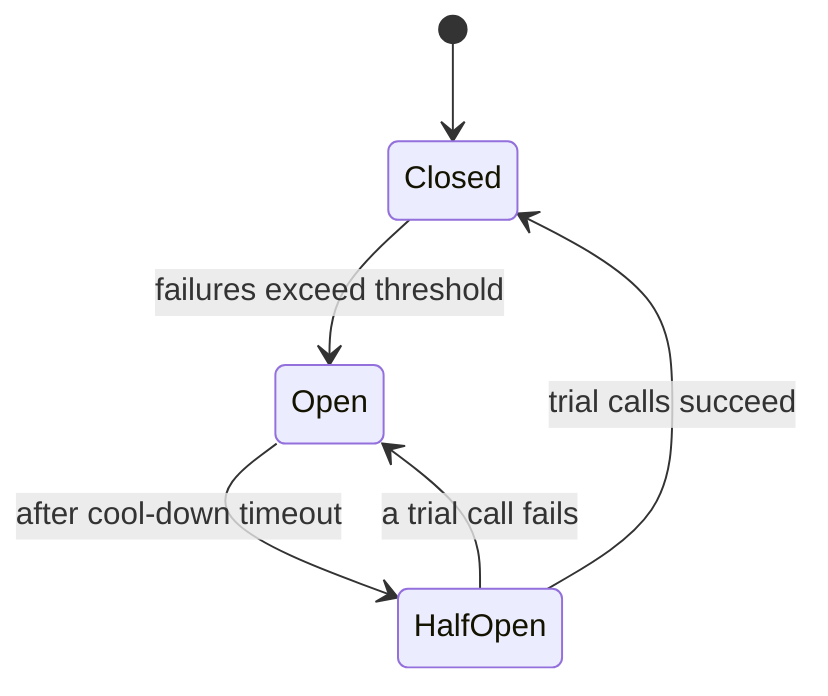

A circuit breaker stops calling a failing dependency so it can recover and so callers fail fast. Pair it with these habits:

- **Timeouts** on every network call, so a slow dependency cannot exhaust your threads.
- **Retries with exponential backoff and jitter**, only for idempotent operations, to avoid synchronized retry storms.
- **Idempotency keys** so a retried payment or order creation is applied once.
- **Rate limiting** to protect services and enforce fair use; the token bucket algorithm allows bursts while enforcing an average rate.
- **Graceful degradation**: serve stale or partial data instead of failing completely.
- **Observability**: metrics, logs, and traces, plus alerts tied to user-visible symptoms.

```python
import time

class TokenBucket:
    def __init__(self, rate_per_sec, capacity):
        self.rate, self.capacity = rate_per_sec, capacity
        self.tokens, self.last = capacity, time.monotonic()

    def allow(self):
        now = time.monotonic()
        self.tokens = min(self.capacity, self.tokens + (now - self.last) * self.rate)
        self.last = now
        if self.tokens >= 1:
            self.tokens -= 1
            return True
        return False
```

### 9.6 API design essentials

REST maps resources to URLs and uses HTTP methods and status codes; gRPC uses Protocol Buffers over HTTP/2 for compact, typed, low-latency service-to-service calls; GraphQL lets clients request exactly the fields they need. For list endpoints, prefer **cursor-based pagination** (stable under inserts, efficient on indexes) over **offset pagination** (simple, but slow and inconsistent for deep pages). Version your APIs, validate input, authenticate callers, and make unsafe operations idempotent.

### 9.7 Worked example: URL shortener

**Requirements.** Create a short link for a long URL, redirect quickly, optionally track clicks. Assume read-heavy traffic (say 100 reads for each write) and a low redirect latency target.

**Core design.**

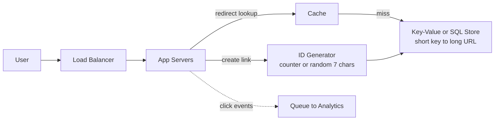

- **API:** `POST /links` with a long URL returns a short key; `GET /{key}` returns a redirect.
- **Key generation:** encode a unique counter in base62 (a 7-character key gives about 3.5 trillion combinations), or generate random keys and retry on collision. Hashing the URL risks collisions and is not required.
- **Storage:** a simple key-to-URL mapping fits a key-value store or a sharded SQL table; shard by key hash.
- **Redirect path:** check the cache first, since popular links dominate traffic. Choosing a 301 (permanent) redirect lets browsers cache it, reducing load but hiding later clicks from analytics; a 302 keeps every click visible.
- **Failure and scale topics:** custom aliases and collisions, expiry, abuse and spam detection, rate limiting, and multi-region replication.

### 9.8 Common design prompts and what they test

| Prompt | Key concepts to bring up |
|--------|--------------------------|
| URL shortener | Key generation, read-heavy caching, sharding |
| Rate limiter | Token or leaky bucket, distributed counters, race conditions |
| News feed | Fan-out on write versus fan-out on read, caching, ranking |
| Chat system | WebSockets, message ordering, delivery receipts, presence |
| Notification service | Queues, retries, idempotency, third-party providers |
| File storage and sync | Chunking, deduplication, metadata versus blob storage |
| Search autocomplete | Tries, top-K, caching of popular prefixes |
| Web crawler | BFS frontier, politeness, deduplication, URL canonicalization |
| Distributed key-value store | Consistent hashing, replication, quorums, conflict resolution |

### Practice questions: system design

1. Walk through how you would scale a service from 1,000 to 100 million users. What breaks first at each step?
2. When would you choose consistency over availability, and give a concrete product example for each.
3. Compare cache-aside and write-through. What goes wrong if the cache and database disagree?
4. How does consistent hashing reduce data movement when a node joins or leaves, and why are virtual nodes needed?
5. Design a rate limiter for an API used by many servers. Where does the state live?
6. A dependency is slow and your service is falling over. Which patterns help, and in what order do you apply them?
7. How do you make a payment API safe to retry?

---

## 10. Answering Well and a Four-Week Plan

### 10.1 The coding interview loop

```mermaid
%% Coding Interview Loop
flowchart TD
    A["Restate the problem<br/>and ask clarifying questions"] --> B["Work a small example<br/>and name edge cases"]
    B --> C["State the brute force<br/>and its complexity"]
    C --> D["Find the bottleneck<br/>and match a pattern"]
    D --> E["Agree on the approach<br/>before coding"]
    E --> F["Code cleanly<br/>and talk through decisions"]
    F --> G["Test with your example<br/>and the edge cases"]
    G --> H["State time and space complexity<br/>and discuss improvements"]
```

The interviewer is mostly evaluating your reasoning and communication, not whether you remember a particular trick [3]. Think aloud, use the language you are most comfortable with [4], and treat hints as part of the conversation rather than as failure.

### 10.2 Checklist before you say "done"

- Did I handle empty input, one element, duplicates, negative numbers, and very large inputs?
- Did I trace my code on the example by hand?
- Can I state time and space complexity, including recursion stack and hash table memory?
- Can I name one alternative approach and its trade-off?
- For system and design questions, did I discuss failure modes and what I would measure?

### 10.3 Four-week plan

The plan assumes about 1.5 to 2 hours per weekday and more on weekends. Adjust it to your interview dates, and shift weight toward the areas your target roles test most (for example, more systems and networking for backend or infrastructure roles) [7][8].

```mermaid
%% Four-Week Preparation Plan
gantt
    title Four-Week Interview Preparation
    dateFormat YYYY-MM-DD
    axisFormat %b %d
    section Week 1 Foundations
    Complexity and Big O drills           :w1a, 2026-10-26, 2d
    Arrays strings hash tables            :w1b, after w1a, 3d
    Linked lists stacks queues            :w1c, after w1b, 2d
    section Week 2 Algorithms
    Trees BFS DFS and graphs              :w2a, 2026-11-02, 3d
    Binary search sorting and heaps       :w2b, after w2a, 2d
    Two pointers and sliding window       :w2c, after w2b, 2d
    section Week 3 Systems
    Dynamic programming and backtracking  :w3a, 2026-11-09, 2d
    OS and concurrency                    :w3b, after w3a, 2d
    Networking and databases              :w3c, after w3b, 3d
    section Week 4 Design and Mocks
    System design fundamentals            :w4a, 2026-11-16, 3d
    Design case studies                   :w4b, after w4a, 2d
    Mock interviews and weak spots        :w4c, after w4b, 2d
```

Practice routine for every topic: explain it aloud in two sentences, write the canonical code from memory, state the complexity, and solve two or three problems under a timer. Track the problems you missed and redo them a few days later.

### 10.4 One-page memory sheet

| Topic | Facts to have ready |
|-------|---------------------|
| Complexity | O(1) < O(log n) < O(n) < O(n log n) < O(n²) < O(2ⁿ) < O(n!); drop constants; amortized O(1) append |
| Hash table | Average O(1), worst O(n); collisions by chaining or open addressing; resize at a load factor |
| BST | O(log n) when balanced, O(n) when skewed; in-order traversal is sorted |
| Heap | Insert and pop O(log n), peek O(1), build O(n); top-K in O(n log k) |
| Sorting | Merge n log n stable O(n) space; quick avg n log n worst n²; heap n log n in place |
| Graph search | BFS (queue, shortest unweighted path), DFS (stack or recursion), both O(V + E) |
| Dijkstra | O((V + E) log V), non-negative weights only |
| DP | State, transition, base case, order; memoization or tabulation |
| Process vs thread | Separate address space vs shared memory with its own stack |
| Deadlock | Mutual exclusion, hold and wait, no preemption, circular wait; fix with lock ordering |
| TCP vs UDP | Reliable ordered connection vs fast connectionless datagrams |
| TLS 1.3 | 1 RTT handshake, certificate authenticates the server, symmetric keys for data |
| ACID | Atomicity, consistency, isolation, durability; WAL for recovery |
| Isolation | Dirty read, non-repeatable read, phantom, write skew |
| Index | B+ tree, leftmost prefix, covering index, write cost |
| CAP | During a partition, choose consistency or availability |
| Quorum | R + W > N gives read and write overlap |
| Caching | Cache-aside; eviction; stampede, penetration, staleness |

### 10.5 Further reading

- *Designing Data-Intensive Applications* by Martin Kleppmann, the standard reference for storage, replication, partitioning, and consistency [3].
- *Computer Networking: A Top-Down Approach* by Kurose and Ross, a common recommendation for network protocols [26].
- *Operating Systems: Three Easy Pieces* (free online) for processes, virtual memory, and concurrency.
- *Introduction to Algorithms* (CLRS) as the formal reference for algorithms and proofs.

---

## References

**Note on sources.** Statements that carry an inline number come from the sources below, most of which are interview-prep guides and blogs rather than primary specifications, so treat them as good summaries of what interviews ask rather than as authoritative standards. Complexity tables, algorithm code, and explanations that carry no citation reflect standard computer science textbook knowledge. The latency and capacity figures in section 9.2 are rules of thumb that vary by hardware. For deep verification, use the textbooks in section 10.5 and your database or language documentation.

1. 30 seconds of code. *Big-O Cheat Sheet*. URL: <https://www.30secondsofcode.org/js/s/big-o-cheatsheet/>
2. AlgoDaily. *One Pager Cheat Sheet (An Executable Data Structures Cheat Sheet)*. URL: <https://algodaily.com/lessons/an-executable-data-structures-cheat-sheet/algodaily-cheatsheet>
3. AlgoDaily. *What Should I Know (How to Prepare for a Technical Interview)*. URL: <https://algodaily.com/lessons/how-to-prepare-for-a-technical-interview/what-should-i-know>
4. Exponent. *Software Engineer Interview Cheat Sheet: Tips, Tricks and Advice*. URL: <https://www.tryexponent.com/blog/software-engineer-interview-cheat-sheet>
5. Skilled.dev, via Level Up Coding. *Essential Data Structures and Algorithms for Coding Interviews*. URL: <https://levelup.gitconnected.com/essential-data-structures-and-algorithms-for-coding-interviews-a283c755b304>
6. DesignGurus. *Grokking the Coding Interview: Patterns for Coding Questions (Complete Revision Guide)*. URL: <https://www.designgurus.io/course-play/grokking-the-coding-interview/doc/64865387eaaadd1855385848>
7. GoLinuxCloud. *Operating System Interview Questions*. URL: <https://www.golinuxcloud.com/operating-system-interview-questions/>
8. GoLinuxCloud. *Computer Networks Interview Questions*. URL: <https://www.golinuxcloud.com/computer-networks-interview-questions/>
9. Towards Data Science archive on Medium. *Seven (7) Essential Data Structures for a Coding Interview and Associated Common Questions*. URL: <https://medium.com/data-science/seven-7-essential-data-structures-for-a-coding-interview-and-associated-common-questions-72ceb644290>
10. Kitemetric. *Big O Notation Cheatsheet: A Guide for Developers*. URL: <https://kitemetric.com/blogs/big-o-notation-cheatsheet-a-guide-for-developers>
11. DG Learning on Substack. *The 12 Coding Patterns That Cover Most of 2026 FAANG Questions*. URL: <https://dglearning.substack.com/p/the-12-coding-patterns-that-cover>
12. DG Learning on Substack. *20 LeetCode Patterns Every New Grad Must Know Before Interviewing at FAANG (2026)*. URL: <https://dglearning.substack.com/p/20-leetcode-patterns-every-new-grad>
13. techinterview.org. *Networking Interview Questions: HTTP, TCP, DNS, TLS Explained*. URL: <https://www.techinterview.org/post/3233460383/networking-interview-questions/>
14. techinterview.org. *What Happens After You Hit Enter, and Why Interviewers Ask*. URL: <https://www.techinterview.org/post/3233476948/what-happens-after-you-hit-enter-networking/>
15. Skill-Lync. *Computer Networks Interview Questions*. URL: <https://resources.skill-lync.com/branches/computer-science/questions/computer-networks>
16. Exponent. *Web Protocols (System Design Interviews course)*. URL: <https://www.tryexponent.com/courses/system-design-interviews/web-protocols>
17. Weekday. *50 DBMS Interview Questions and Answers (2026): Normalization to Transactions*. URL: <https://www.weekday.works/post/dbms-interview-questions>
18. Skill-Lync. *Database Systems Interview Questions*. URL: <https://resources.skill-lync.com/branches/computer-science/questions/database-systems>
19. Cleverence. *Database Concepts: Complete Contents, Models, SQL, ACID, Indexing*. URL: <https://www.cleverence.com/amp/articles/oracle-documentation/database-concepts-contents-4827/>
20. DesignGurus (Arslan Ahmad). *25 Fundamental System Design Concepts Engineers Must Know*. URL: <https://www.designgurus.io/blog/system-design-interview-fundamentals>
21. DesignGurus on Substack. *The Only System Design Cheat Sheet You'll Ever Need [2026 Edition]*. URL: <https://designgurus.substack.com/p/the-only-system-design-cheat-sheet>
22. techinterview.org. *Coding Interview: Concurrency Patterns (Threads, Locks, Mutex, Semaphore, Deadlock, Producer-Consumer, Async/Await)*. URL: <https://www.techinterview.org/post/3233474149/coding-interview-concurrency-patterns-threads-locks-mutex-semaphore-deadlock-producer-consumer-reader-writer-async-await/>
23. Educative. *Top 5 Concurrency Interview Questions for Software Engineers*. URL: <https://www.educative.io/blog/top-five-concurrency-interview-questions-for-software-engineers>
24. TechPrep. *110 Concurrency Interview Questions and Answers (2026)*. URL: <https://www.techprep.app/blog/concurrency-interview-questions>
25. FullStack.Cafe, via DEV Community. *12 Concurrency Interview Questions To Know Before System Design Interview*. URL: <https://dev.to/fullstackcafe/12-concurrency-interview-questions-to-know-before-system-design-interview-2cil>
26. DesignGurus. *How to Understand Network Protocols for Software Interviews?* URL: <https://designgurus.io/answers/detail/how-to-understand-network-protocols-for-software-interviews>
27. DesignGurus. *What Are Some Concurrency and Parallelism Interview Questions?* URL: <https://www.designgurus.io/answers/detail/what-are-some-concurrency-and-parallelism-interview-questions>
28. PW Skills. *Top DSA Patterns Asked in Product-Based Company Interviews*. URL: <https://pwskills.com/blog/dsa/dsa-interview-patterns>
29. iTechGuides. *SQL and DBMS Interview Questions* (DBMS fundamentals and SQL problems). URL: <https://www.itechguides.com/?p=348629>
