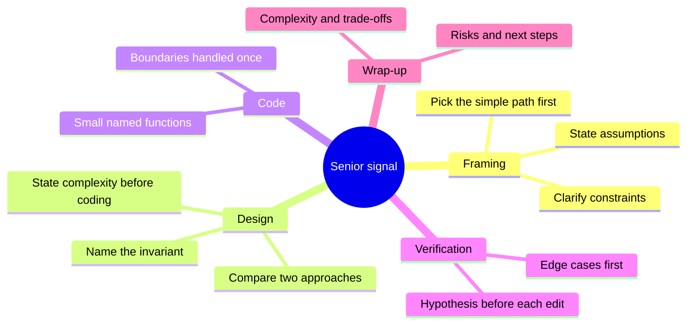

# Live Coding: Study Guide

Part of the mockinterview plugin. This guide is for you to read; it explains what you are preparing for, how to practise, and what senior interviewers look for. To practise, run `/mockinterview:practice` (you choose the problem) or `/mockinterview:interview` (the plugin chooses for your level), and use `/mockinterview:teach` when you want something explained. Problems here are called by their original codes (A1, B3, C2); each code is the `legacy_id` of a pack, and the table in section 5 maps it to the pack id.

## 1. What you are preparing for

Two different things are hiding behind "TestGorilla and live coding", and they reward different habits.

**TestGorilla** is an automated assessment platform. The employer chooses which tests to include, so the exact content of your invitation is unknown until you open it. What is documented about the programming library [3]:

| Test format | Documented length | What it checks | Where to practise it |
|---|---|---|---|
| Coding test: algorithms, entry level | 15 min | small algorithmic tasks with an input/output contract | Tier A packs (`lc-a01-two-sum` and the other `lc-a` packs) |
| Coding test: algorithms and data structures, intermediate | 35 min | arrays, strings, hash tables, linked lists, trees, graphs, heaps, stacks, queues | Tier A and B packs (`lc-a...`, `lc-b...`) |
| Coding test: debugging, advanced | 35 min | read code, find and fix defects against a specification | Tier E, planned: not yet in the plugin |
| SQLite coding test | 20 min (entry), 30 min (intermediate) | queries and database operations | Tier F, planned: not yet in the plugin |
| Multiple-choice knowledge tests | mostly 10 min | language, tools and concept knowledge | Tier G, planned: not yet in the plugin |

What the sources say about the mechanics: the employer enables the languages and you pick from them; there is a walkthrough and a practice question first; scoring is automatic, by whether your code produces the right output on the test cases, and is turned into a percentile against benchmarks; the report can include per-test-case results and a timeline of your actions; behaviour signals such as tab switches, pasting, leaving full screen and webcam data may be visible to the employer; and a candidate cannot reset a test, a recruiter has to invite you again and the same questions may come back [1][2]. The sources do not say how many questions a given test contains, so treat the 15 and 35 minute figures as the budget for *one or more* tasks and practise both.

**Live coding** is a conversation with an engineer, and the code is only part of what is scored. Published interviewer guidance lists seven dimensions: problem framing, collaboration, communication, code quality, testing and debugging, adaptability, and wrap-up. Strong signals include restating the goal before coding, sharing a short plan, working in small steps, and stating a hypothesis before editing after a failure. Red flags include coding immediately and discovering requirements through failures, working silently, a fragile fix that only handles the visible example, and stopping at green tests without summarising assumptions and risks [4].

**Honest scope note.** This bank is broad on purpose ("all common tests"), but no document can promise the exact questions you will get. What it can do is make sure that no *category* is new to you on the day: every algorithm and data-structure topic the TestGorilla library names (arrays, strings, hash tables, linked lists, trees, graphs, heaps, stacks, queues) has several problems here, and the senior tier covers what live rounds ask once the warm-up is over (stateful designs, parsing, schedulers). Debugging, SQLite, concurrency and multiple-choice exercises (tiers D to G below) are planned for a later release of the plugin; the parts of this guide that mention them are kept so you can see the full plan.

---

## 2. Three ways to practise

| Mode | Purpose | Interviewer behaviour | Scoring |
|---|---|---|---|
| **Drill** | Rebuild syntax fluency and pattern recall. Untimed, tests visible. | Silent unless asked. Runs tests on request. | Pass or fail per problem. |
| **TestGorilla simulation** | Reproduce the silent, timed, auto-scored format. | Gives the prompt, starts the timer, says nothing, reveals only the score at the end. | Percentage of cases passed, time used. |
| **Live mock** | Rehearse the conversation. | Plays the interviewer (`/mockinterview:interview`): clarifying answers, hints, follow-ups. | Scorecard at the end of the session. |

All three can run **asynchronously**: if you would rather not talk, keep a `.mockinterview/work/notes.md` file as your think-aloud log (questions you would ask, approach, complexity, test ideas, decisions) and tell the agent to respond at checkpoints. The interviewer reads the notes and the latest code and answers in writing. The scorecard treats the notes as your spoken communication.

---

## 3. Rules for the candidate

- Practise as you will be tested: **no AI completion, no copy-paste of solutions, no web** during a timed block. An editor with syntax highlighting is fine. TestGorilla can flag pasting and tab switching, and interviewers can see how you work [1].
- Allowed: the language's standard library and its official documentation. Not allowed: third-party packages, and library shortcuts that remove the point of the exercise (a built-in LRU cache for C1, `eval` for C6).
- If you have not hand-written code for a while, spend the first week on the warm-up path in section 6.1 before any timed block. Fluency (typing a loop, indexing a map, handling an error value) comes back in days, but it does not come back by reading.

---

## 4. Senior-level playbook

### 4.1 The seven steps (use them on every problem)

1. **Restate** the task in one sentence and the input/output contract. ("Given a list of intervals, return merged non-overlapping intervals, sorted.")
2. **Clarify** with a short fixed list: empty input? size limits? duplicates? sorted already? negative values? what to return on failure? can I modify the input? is the output order specified?
3. **Examples**: walk one given example and invent one edge case (empty, one element, all equal).
4. **Approach**: state the brute force and its cost, then the better one and why it works (the invariant). Say the complexity before you type.
5. **Code** in small pieces: helper functions with clear names, boundaries handled once, no premature cleverness. Narrate decisions, not keystrokes [4].
6. **Test**: run the examples, then your own edge cases, then think about what could still break. When something fails, say your hypothesis *before* changing anything, and change one thing at a time [4].
7. **Wrap-up**: complexity, assumptions, what you would improve with more time, what you would test next.

### 4.2 What "senior" adds on top of correctness

| Behaviour | Example of saying it |
|---|---|
| Trade-offs, not just solutions | "A sorted list gives O(log n) lookups but O(n) inserts; a heap gives O(log n) for both but no ordered iteration. I need min only, so the heap." |
| Naming the invariant | "At the top of the loop, `[lo, hi)` always contains the answer if it exists." |
| Scale awareness | "At 10^6 elements the quadratic version is out; at 100 it is fine and clearer. The limit says 5·10^5, so I need n log n." |
| Failure modes and operations | "If the loader throws, waiting callers must see the same error and the key must not stay stuck." |
| Testability | "I'll isolate the clock so the tests don't sleep." |
| Knowing when to stop | "This is correct and simple. The optimisation would only matter above about 10^5 keys; I'd measure first." |

### 4.3 Rebuilding hand-coding fluency (after a long stretch of AI-assisted work)

- Turn off AI completion and inline suggestions in your practice editor. Keep syntax highlighting, a linter and the language docs.
- Week-one routine: ten minutes of "blind typing" katas before each session. Rewrite A1, A2, A10, A12 and A16 from memory in your target language until you can do each in under five minutes without looking anything up.
- Run tests after every 10 to 15 lines. The reflex that AI tools weaken is the small write-run-fix loop.
- Keep a personal cheat-sheet of idioms for your language (iterating a map in sorted order, reading all stdin, integer division of negatives, string building, heap/priority queue API, sorting with a comparator) and *write it from memory*, then check it.
- For each failed problem, write the one-line pattern in your own notes ("monotonic stack: pop while top is smaller") and re-solve it three days later.

---

## 5. Problem index and coverage

| Code | Pack id | Problem | Tier | Minutes | Kind | Topics |
|---|---|---|---|---|---|---|
| A1 | `lc-a01-two-sum` | Two Sum | A | 10 | function | hash map |
| A2 | `lc-a02-valid-brackets` | Valid Brackets | A | 10 | function | stack, strings |
| A3 | `lc-a03-roman-numeral-to-integer` | Roman Numeral to Integer | A | 10 | function | strings, parsing |
| A4 | `lc-a04-group-anagrams` | Group Anagrams | A | 15 | function | hash map, sorting |
| A5 | `lc-a05-parse-one-csv-line` | Parse One CSV Line | A | 20 | function | parsing, state machine |
| A6 | `lc-a06-rotate-a-matrix` | Rotate a Matrix | A | 15 | function | matrix, indices |
| A7 | `lc-a07-top-k-words` | Top K Words | A | 15 | function | hash map, sorting, strings |
| A8 | `lc-a08-count-primes` | Count Primes Below N | A | 10 | function | math, sieve |
| A9 | `lc-a09-validate-ipv4` | Validate an IPv4 Address | A | 10 | function | strings, validation |
| A10 | `lc-a10-fizzbuzz` | FizzBuzz | A | 10 | function | loops, strings |
| A11 | `lc-a11-valid-palindrome` | Valid Palindrome | A | 10 | function | strings, two pointers |
| A12 | `lc-a12-single-number` | Single Number | A | 10 | function | bit manipulation |
| A13 | `lc-a13-maximum-subarray-sum` | Maximum Subarray Sum | A | 15 | function | dynamic programming, arrays |
| A14 | `lc-a14-spiral-matrix` | Spiral Matrix | A | 20 | function | matrix, simulation |
| A15 | `lc-a15-house-robber` | House Robber | A | 15 | function | dynamic programming |
| A16 | `lc-a16-stack-with-minimum` | Stack With Minimum | A | 15 | class | design, stack |
| B1 | `lc-b01-longest-unique-substring` | Longest Substring Without Repeating Characters | B | 25 | function | sliding window, hash map |
| B2 | `lc-b02-merge-intervals` | Merge Intervals | B | 20 | function | sorting, intervals |
| B3 | `lc-b03-top-k-frequent-elements` | Top K Frequent Elements | B | 20 | function | hash map, heap, sorting |
| B4 | `lc-b04-number-of-islands` | Number of Islands | B | 25 | function | graph, dfs, bfs, grid |
| B5 | `lc-b05-course-order` | Course Order (Lexicographically Smallest Topological Sort) | B | 30 | function | graph, topological sort, heap |
| B6 | `lc-b06-tree-max-path-sum` | Binary Tree Maximum Path Sum | B | 35 | function | tree, dfs, dp on trees |
| B7 | `lc-b07-coin-change` | Coin Change (Fewest Coins) | B | 25 | function | dynamic programming |
| B8 | `lc-b08-longest-increasing-subsequence` | Longest Strictly Increasing Subsequence | B | 30 | function | dynamic programming, binary search |
| B9 | `lc-b09-word-break` | Word Break | B | 25 | function | dynamic programming, strings |
| B10 | `lc-b10-search-rotated-array` | Search in a Rotated Sorted Array | B | 25 | function | binary search |
| B11 | `lc-b11-minimum-window-substring` | Minimum Window Substring | B | 40 | function | sliding window, hash map |
| B12 | `lc-b12-running-median` | Running Median | B | 30 | class | heap, design |
| B13 | `lc-b13-word-ladder` | Word Ladder | B | 40 | function | graph, bfs |
| B14 | `lc-b14-edit-distance` | Edit Distance | B | 30 | function | dynamic programming, strings |
| B15 | `lc-b15-generate-balanced-parentheses` | Generate Balanced Parentheses | B | 20 | function | backtracking |
| B16 | `lc-b16-network-delay-time` | Network Delay Time | B | 30 | function | graph, dijkstra, heap |
| B17 | `lc-b17-trapping-rain-water` | Trapping Rain Water | B | 30 | function | two pointers, arrays |
| B18 | `lc-b18-min-meeting-rooms` | Minimum Meeting Rooms | B | 25 | function | intervals, sorting, heap |
| B19 | `lc-b19-linked-list-cycle-entry` | Linked List Cycle Entry | B | 25 | function | linked list, two pointers |
| B20 | `lc-b20-reverse-k-groups` | Reverse Nodes in k-Groups | B | 35 | function | linked list, pointers |
| B21 | `lc-b21-validate-a-binary-search-tree` | Validate a Binary Search Tree | B | 25 | function | tree, bst, inorder |
| B22 | `lc-b22-lowest-common-ancestor` | Lowest Common Ancestor of a Binary Tree | B | 30 | function | tree, ancestors |
| B23 | `lc-b23-daily-temperatures` | Days Until a Warmer Temperature | B | 25 | function | stack, monotonic stack |
| B24 | `lc-b24-combination-sum` | Combination Sum | B | 25 | function | backtracking |
| B25 | `lc-b25-connected-components` | Connected Components | B | 20 | function | graph, union find |
| B26 | `lc-b26-merge-k-sorted-lists` | Merge K Sorted Lists | B | 25 | function | heap, k-way merge |
| B27 | `lc-b27-kth-largest` | K-th Largest Element | B | 25 | function | heap, quickselect, sorting |
| B28 | `lc-b28-longest-palindrome` | Longest Palindromic Substring | B | 30 | function | strings, expand around center, dp |
| B29 | `lc-b29-decode-ways` | Decode Ways | B | 25 | function | dynamic programming, strings |
| B30 | `lc-b30-sliding-window-maximum` | Sliding Window Maximum | B | 30 | function | deque, monotonic queue, sliding window |
| C1 | `lc-c01-lru-cache` | LRU Cache | C | 30 | class | design, hash map, linked list |
| C2 | `lc-c02-transactional-kv-store` | In-Memory Key-Value Store with Nested Transactions | C | 40 | class | design, state, stack |
| C3 | `lc-c03-sliding-window-rate-limiter` | Sliding-Window Rate Limiter | C | 35 | class | design, queue, sliding window |
| C4 | `lc-c04-task-scheduler` | Task Scheduler with Dependencies and Workers | C | 45 | function | graph, simulation, heap |
| C5 | `lc-c05-access-log-analytics` | Access-Log Analytics | C | 40 | function | parsing, hash map, percentiles |
| C6 | `lc-c06-arithmetic-expression-evaluator` | Arithmetic Expression Evaluator | C | 40 | function | parsing, recursion, grammar |
| C7 | `lc-c07-in-memory-file-system` | In-Memory File System | C | 45 | class | design, tree, trie-like |
| C8 | `lc-c08-http-path-router` | HTTP Path Router | C | 45 | class | design, strings, trie |
| C9 | `lc-c09-spreadsheet-evaluator` | Spreadsheet Formula Evaluator | C | 45 | function | graph, dfs, cycle detection, memoization |
| C10 | `lc-c10-search-suggestions` | Search Suggestions | C | 35 | class | design, trie, binary search, sorting |
| C11 | `lc-c11-priority-job-queue` | Priority Job Queue with Retries and Dead Letters | C | 50 | class | design, heap, state machine, retries |
| D1 to D3 | planned | Bounded blocking queue, ordered parallel map, single-flight | D | 40 to 50 | concurrency | threads, locks, condition variables |
| E1 to E8 | planned | Debugging snippets | E | 10 to 12 each | debugging | off-by-one, shared state, races, performance, floats, error handling, closures, mutation |
| F1 to F12 | planned | SQL questions on one schema | F | 8 to 15 each | SQL | joins, windows, CTEs, recursion |
| G1 to G47 | planned | Multiple-choice knowledge bank | G | 40 seconds each | quiz | complexity, data structures, Python, Go, Rust, SQL, HTTP, security, concurrency |

### Coverage by topic

| Category | Problems |
|---|---|
| Arrays, strings, hashing | A1, A2, A3, A4, A6, A7, A8, A9, A10, A11, A12, A13, B1, B3, B9, B11, B14, B17, B28, B29, C1, C5, C8 |
| Matrices and grids | A6, A14, B4, C4 |
| Two pointers, sliding window | A11, B1, B11, B17, B19, B20, B30, C3 |
| Sorting, searching, intervals | A4, A7, B2, B3, B8, B10, B18, B27, C10 |
| Stacks, queues, heaps | A2, A16, B3, B5, B12, B16, B18, B23, B26, B27, C2, C3, C4, C11 |
| Linked lists | B19, B20, C1 |
| Trees and tries | B6, B21, B22, C7, C8, C10 |
| Graphs | B4, B5, B6, B13, B16, B25, C4, C9 |
| Dynamic programming, backtracking | A13, A15, B6, B7, B8, B9, B14, B15, B24, B28, B29, C9 |
| Parsing and text processing | A3, A5, C5, C6 |
| Stateful design, services | A5, A16, B12, C1, C2, C3, C7, C8, C10, C11 |
| Concurrency | D1, D2, D3 |
| Debugging | E1 to E8 |
| SQL | F1 to F12 |
| Knowledge questions | G1 to G47 |

---

## 6. Training plan and simulation recipes

### 6.1 Two-week plan (about 90 minutes a day)

| Day | Focus | Mode | Problems |
|---|---|---|---|
| 1 | Fluency katas and a working editor set-up | Drill | A1, A2, A10, A11, A12 |
| 2 | Strings, maps, simple DP | Drill | A3, A4, A7, A13, A15 |
| 3 | Matrices, parsing, design basics | Drill | A5, A6, A14, A16, A9 |
| 4 | Sliding window, intervals, heaps | Drill, then timed | B1, B2, B3 (35 min each, timed) |
| 5 | Graphs and grids | Timed | B4, B5, B25 |
| 6 | Trees and linked lists | Timed | B21, B22, B19, B20 |
| 7 | Review day: redo the two weakest problems from memory | Drill | from `/mockinterview:progress` |
| 8 | Dynamic programming and backtracking | Timed | B7, B8, B9, B14, B24 |
| 9 | TestGorilla simulation 1 (recipe below) | Simulation | random A and B |
| 10 | Stateful design | Live mock | C1, C2 |
| 11 | Parsing and scheduling | Live mock | C4, C6 |
| 12 | Concurrency, debugging, SQL | Mixed | D1, E1 to E4, F1 to F6 |
| 13 | Senior live mock, full 60 minutes with follow-ups | Live mock | one of C3, C7, C8, C9, C11 |
| 14 | TestGorilla simulation 2, then a retrospective | Simulation | random, unseen |

Skip or stretch freely; the order matters less than doing each category once under a clock. Day 12 uses tiers D, E and F, which are planned and not yet in the plugin; until they ship, use that day for a B-tier review.

### 6.2 TestGorilla simulation recipes

Each block runs in silent mode: the agent gives the prompt, starts the timer, and reveals only the percentage at the end.

| Recipe | Blocks | Source |
|---|---|---|
| Algorithms (35 min) | two problems: one from A, one from B | pick unseen ids |
| Data structures (35 min) | two B problems from different structures (tree/graph/heap/list) | B19 to B22, B25, B26 |
| Debugging (35 min), planned | three snippets | E1 to E8, three at random (not yet in the plugin) |
| SQLite (30 min), planned | four questions: one each from F1 to F3, F4 to F6, F7 to F9, F10 to F12 | not yet in the plugin |
| Knowledge (10 min), planned | 15 questions | not yet in the plugin |

### 6.3 Readiness checklist

- Three consecutive A-tier problems solved in under 12 minutes each, in your target language, without lookups.
- Five B-tier problems each passing all tests including the scaling check inside 35 minutes, with the seven-step routine visible in your notes.
- Two C-tier problems finished with a follow-up discussed, scorecard 70 or more.
- Once tier D is available: one concurrency exercise passing its stress tests five runs in a row.
- Once tier G is available: MCQ quizzes consistently at 80 percent or more.
- You can explain, without notes, the complexity and the invariant of every solution you wrote this fortnight.

---

## References

1. PracHub. "TestGorilla coding test guide: practice questions, results and retakes." https://prachub.com/resources/testgorilla-coding-test-guide-practice-questions-results-and-retakes
2. TestGorilla. "Go coding test: intermediate problems" (test description page). https://testgorilla.com/test-library/programming-skills-tests/go-coding-test-intermediate-problems
3. TestGorilla. "Programming skills tests" (library overview: coding tests, SQLite tests, multiple-choice tests and their durations). https://www.testgorilla.com/test-library/programming-skills-tests/
4. PracHub. "Pair programming interview guide: what interviewers score beyond correct code." https://prachub.com/resources/pair-programming-interview-guide-what-interviewers-score-beyond-correct-code
