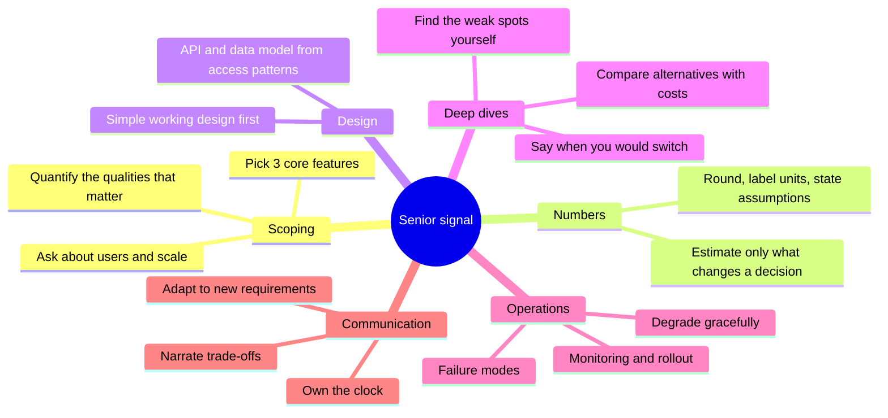
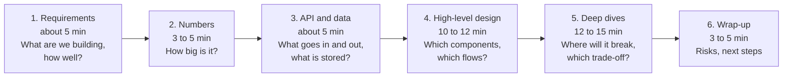

# System Design: Study Guide

Part of the mockinterview plugin. This guide is for you to read; it explains what a senior design round rewards, how to practise, and how to plan your weeks. To practise, run `/mockinterview:practice` and choose a problem, or `/mockinterview:interview` and let the plugin choose; use `/mockinterview:teach` when you want something explained.

## 1. What you are preparing for

A system design round is a 45 to 60 minute conversation about one open-ended problem ("design a chat service"). There is no single right answer and nothing to compile. You are judged on how you structure an ambiguous problem, how you reason with numbers, and how you choose between alternatives.

Published guidance from two interview-preparation sources agrees on the shape of a strong answer:

- A repeatable structure: requirements first (the top few functional requirements and the three to five non-functional qualities that matter, quantified where possible), then the core entities and the API, then a high-level design that satisfies those requirements, then deep dives that harden the design against the non-functional requirements and the interviewer's probes [2].
- **Level changes who leads.** For a junior candidate the interviewer is expected to step in and point out where the design could improve; for a senior candidate, the candidate is expected to identify the weak points independently and lead the deep-dive discussion [2].
- Senior-level reasoning, as one source describes it: announcing the time plan at the start, quantifying before choosing components, stating the trade-off behind each choice (the decision, an alternative, and the specific constraint that justifies the pick), starting from a simple working design and iterating, and narrating your thinking even when stuck [3].
- A suggested split for a 45 minute round, from the same source: about 5 minutes on requirements, 10 on the high-level design, 20 on deep dives and 5 on wrap-up (the remaining time is buffer), with the observation that deep dives carry the largest share of the score [3].

**Honest scope note.** The coding problems can run your code against tests; a design cannot be run. What *can* be verified mechanically is narrower but useful: your arithmetic and your estimates (against your own assumptions and against a reference), the structure of your written design (nothing essential is missing), and the factual claims people routinely make in design interviews ("20% of items serve 80% of requests", "adding a node moves only 1/N of the keys", "a fixed window limiter is fine"), which six small simulations (explained in the `kb-simulations` document) let you test. The quality of the design itself is judged by the agent against the rubric and the reference notes the agent holds (the interviewer notes inside each system-design pack, which stay hidden during an interview). The 16 problems cover the classic canon plus platform topics (scheduler, metrics, an LLM gateway with retrieval); no document can promise the exact question you will get, so the aim is that no *kind* of problem is new on the day. The problem canon is cross-checked against a published list of 30 frequently asked questions ranked by difficulty [4].

---

## 2. Five ways to practise

| Mode | Time | What happens | Best for |
|---|---|---|---|
| **Full mock** | 45 min + 10 min debrief | The agent plays the interviewer for one system-design problem (`/mockinterview:interview` or `/mockinterview:practice`). | Rehearsing the real thing |
| **Rapid round** | 20 min | Requirements, one diagram and a single deep dive on a problem you have seen before. | Repetition, weak spots |
| **Estimation drill** | 10 min | One of the drills D1 to D6 in the `kb-estimation` document, checked by the agent's calculator. | Speed with numbers |
| **Deep-dive drill** | 15 min | Skip to one probe from a problem's deep-dive list and defend a trade-off. | Depth |
| **Async written round** | 45 min writing, then review | You write `.mockinterview/work/design.md` (the plugin creates the template when the session begins), the agent reviews it with its tools and a two-round Q&A in writing. | Practising without speaking |

All modes can run asynchronously. If you prefer to think in writing, keep `.mockinterview/work/notes.md` as your think-aloud log; the scorecard counts it as your communication.

---

## 3. Rules for the candidate

- Practise as you will be tested: no AI help and no looking up reference designs during the timed block. A notes file, a calculator and a diagram tool are fine.
- Do the arithmetic by hand first (rounded, with units), then let the tool check it. The tool is for feedback, not for thinking.
- Say or write *why* for every choice. A technology name without a reason scores nothing.
- Do not memorise designs. The problems are different on purpose, and interviewers change requirements midway; reasoning from requirements transfers, memorised diagrams do not.

---

## 4. Senior-level playbook

### 4.1 The 45 minutes

The structure follows the delivery framework published by Hello Interview: functional requirements as "users should be able to..." statements (the top three), the three to five most relevant non-functional qualities quantified where possible, core entities as a draft you revise, an API (REST with plural resource names by default; take the current user from the auth token, not the request), a high-level design that satisfies the functional requirements while *noting* possible additions such as caches and queues without detouring, then deep dives [2]. The same source advises **skipping upfront capacity estimation** and doing the math only when it will change the design; in this document, the estimation phase is therefore "the numbers that decide something", not a ritual [2].

### 4.2 Say the trade-off, every time

The pattern recommended for senior answers is: name the decision, name an alternative, and justify the pick with a specific constraint [3]. A template that makes this automatic:

> *"I'll use **X** for **Y** because **constraint Z**. The alternative is **W**, which would be better if **condition**. What we give up is **cost**, and I'd revisit it if **trigger**."*

Example for S1: "I'll generate a random 7-character code and insert it with a unique constraint because it needs no coordination service and codes are not guessable. The alternative is allocating ID ranges per server, which would be better if we needed shorter codes or guaranteed no retries. What we give up is a rare retry on collision (under 0.2% at 6 billion links), and I'd revisit it if the collision rate showed up in latency metrics."

### 4.3 Habits that separate senior from mid-level answers

| Mid-level habit | Senior habit |
|---|---|
| Lists technologies | States the property needed, then the technology that provides it |
| Designs the happy path | Walks through a failure of each component and says what the user sees |
| Waits for the interviewer to point at weaknesses | Names the three weakest points of their own design before being asked [2] |
| Estimates as a ritual | Estimates to decide ("this fits on one machine, so I won't shard for capacity") |
| Chooses one design and defends it | Starts simple, shows where it breaks, then adds the next component [3] |
| Says "scalable" and "highly available" | Gives numbers: p99 latency, availability target, recovery time |
| Goes quiet when stuck | Narrates what they are weighing so the interviewer can help [3] |

### 4.4 Common ways to lose points

- Starting with the architecture diagram before any requirement or number.
- Adding a component (cache, queue, new database) without saying which problem it solves.
- Treating a queue or a retry as free: at-least-once delivery needs idempotency; retries need backoff and jitter.
- Leaving data deletion, security and abuse out entirely.
- Running out of time before the deep dives, which carry the largest share of the score [3].

---

## 5. Problem index and coverage

| ID | Problem | Tier | Minutes | Topics |
|---|---|---|---|---|
| S1 | URL shortener | Core | 40 | ID generation, key-value storage, caching, read-heavy |
| S2 | Distributed rate limiter | Core | 40 | algorithms, Redis, atomicity, failure policy |
| S3 | Distributed key-value store | Core | 45 | partitioning, replication, quorums, consistency |
| S4 | News feed (social timeline) | Core | 45 | fan-out, caching, graph, ranking |
| S5 | Chat service | Core | 45 | WebSockets, ordering, delivery guarantees, presence |
| S6 | Notification system | Core | 40 | queues, retries, priorities, third-party providers |
| S7 | Web crawler | Core | 40 | queues, deduplication, politeness, large-scale batch |
| S8 | Search autocomplete (typeahead) | Core | 35 | tries, top-k, latency, data pipeline |
| S9 | File storage and sync | Senior | 45 | chunking, deduplication, metadata consistency, sync protocol |
| S10 | Video streaming platform | Senior | 45 | media pipeline, CDN, adaptive bitrate, cost |
| S11 | Ride hailing and nearby search | Senior | 45 | geospatial index, real-time location, matching, state machines |
| S12 | Ticket sales under a flash crowd | Senior | 45 | contention, inventory, waiting room, idempotency |
| S13 | Distributed job scheduler | Senior | 45 | leases, at-least-once, scheduling, fairness |
| S14 | Metrics and monitoring platform | Senior | 45 | time series, ingestion, downsampling, alerting |
| S15 | LLM gateway and retrieval platform | Senior | 45 | API gateway, token budgets, vector search, RAG, evaluation |
| S16 | Payment processing (optional) | Optional | 45 | idempotency, ledger, state machines, reconciliation |

Estimation drills D1 to D6 are in the `kb-estimation` document, section 4. Each problem is a pack: S1 `sd-s01-url-shortener`, S2 `sd-s02-distributed-rate-limiter`, S3 `sd-s03-distributed-key-value-store`, S4 `sd-s04-news-feed`, S5 `sd-s05-chat-service`, S6 `sd-s06-notification-system`, S7 `sd-s07-web-crawler`, S8 `sd-s08-search-autocomplete`, S9 `sd-s09-file-storage-and-sync`, S10 `sd-s10-video-streaming`, S11 `sd-s11-ride-hailing-nearby-search`, S12 `sd-s12-ticket-sales-flash-crowd`, S13 `sd-s13-distributed-job-scheduler`, S14 `sd-s14-metrics-monitoring-platform`, S15 `sd-s15-llm-gateway-and-retrieval`, S16 `sd-s16-payment-processing`. Tiers: **Core** (the classics every interview loop draws from), **Senior** (contention, media, geo, platform topics where deep dives decide the result), **Optional** (domain-specific, skippable).

**Coverage by concept**

| Concept | Problems |
|---|---|
| Back-of-envelope estimation | all problems; drills D1 to D6 |
| Caching and hot keys | S1, S2, S4, S8, S10, S12, S15 |
| Partitioning and consistent hashing | S3, S4, S5, S7, S9, S11, S14 |
| Replication, quorums and conflict handling | S3, S9, S14 |
| Queues, async processing and delivery guarantees | S4, S5, S6, S7, S10, S13, S14 |
| Idempotency and exactly-once effects | S1, S5, S6, S12, S13, S16 |
| Concurrency control and contention | S2, S11, S12, S13 |
| Persistent connections and real time | S5, S11 |
| Geospatial indexing | S11 |
| Blob storage, media and CDN | S4, S9, S10 |
| Search, indexing and ranking | S4, S8, S15 |
| Rate limiting and quotas | S2, S6, S12, S15 |
| Batch and stream data pipelines | S7, S8, S14, S15 |
| Observability and operations | S13, S14, S15 |
| LLM and retrieval platforms | S15 |
| Ledgers and payments (optional) | S16 |

---

## 6. Training plan

If you have not designed systems under time pressure for a while, start with numbers and the classics; they teach the vocabulary all later problems reuse. A suggested three-week plan with about five sessions per week (each a 45 minute mock or a 25 minute rapid round plus a debrief):

| Week | Focus | Sessions |
|---|---|---|
| 1: foundations | Estimation speed; read and write paths; caching and sharding | Drills D1 to D6 (one per day for the first days); S1 URL shortener; S2 rate limiter; S3 key-value store; S8 autocomplete |
| 2: asynchronous systems | Queues, fan-out, delivery guarantees, state | S4 news feed; S5 chat; S6 notifications; S7 crawler; S13 scheduler |
| 3: senior depth | Contention, media, geo, platform topics, curveballs | S12 ticket sales; S9 file sync; S11 ride hailing; S10 video; S14 metrics; S15 LLM gateway and retrieval |
| Final | Unseen problems under the full protocol | Two full mocks on problems you have not seen, with a curveball each; repeat the lowest-scoring problem |

Rules that make the plan work: (1) after every mock, redo the *weakest phase* of the same problem in a 15 minute rapid round two days later; (2) rotate curveballs, so the same design is stressed in different ways; (3) keep the scorecard history (`/mockinterview:progress` shows it) and look for the lowest dimension, not the average; (4) in the last days, do not learn new building blocks, rehearse the framework and the trade-off sentence.

**Optional problem.** S16 (payment processing) is domain-specific. Skip it unless the role involves payments, billing or financial ledgers; the transferable ideas (idempotency keys, outbox, state machines, conditional updates) are practised in S6, S12 and S13.

---

## References

2. Hello Interview. "Delivery" (system design delivery framework: requirements, core entities, API, data flow, high-level design, deep dives; time guidance and level expectations). <https://hellointerview.com/learn/system-design/in-a-hurry/delivery>
3. DesignGurus. "System Design Interviews: How to Fill 45 Minutes With Senior-Level Reasoning" (seven-step preparation framework, time allocation, senior-level reasoning). <https://designgurus.substack.com/p/system-design-interview-a-7-step>
4. DesignGurus. "Every System Design Question You'll Get at FAANG, Ranked by Difficulty" (30 questions with key concepts). <https://designgurus.substack.com/p/30-system-design-interview-questions>

All links were opened while writing these documents (October 2026). Numbers and demonstrations were produced by running the tools in `runner/tools/`, not copied from the sources.
