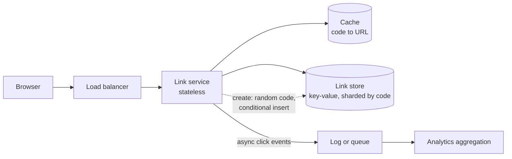

# URL shortener

## Statement

**Tier:** Core · **Suggested time:** 40 min · **Topics:** ID generation, key-value storage, caching, read-heavy

> Design a service that turns long URLs into short links and redirects anyone who opens a short link to the original page. Think of a public service such as TinyURL.

## Self-check questions

Answer these after your design, or in the debrief:

- How many distinct codes do you need over the lifetime of the service, and how long must a code be?
- What happens when two people shorten at the same moment, and when two different URLs would get the same code?
- Which status code do you redirect with, and what does that choice cost you?
- What breaks first when the cache cluster disappears?
- How would you add click analytics without slowing the redirect?

**Tools the agent can run to test your claims afterwards** (they live in `runner/tools/`; just ask): `runner/tools/estimate.py` for the load, `runner/tools/sim_cache.py --alpha 1.0` for the hit ratio.

## Interviewer notes

### Clarifying questions and answers

Give only what is asked, word for word.

| Question | Answer |
|---|---|
| Functional scope? | Create a short link from a long URL, optionally with a custom alias and an expiry date. Redirect. Delete your own link. Click analytics only as a follow-up. |
| Scale? | 100 million new links per month. Reads are 100 times writes. Links are kept 5 years unless they expire. |
| Latency and availability? | Redirect p99 under 100 ms on the server side, 99.99% available. Creation may be slightly less available. |
| Code format? | As short as reasonable, letters and digits only. Say how long and why. |
| Accounts? | Anonymous creation is allowed; a logged-in owner can list and delete links. Authentication details are out of scope. |

### Reference estimate

Computed from the assumptions in the `## Reference estimate` section by `runner/tools/estimate.py`.


| Quantity | Value |
|---|---|
| write QPS (average) | 38.5 |
| read QPS (average) | 3.85 K |
| write QPS (peak) | 77.1 |
| read QPS (peak) | 7.71 K |
| bytes written per day | 1.67 GB |
| total storage over the retention period | 9.12 TB |
| peak ingress | 38.5 KB/s |
| peak egress | 3.85 MB/s |
| cache size (upper bound) | 33.3 GB |
| app servers at the stated server_qps | 4 |

100M links per month is about 3.3M creations per day, which is about 39 writes/s and 3.9K reads/s on average. Storage is small (about 3 TB logical, 9 TB with 3 replicas), so sharding is for throughput and availability, not capacity. `cache_bytes` is an upper bound that assumes every read touches a different link; real traffic repeats, so the hot set is smaller.

### Reference design

- **API.** `POST /v1/links {long_url, custom_alias?, expires_at?}` returns `201 {short_url}`. `GET /{code}` returns a redirect. `DELETE /v1/links/{code}` for the owner. Idempotent creation: same owner and same long URL may return the existing code.
- **Code space.** 6 billion links over 5 years. Base62 with 7 characters gives 62^7, about 3.5 trillion codes, so a random 7-character code collides with probability under 0.2% even at the end of the 5 years. 6 characters (about 57 billion) would be too tight for random assignment.
- **Generating codes, three options.** (a) Hash the URL and truncate: no coordination, same URL gives the same code, but collisions need a retry scheme and truncation makes them likely. (b) Counter ranges: a small allocator hands each app server a block of IDs (for example 1M at a time), the server encodes the next ID in base62; no collisions, but codes are guessable unless the ID is permuted. (c) Random code plus a conditional insert on a unique key and retry on conflict: simplest, no allocator, enumeration-resistant. A senior answer picks one and says what it gives up.
- **Storage.** Access is always by code, no joins: a key-value or wide-column store (or sharded SQL with the code as shard key). Row: code, long_url, owner, created_at, expires_at. About 3 TB logical over 5 years.
- **Read path.** Edge or app cache first (cache-aside, LRU, TTL), then the store. Cache negative results briefly so scans for unknown codes do not reach the database. Redirect `301` lets browsers cache (cheaper, but later clicks never reach you, so no analytics and no way to expire); `302` sends every click through you.
- **Expiry and deletion.** Check `expires_at` on read; a background sweeper reclaims rows. Deleted or expired codes return 404 or 410 and are not reused for a long cool-off.
- **Abuse.** Rate limit creation per client, check URLs against a malware and phishing blocklist, refuse links to the service itself (redirect loops).
- **Analytics, if asked.** Emit a click event (code, time, coarse client data) to a log or queue asynchronously; aggregate in a stream or batch job. Never write analytics inside the redirect request.



### Deep-dive probes

| Probe | What a strong answer contains |
|---|---|
| How do you generate the code, and what is the collision story? | Names at least two options with costs: coordination-free hash or random plus conditional insert and retry versus allocated ID ranges plus encoding. Computes the code space (62^7) against 6B links. Knows a unique constraint, not an application check, is what makes it correct under concurrency. |
| Size the cache and predict the hit ratio. | Reasons that traffic is skewed (a few links get most clicks), uses a number from `runner/tools/sim_cache.py` rather than the 80/20 slogan, notes the upper-bound nature of the estimate, and states what the miss rate means for database load (misses times read QPS). |
| 301 or 302? | 301 is cacheable by browsers and CDNs, which lowers load but removes control (expiry, analytics, takedown). 302 keeps control at a cost of every click reaching the edge. Chooses 302 (or 301 with a short max-age) when analytics or expiry matter. |
| How do two regions both accept writes? | Partition the code space per region (prefix or range) or use region-local random codes with a global unique check on the owning shard; discusses replication lag and why a link created in region A may briefly 404 in region B. |

### Failure injections

| Injection | Strong response |
|---|---|
| The cache cluster is down. | Database sees all reads: roughly 4K to 8K reads/s, which a few replicas can serve. Mentions request coalescing for the same hot key, a per-node in-memory fallback cache, and load shedding for anonymous creation first. |
| The ID allocator is down. | Servers keep their pre-fetched block (the design degrades gracefully) or the random-code design has no allocator at all. Alerts before blocks run out. |
| A viral link gets 200K requests/s. | A single hot key: replicate it in local caches, let the CDN serve it, and avoid a single cache shard melting. |

### Common mistakes

- Starts with components before stating a single number.
- Uses one auto-increment column and never discusses guessability or the single-writer bottleneck.
- Truncates a hash and ignores collisions.
- Says 'NoSQL because it scales' without saying what the access pattern is.
- Puts analytics writes inside the redirect request.
- Forgets expiry, abuse and the redirect loop.

### Level calibration

| Level | What the answer looks like |
|---|---|
| Mid-level | Working create and redirect, cache and database, picks a code scheme without analysing collisions. |
| Senior (the target) | Quantifies code space and load, compares code schemes, justifies 302, designs cache and negative caching, handles hot keys, abuse and multi-region. |
| Stretch | Custom alias squatting rules, link-level privacy, regional data residency, cost model. |

### Probe ladder

Use one rung at a time and record the highest rung reached; only the highest rung is deducted.

- P0 (free): a neutral question, for example: What happens when this component fails?
- P1 (-5): What does the whole system look like with 5 services removed? What is the minimum?
- P2 (-10): How many codes do you need, and what does that say about the code length?
- P3 (-20): Consider a unique key and retry instead of checking first.

## Reference estimate

```json estimate
{"dau": 3330000.0, "writes_per_user_day": 1, "reads_per_user_day": 100, "bytes_per_write": 500, "bytes_per_read": 500, "peak_factor": 2, "retention_years": 5, "replication": 3, "server_qps": 2000}
```
