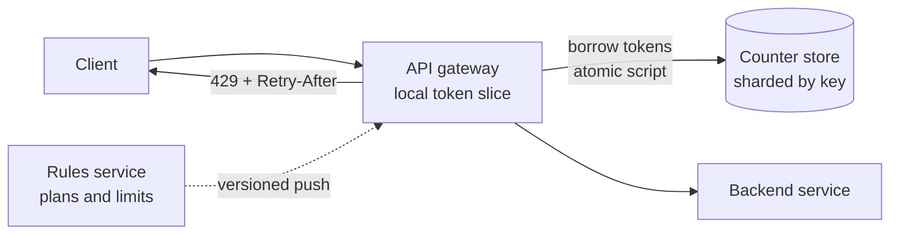

# Distributed rate limiter

## Statement

**Tier:** Core · **Suggested time:** 40 min · **Topics:** algorithms, Redis, atomicity, failure policy

> Design a rate limiter for a public API platform. Each API key may make a limited number of requests per minute, and the limit must hold across many gateway servers.

## Self-check questions

Answer these after your design, or in the debrief:

- Which algorithm do you pick and what is its worst-case behaviour at a window boundary?
- Where is the counter stored, and why is a read-then-write on it a bug?
- How many requests per second reach the counter store, and how do you reduce that?
- If the counter store is unreachable, do you allow or block traffic, and why?
- How do two regions share one limit?

**Tools the agent can run to test your claims afterwards** (they live in `runner/tools/`; just ask): `runner/tools/sim_ratelimit.py` for the boundary behaviour, `runner/tools/estimate.py` for operations per second.

## Interviewer notes

### Clarifying questions and answers

Give only what is asked, word for word.

| Question | Answer |
|---|---|
| What is limited? | Requests per API key per minute; unauthenticated traffic is limited per IP. Limits differ per plan (for example 600 per minute free, 6,000 per minute paid), and rules change without redeploying. |
| Scale? | Peak 50,000 requests/s across 100 gateway servers, 5 million distinct keys, 2 million of them active on a given day. |
| Overhead budget? | Under 5 ms at p99 added to a request. |
| Accuracy? | Approximately right is fine (within about 10%). Never let one client take a service down. |
| What does the client see? | HTTP 429 with a `Retry-After` header and rate limit headers. |
| If the limiter itself fails? | Candidate's call: expect them to ask, then to justify the answer. Either choice is acceptable with reasoning. |

### Reference estimate

Computed from the assumptions in the `## Reference estimate` section by `runner/tools/estimate.py`.


| Quantity | Value |
|---|---|
| read QPS (average) | 20 K |
| read QPS (peak) | 50 K |
| peak egress | 5 MB/s |
| cache size (upper bound) | 34.6 GB |
| app servers at the stated server_qps | 100 |

Here 'users' are active API keys and 'reads' are limiter checks: 2M keys times 864 requests is about 20K checks/s on average, 50K at peak. Memory is tiny (5M counters of about 100 bytes is 500 MB); the real constraint is operations per second on the counter store and the latency of reaching it.

### Reference design

- **Algorithm choice.** Fixed window is the cheapest but allows 2x the limit around a boundary. Sliding window log is exact but stores a timestamp per request. Sliding window counter approximates with two counters. Token bucket allows controlled bursts and needs two numbers per key. Run `runner/tools/sim_ratelimit.py` to show the boundary effect. Token bucket (or sliding window counter) is the usual answer for APIs.
- **State.** A central store (Redis or similar) keyed `rl:{key}:{rule}` with a TTL so idle keys disappear. Updates must be **atomic**: a server-side script (Lua in Redis) or a single atomic command, never GET followed by SET from the app.
- **Reducing store load.** Each gateway keeps a local slice of the allowance and refills it from the store when it runs low. Slice size is the accuracy knob: for a key limited to 600 per minute across 100 gateways a fixed slice of 60 tokens would let a few gateways strand the whole budget while others reject traffic, so size slices from the key's recent local rate (and cap them at a small fraction of the limit), and use slices only for high-rate keys; low-rate keys go to the store on every request. Alternative: check the central store only for keys near their limit.
- **Sharding the store.** Partition by key with consistent hashing or the store's native cluster slots; one key lives on one shard, so there is no cross-shard coordination.
- **Rules.** A rules service holds plan limits; gateways cache rules with a version and refresh by push or short poll. Rule changes apply within seconds.
- **Failure policy.** The limiter should fail open for availability (allow, log, fall back to a coarse local limit) for ordinary traffic; fail closed only for abuse-sensitive endpoints such as login or expensive calls. Say it explicitly.
- **Response.** 429 with `Retry-After`; headers with limit, remaining and reset time.
- **Multi-region.** Per-region limits (budget split by traffic share) are simple and fast; a global limit needs cross-region replication of counters with eventual consistency and accepts overshoot.



### Deep-dive probes

| Probe | What a strong answer contains |
|---|---|
| Why is `GET count; if count < limit: SET count+1` wrong? | Two gateways read the same value and both allow. Needs an atomic increment or a script that checks and updates in one step. Mentions the TTL being set in the same atomic unit so a crash cannot leave a counter that never expires. |
| 50K checks/s and a 5 ms budget: how do you keep the store from becoming the bottleneck? | Local allowance slices or batching sized from each key's observed rate, with a stated accuracy bound and the stranded-budget problem for low-rate keys; sizes the shard count from operations per second per shard (for example, tens of thousands per node) and replicates reads only if the counters tolerate staleness. |
| Pick the algorithm and defend it. | Compares at least token bucket and sliding window counter on burst behaviour, memory per key and boundary error, with the numbers from `runner/tools/sim_ratelimit.py`. |
| What if the clocks on the gateways differ? | Prefer the store's clock or monotonic elapsed time inside the script; token bucket refill computed from the store's time; windows keyed by the store's clock. |

### Failure injections

| Injection | Strong response |
|---|---|
| One counter shard dies. | Keys on it fail open to the local fallback limit; the shard is replaced from a replica; counters are allowed to reset because short-lived counters are cheap to lose. |
| An attacker rotates 100K IP addresses. | Per-IP limits do not help alone; add a global limit per endpoint, a per-account limit once authenticated, and network-level protections. A rate limiter is not DDoS protection. |
| A rule is changed from 600 to 60. | Gateways converge within the refresh interval; tokens already borrowed are honoured; discuss whether lowering applies immediately. |

### Common mistakes

- Non-atomic read-modify-write on the counter.
- Fixed window without mentioning the boundary burst.
- No failure policy ('Redis never goes down').
- Counts per server instead of per key, so the limit is multiplied by the fleet size.
- Uses application clocks to compute windows across servers.
- Confuses rate limiting (protect the service) with quotas (billing per month).

### Level calibration

| Level | What the answer looks like |
|---|---|
| Mid-level | Token bucket in Redis with a correct atomic update. |
| Senior (the target) | Compares algorithms with numbers, local slices to cut store traffic with a stated error bound, failure policy per endpoint class, rules distribution, multi-region approach. |
| Stretch | Fairness between tenants, adaptive limits under overload, limiting by tokens or cost instead of request count (relevant to S15). |

### Probe ladder

Use one rung at a time and record the highest rung reached; only the highest rung is deducted.

- P0 (free): a neutral question, for example: What happens when this component fails?
- P1 (-5): What does your counter store see per second, and how would you cut that?
- P2 (-10): Walk through two gateways incrementing the same counter at the same time.
- P3 (-20): What should happen to user traffic when your own limiter is down?

## Reference estimate

```json estimate
{"dau": 2000000.0, "reads_per_user_day": 864, "peak_factor": 2.5, "bytes_per_read": 100, "server_qps": 500}
```
