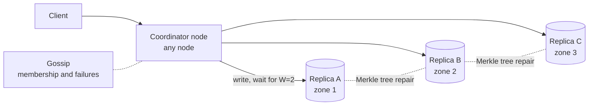

# Distributed key-value store

## Statement

**Tier:** Core · **Suggested time:** 45 min · **Topics:** partitioning, replication, quorums, consistency

> Design a distributed key-value store with put, get and delete that keeps working when machines and even a whole availability zone fail.

## Self-check questions

Answer these after your design, or in the debrief:

- How are keys assigned to nodes, and how many keys move when a node joins?
- Where do the replicas of a key live, and what are N, R and W for your default?
- What happens to a write while one replica is down, and how does that replica catch up later?
- Two clients write the same key at the same time on different replicas: who wins and who finds out?
- What would you change to make reads linearizable, and what does that cost?

**Tools the agent can run to test your claims afterwards** (they live in `runner/tools/`; just ask): `runner/tools/sim_hashring.py --nodes 10 --vnodes 1,10,100,500` before the first deep dive.

## Interviewer notes

### Clarifying questions and answers

Give only what is asked, word for word.

| Question | Answer |
|---|---|
| Data model? | Opaque keys up to 256 bytes, values up to 10 KB (average 5 KB). No range scans, no multi-key transactions. |
| Scale? | 5,000 writes/s and 15,000 reads/s on average; about 8 TB of logical data, 3 copies of each. |
| Latency? | p99 under 10 ms inside a region. |
| Priority: availability or consistency? | Availability first; a read may be slightly stale. Offer consistency as a per-request option if you can. |
| Failures to survive? | Any single node, and one whole availability zone out of three. |

### Reference estimate

Computed from the assumptions in the `## Reference estimate` section by `runner/tools/estimate.py`.


| Quantity | Value |
|---|---|
| write QPS (average) | 5 K |
| read QPS (average) | 15 K |
| write QPS (peak) | 10 K |
| read QPS (peak) | 30 K |
| bytes written per day | 2.16 TB |
| total storage over the retention period | 23.7 TB |
| peak ingress | 50 MB/s |
| peak egress | 150 MB/s |
| cache size (upper bound) | 1.3 TB |
| app servers at the stated server_qps | 8 |

Here 'users' are client applications. Most writes overwrite existing keys, so only about 1% of written bytes become new data (`new_data_fraction`). The estimate lands near 8 TB logical, 24 TB with 3 replicas, which is why storage alone calls for roughly ten or more nodes (a few TB each) and the 15K reads/s plus 5K writes/s add headroom and failure tolerance.

### Reference design

- **Partitioning.** Consistent hashing on a ring [5] with many virtual nodes per machine, so load evens out and heterogeneous machines can own more points [6]. Adding a node moves about 1/(N+1) of the keys instead of nearly all of them (run `runner/tools/sim_hashring.py`).
- **Replication.** Each key is stored on N=3 nodes: the owner and the next distinct nodes on the ring, chosen from different availability zones (the preference list) [6].
- **Quorums.** A write succeeds when W replicas acknowledge, a read when R replicas answer. R + W > N guarantees that a read quorum overlaps the latest write quorum [6]. N=3, W=2, R=2 is the balanced default; W=1 favours write availability, R=1 favours read speed.
- **Any node coordinates.** The client (or a stateless proxy) contacts any node; that node coordinates the replicas for the key. Latency is set by the slowest of the R or W replicas needed [6].
- **Sloppy quorum and hinted handoff.** If a preferred replica is down, write to the next healthy node with a hint to hand the data back later [6]. This keeps writes available at the cost of weaker guarantees during the failure.
- **Conflicts.** Concurrent writes to the same key create versions. Options: last-write-wins by timestamp (simple, loses updates, depends on clocks); vector clocks that keep both versions and let the application merge [6]; CRDT-style values for counters and sets.
- **Repair.** Read repair fixes stale replicas that answered a read. Background anti-entropy compares replicas with Merkle trees so only differing key ranges are transferred.
- **Membership.** Gossip spreads the ring state and failure suspicion; no single master to fail.
- **Node storage.** Log-structured merge tree: write-ahead log, in-memory table, immutable sorted files, background compaction, Bloom filters to skip files on reads. Deletes write tombstones that are purged after a grace period longer than the repair interval.
- **The consistent alternative.** If linearizable reads and writes matter, replicate each partition with a consensus protocol (Raft or Paxos) and serve through the leader: no stale reads, but unavailability on the minority side of a partition.



### Deep-dive probes

| Probe | What a strong answer contains |
|---|---|
| Why do virtual nodes matter? | With one point per node the load is badly uneven and a join moves a lopsided share (see the sim output); with many points load evens out, and a failed node's load spreads over many survivors. Costs: more metadata and more streaming sources. |
| Explain R + W > N and give an example where it still returns stale data. | Overlap argument. Stale reads still happen with sloppy quorums (the write went to hinted nodes outside the preference list) and with concurrent writes; also the quorum itself does not give linearizability without extra steps. |
| How do you pick a conflict policy? | Compares LWW (clock skew can discard a newer write) with vector clocks (more work for the application) and with CRDTs; ties the choice to the data (shopping cart merge versus session token). |
| A node has been down for 3 hours. What does it do when it comes back? | Receives hinted writes, then runs anti-entropy; tombstones older than the grace period must not resurrect deleted keys, so the grace period must exceed the longest tolerated outage or the node must be rebuilt. |

### Failure injections

| Injection | Strong response |
|---|---|
| An availability zone is partitioned from the other two. | With N=3 across 3 zones and W=R=2, the majority side still serves reads and writes; the isolated side serves only with a relaxed level. Explains the CAP trade-off in these terms. |
| Clock skew of 5 seconds between nodes with LWW. | A newer write can lose to an older one with a faster clock; mitigations: logical clocks, hybrid logical clocks, or the conflict resolution of vector clocks. |
| One key receives 50% of all traffic. | Replication does not help a single key. Mitigate with client-side caching, a small read replica set for that key, or key splitting for write-hot counters. |

### Common mistakes

- Uses modulo hashing and does not notice that adding a node reshuffles everything.
- States 'eventual consistency' without saying how replicas converge.
- Treats R + W > N as linearizability.
- Ignores deletes (tombstones) and the resurrection problem.
- Puts all replicas in one zone.
- Designs a metadata master as a single point of failure without saying so.

### Level calibration

| Level | What the answer looks like |
|---|---|
| Mid-level | Ring, replicas, put/get; mentions quorum. |
| Senior (the target) | Virtual nodes, N/R/W with the overlap argument, sloppy quorum and hinted handoff, conflict policy trade-offs, repair, LSM node internals, and when to choose consensus instead. |
| Stretch | Rebalancing without hot spots, multi-region replication, secondary indexes, transactions. |

### Probe ladder

Use one rung at a time and record the highest rung reached; only the highest rung is deducted.

- P0 (free): a neutral question, for example: What happens when this component fails?
- P1 (-5): What happens to a write when one of the three replicas is down?
- P2 (-10): Draw the ring with 3 machines and think about what 'next node' means with virtual nodes.
- P3 (-20): If two replicas disagree, how does the system find out?

### References

5. Karger, Lehman, Leighton, Levine, Lewin, Panigrahy. "Consistent Hashing and Random Trees: Distributed Caching Protocols for Relieving Hot Spots on the World Wide Web", MIT (balance, monotonicity, spread, load). <https://cs.brown.edu/courses/csci2950-u/f09/papers/chash97stoc.pdf>
6. DeCandia et al. "Dynamo: Amazon's Highly Available Key-value Store" (consistent hashing with virtual nodes, (N, R, W) quorums with R + W > N, sloppy quorum and hinted handoff, vector clocks). Course copy of the paper. <https://courses.grainger.illinois.edu/cs525/sp2010/Dynamo_paper_CS525.pdf>

## Reference estimate

```json estimate
{"dau": 100000.0, "writes_per_user_day": 4320, "reads_per_user_day": 12960, "bytes_per_write": 5000, "bytes_per_read": 5000, "peak_factor": 2, "retention_years": 1, "replication": 3, "new_data_fraction": 0.01, "server_qps": 5000}
```
