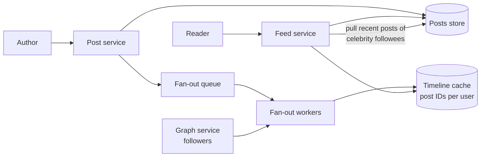

# News feed (social timeline)

## Statement

**Tier:** Core · **Suggested time:** 45 min · **Topics:** fan-out, caching, graph, ranking

> Design the home feed of a social network: people follow each other, post short items with optional images, and open an app that shows the latest items from the people they follow.

## Self-check questions

Answer these after your design, or in the debrief:

- Do you build each feed when a post is written or when the feed is read? What does each choice cost at 50 million followers?
- What exactly is stored in a user's cached timeline?
- How does a feed page request avoid loading a million rows, and how does the next page work?
- What happens when someone unfollows, deletes a post, or has not logged in for a month?
- Where does ranking fit if you want to add it later?

**Tools the agent can run to test your claims afterwards** (they live in `runner/tools/`; just ask): `runner/tools/sim_fanout.py` for the fan-out numbers, `runner/tools/sim_queue.py` for the backlog arithmetic.

## Interviewer notes

### Clarifying questions and answers

Give only what is asked, word for word.

| Question | Answer |
|---|---|
| Scale? | 200 million daily active users; on average each posts 0.5 times per day and opens the feed 10 times per day. Average following is 200 accounts; the most followed account has 50 million followers. |
| Feed content? | Reverse chronological first; ranking by relevance is a follow-up. A page is 20 items, newest first, loaded with a cursor. |
| Freshness? | A new post should reach followers' feeds within about 5 seconds at p99 for ordinary accounts; a minute is fine for huge accounts. |
| Media? | Images and short video are stored as files and referenced by URL; the feed service handles metadata only. |
| Consistency? | A user must see their own post immediately. Others may see a short delay. |

### Reference estimate

Computed from the assumptions in the `## Reference estimate` section by `runner/tools/estimate.py`.


| Quantity | Value |
|---|---|
| write QPS (average) | 1.16 K |
| read QPS (average) | 23.1 K |
| write QPS (peak) | 3.47 K |
| read QPS (peak) | 69.4 K |
| bytes written per day | 100 GB |
| total storage over the retention period | 548 TB |
| peak ingress | 3.47 MB/s |
| peak egress | 1.39 GB/s |
| cache size (upper bound) | 8 TB |
| app servers at the stated server_qps | 25 |

Average 1.2K posts/s and 23K feed reads/s, peaking near 70K reads/s. Post metadata alone is 100 GB/day (about 550 TB over 5 years with 3 copies, excluding media). The timeline cache is the memory question: 800 post IDs of 8 bytes per active user is 6.4 KB, so 200M users need about 1.3 TB.

### Reference design

- **Core entities.** User, Follow edge, Post, Timeline entry (user, post ID, time).
- **API.** `POST /v1/posts`, `GET /v1/feed?cursor=...` (cursor = last post ID or time, never an offset), `POST /v1/follows/{user}`.
- **Services.** Post service (stores posts, sharded by post or author), Graph service (follow edges, sharded by user, indexed both ways), Fan-out workers fed by a queue, Timeline cache (a capped list of post IDs per user), Feed service (reads the timeline, hydrates post details, merges, ranks).
- **Push (fan-out on write).** On a new post, workers append the post ID to every follower's timeline. Reads are one cache lookup. Cost: write amplification of followers per post and a huge burst for celebrities.
- **Pull (fan-out on read).** Store the post once; at read time fetch the recent posts of every followee and merge. Cheap writes, expensive reads (about 200 lookups per feed read in this scenario).
- **Hybrid.** Push for ordinary accounts, pull for accounts above a follower threshold; at read time merge the cached timeline with the recent posts of the few celebrities the viewer follows. `runner/tools/sim_fanout.py` shows the worst single-post fan-out dropping by an order of magnitude.
- **Inactive users.** Do not maintain timelines for users who have not been seen in weeks; rebuild lazily on their next visit.
- **Consistency details.** A user's own posts are merged in at read time so they appear immediately. Deleted posts: hydration filters them out (timelines hold only IDs). Unfollow: filter at read time and let old entries age out.
- **Ranking.** Candidate set from the timeline, a lightweight scoring model using recency, affinity and engagement, and diversity rules. Keep it behind a feed-service interface so chronological remains the fallback.
- **Pagination.** Cursor on (time, post ID) so new posts do not shift pages; the cache holds enough entries for several pages, older pages fall through to storage.



### Deep-dive probes

| Probe | What a strong answer contains |
|---|---|
| Push, pull or hybrid? Defend it with numbers. | Computes write amplification (followers per post) and read cost (followees per read), uses the ratio of reads to writes, identifies the threshold concept and what it protects against (a single 50M-follower post). |
| How do you handle a post by an account with 50M followers? | Do not fan out synchronously; pull path for such accounts, or push in batches by priority (active followers first), rate-limited workers; note the 'a minute is fine' relaxation from the clarification. |
| Walk through unfollow and delete. | Timeline holds IDs only; filter at read time against current graph and post state; entries expire from the capped list; avoids rewriting millions of timelines. |
| How do you size and shard the timeline cache? | Per-user capped list; memory estimate from entry size times length times active users; shard by user ID; replicas; rebuild from storage on loss, which is why the cache can be treated as disposable. |

### Failure injections

| Injection | Strong response |
|---|---|
| The fan-out queue is 10 minutes behind. | Little's law and drain time: backlog divided by (capacity minus arrival rate); more workers, priority for small accounts and recently active followers, read-time merge as a safety net. |
| The graph service is slow. | Cache follower lists, cap synchronous waits, degrade to a stale fan-out list. |
| A bug wrote bad entries into many timelines. | Timelines are derived data: invalidate and rebuild from posts and graph. |

### Common mistakes

- Pure push with no answer for celebrities, or pure pull with no answer for read latency.
- Offset pagination.
- Stores full posts in every timeline instead of IDs.
- Fans out to inactive users.
- Ignores unfollow and delete semantics.
- Treats ranking as a database query.

### Level calibration

| Level | What the answer looks like |
|---|---|
| Mid-level | Push or pull with a cache and a queue. |
| Senior (the target) | Hybrid with a quantified threshold, timeline cache sizing, correct deletion and pagination semantics, inactive users, graceful degradation. |
| Stretch | Ranking architecture, cross-region feeds, abuse and spam, ads insertion. |

### Probe ladder

Use one rung at a time and record the highest rung reached; only the highest rung is deducted.

- P0 (free): a neutral question, for example: What happens when this component fails?
- P1 (-5): How many writes does one post from the biggest account cause?
- P2 (-10): What do you store in the timeline: posts or something smaller?
- P3 (-20): What happens to the feed when the fan-out workers fall behind?

## Reference estimate

```json estimate
{"dau": 200000000.0, "writes_per_user_day": 0.5, "reads_per_user_day": 10, "bytes_per_write": 1000, "bytes_per_read": 20000, "peak_factor": 3, "retention_years": 5, "replication": 3, "server_qps": 3000}
```
