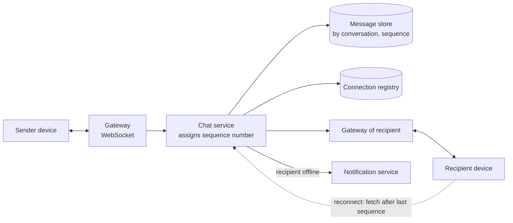

# Chat service

## Statement

**Tier:** Core · **Suggested time:** 45 min · **Topics:** WebSockets, ordering, delivery guarantees, presence

> Design a chat service that supports one-to-one and group conversations (up to 500 members), message history, online status and delivery and read receipts.

## Self-check questions

Answer these after your design, or in the debrief:

- How does a message get from sender to a recipient who is online, and to one who is offline?
- How do you keep messages in order inside a conversation, and how do you avoid duplicates after a retry?
- How many open connections must you hold at peak, and how many servers is that?
- A gateway server crashes with 100,000 connected users. What happens next?
- How is presence (online / last seen) kept cheap?

**Tools the agent can run to test your claims afterwards** (they live in `runner/tools/`; just ask): `runner/tools/estimate.py` for message and connection counts; `runner/tools/sim_queue.py` if asked about backlog after an outage.

## Interviewer notes

### Clarifying questions and answers

Give only what is asked, word for word.

| Question | Answer |
|---|---|
| Scale? | 50 million daily active users, 40 messages sent per user per day on average, peak concurrency about 20% of daily users. Messages average 500 bytes. |
| Latency? | Online delivery under 200 ms at p99 within a region. |
| History? | Kept for 5 years; users scroll back and search is out of scope. |
| Devices? | Several devices per user must stay in sync. |
| Media? | Files are uploaded to object storage and shared as references; the chat path carries references only. |
| Encryption? | Mention where end-to-end encryption would change the design, but do not design it. |

### Reference estimate

Computed from the assumptions in the `## Reference estimate` section by `runner/tools/estimate.py`.


| Quantity | Value |
|---|---|
| write QPS (average) | 23.1 K |
| read QPS (average) | 11.6 K |
| write QPS (peak) | 57.9 K |
| read QPS (peak) | 28.9 K |
| bytes written per day | 1 TB |
| total storage over the retention period | 5.47 PB |
| peak ingress | 28.9 MB/s |
| peak egress | 145 MB/s |
| cache size (upper bound) | 1 TB |
| app servers at the stated server_qps | 5 |

About 23K messages/s on average, 58K at peak; roughly 1 TB/day of messages, 5.5 PB over 5 years with 3 copies. Connections matter more than QPS: 20% of 50M is 10M simultaneous WebSockets; at about 100K connections per tuned gateway that is on the order of 100 gateways, plus headroom for failover.

### Reference design

- **Connection layer.** Stateful gateways terminate WebSocket connections (long polling as fallback). A connection registry (user and device to gateway) lives in a fast store with a TTL refreshed by heartbeats.
- **Send path.** Client sends `{conversation_id, client_msg_id, body}` over the socket. The chat service validates, assigns the next **per-conversation sequence number** (the conversation's partition is the single writer), persists the message, acknowledges to the sender, then delivers.
- **Delivery.** Look up members' gateways in the registry and push to online devices. For offline devices, rely on the stored message and send a push notification (see S6). On reconnect, the client asks for everything after its last sequence number per conversation. This makes delivery at-least-once and recovery simple.
- **Idempotency.** The client generates `client_msg_id`; the server dedupes on (conversation, client_msg_id), so retries after timeouts create no duplicates. The client also dedupes by sequence number.
- **Ordering.** Order within a conversation by sequence number; there is no global order and none is needed.
- **Storage.** Wide-column or sharded store partitioned by conversation ID, clustered by sequence number, so a history page is one contiguous read. Hot, very large group conversations may need sub-partitioning by time bucket.
- **Groups.** Membership is looked up at send time; for groups of 500, delivering to each member is cheap. Very large channels would use a pull model with unread counters.
- **Receipts.** Delivered and read are small events per (message, user) or, cheaper, a per-conversation 'read up to sequence N' pointer per user.
- **Presence.** Heartbeat extends a TTL entry; absence for the TTL means offline. Do not broadcast every change to all contacts: subscribe only to the contacts currently on screen, and batch updates.
- **Gateway failure.** Clients reconnect with exponential backoff and jitter to avoid a reconnect storm, then sync from their last sequence number; messages are safe because they were persisted before delivery.



### Deep-dive probes

| Probe | What a strong answer contains |
|---|---|
| How do you guarantee order and avoid duplicates? | Sequence per conversation from a single writer; client message IDs for idempotent retries; acknowledgements at three points (accepted by server, delivered to device, read); explains why exactly-once delivery is replaced by at-least-once plus dedupe. |
| What does a gateway failure look like, and how do you contain it? | Registry entries expire; clients reconnect with jittered backoff; the sync-from-sequence protocol closes any gap; capacity headroom so the survivors can absorb the displaced connections; may mention connection draining on deploy. |
| How do you store and query history at 1 TB/day? | Partition and clustering keys; the page-of-history query pattern; time-bucketing for hot conversations; tiering cold history; replication factor; why not a single relational database. |
| Design presence for 50M users without a write storm. | TTL heartbeats at a low frequency, subscription-based fan-out of presence changes, coalescing flapping, accepting a few seconds of staleness. |

### Failure injections

| Injection | Strong response |
|---|---|
| The message store is slow for 30 seconds. | Backpressure on the send path; the sender sees 'sending' and the client retries with the same client ID; queue in the chat service only if persistence is required before acknowledgement (it is). |
| Two members send at the same moment. | The single writer gives them an order; both clients converge on the server's order. |
| A user's phone is offline for a week. | Sync cursor; page through the backlog; push notification summarisation rather than one per message. |

### Common mistakes

- Delivers directly between gateways without persisting first.
- Claims exactly-once delivery.
- Orders by client timestamps.
- Broadcasts presence to everyone on every change.
- Forgets the reconnect storm.
- Uses polling for the main path at this scale.

### Level calibration

| Level | What the answer looks like |
|---|---|
| Mid-level | WebSocket gateway, message store, push to online users. |
| Senior (the target) | Sequence numbers, idempotent send, reconnect and sync protocol, quantified connection capacity, storage layout, presence design, failure handling. |
| Stretch | End-to-end encryption and multi-device key handling, very large channels, cross-region routing, message search. |

### Probe ladder

Use one rung at a time and record the highest rung reached; only the highest rung is deducted.

- P0 (free): a neutral question, for example: What happens when this component fails?
- P1 (-5): What do you do with a message for someone who is not connected right now?
- P2 (-10): How would a client know it missed something?
- P3 (-20): How many sockets is 20% of 50 million, and what holds them?
---

## Reference estimate

```json estimate
{"dau": 50000000.0, "writes_per_user_day": 40, "reads_per_user_day": 20, "bytes_per_write": 500, "bytes_per_read": 5000, "peak_factor": 2.5, "retention_years": 5, "replication": 3, "server_qps": 20000}
```
