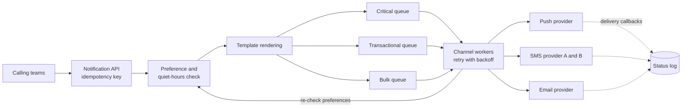

# Notification system

## Statement

**Tier:** Core · **Suggested time:** 40 min · **Topics:** queues, retries, priorities, third-party providers

> Design a platform that other teams use to send push notifications, SMS and email to users, respecting user preferences, with reliable delivery even when providers misbehave.

## Self-check questions

Answer these after your design, or in the debrief:

- How do you keep a marketing campaign from delaying a login code?
- A provider times out: do you retry, and how do you avoid sending twice?
- Where are user preferences checked, and what happens when they change during a campaign?
- How long does it take to drain a 5-million message campaign at the provider's rate limit?
- How do you know a notification was delivered?

**Tools the agent can run to test your claims afterwards** (they live in `runner/tools/`; just ask): `runner/tools/sim_queue.py` for backlog and drain time.

## Interviewer notes

### Clarifying questions and answers

Give only what is asked, word for word.

| Question | Answer |
|---|---|
| Volume? | 10 million notifications per day on average. A campaign can add 5 million within 5 minutes. |
| Channels? | Mobile push (through the platform vendors' services), SMS and email through third-party providers; each has its own rate limits and failure modes. |
| Priorities? | Critical (one-time codes, security alerts): delivered in under 10 seconds. Transactional: under a minute. Bulk or marketing: best effort within hours. |
| Rules? | Per-user opt-out per channel and category, quiet hours, a daily cap per user for marketing. |
| Guarantees? | No duplicates visible to users when avoidable; no lost critical notifications. |
| Reporting? | Callers can query the status of a notification: accepted, sent, delivered, failed. |

### Reference estimate

Computed from the assumptions in the `## Reference estimate` section by `runner/tools/estimate.py`.


| Quantity | Value |
|---|---|
| write QPS (average) | 116 |
| read QPS (average) | 57.9 |
| write QPS (peak) | 17.4 K |
| read QPS (peak) | 8.68 K |
| bytes written per day | 10 GB |
| total storage over the retention period | 2.74 TB |
| peak ingress | 17.4 MB/s |
| peak egress | 4.34 MB/s |
| cache size (upper bound) | 500 MB |
| app servers at the stated server_qps | 14 |

Average 116 notifications/s but the burst is 5M in 5 minutes, about 16.7K/s, a peak factor above 100. The queue absorbs the burst; the real limit is the provider's rate. With a provider limit of 2,000 messages/s, the campaign needs 2,500 s (about 42 minutes) to drain regardless of how many workers you add.

### Reference design

- **API.** `POST /v1/notifications {recipient, channel or 'auto', template_id, params, priority, idempotency_key, send_at?}` returns `202 Accepted {id}`. Callers get a status endpoint and optional webhooks.
- **Pipeline.** Ingest, validate, check idempotency key, resolve the recipient's preferences and quiet hours, render the template (localised), then enqueue per channel and per priority. Workers call provider adapters.
- **Separate queues by priority.** Critical, transactional and bulk use separate queues and separate worker pools, so a campaign cannot cause head-of-line blocking for one-time codes.
- **Reliability.** At-least-once delivery from the queue plus an idempotency key per notification and channel; workers record the attempt before and after calling the provider. Retries with exponential backoff and jitter; poison messages go to a dead-letter queue. Circuit breaker per provider with failover to a second provider for SMS and email.
- **Preferences.** A fast read-only view of opt-outs; checked at send time (not only at enqueue) so a user who opts out during a campaign is respected. Transactional or legal messages may bypass marketing preferences.
- **Rate limiting.** Outbound limits per provider and per tenant; per-user caps; the bulk queue drains at the allowed rate.
- **Campaigns.** A job expands a segment into batches and feeds the bulk queue; progress is resumable.
- **Status.** Providers report delivery by callbacks; a webhook receiver is idempotent and updates an append-only status log. Open and click tracking is optional and asynchronous.
- **Scheduling.** Delayed notifications are stored with `send_at` and released by a scheduler (see S13).



### Deep-dive probes

| Probe | What a strong answer contains |
|---|---|
| Can you promise exactly-once? | No: a timeout after the provider accepted the request leaves the outcome unknown. Offers at-least-once with idempotency keys on the platform side and provider-side dedupe tokens where they exist; explains the residual duplicate risk and who owns it. |
| How do you isolate critical notifications? | Separate queues, separate workers and separate provider quotas; reserved capacity; load-shedding rules that drop bulk first. |
| Size the campaign drain time. | Backlog divided by the bottleneck rate; connects to the queueing arithmetic (drain time is backlog over service rate minus arrival rate); may suggest throttling the campaign rather than flooding the queue. |
| A provider is returning errors for 30% of calls. | Circuit breaker, failover to the second provider, cost and sender-reputation implications of switching, replay of the failed backlog. |

### Failure injections

| Injection | Strong response |
|---|---|
| The preference service is down. | Fail closed for marketing (do not send), fail open for critical security messages, with caching of the last known state. |
| The same request is posted three times by a retrying caller. | Idempotency key returns the original ID and sends once. |
| A bug sends the wrong template to 100K users. | Kill switch on the campaign and queue purge by campaign ID; audit trail; this argues for per-campaign queues or tags. |

### Common mistakes

- One shared queue for everything.
- Retries without idempotency, so users get 5 identical SMS messages.
- Checks preferences only when the request arrives.
- No plan for provider rate limits or failover.
- Synchronous API that waits for the provider.
- No way to see what happened to a notification.

### Level calibration

| Level | What the answer looks like |
|---|---|
| Mid-level | Queue, workers, provider calls, retries. |
| Senior (the target) | Priority isolation, idempotency story, preference timing, provider failover and rate limits, campaign drain arithmetic, status callbacks. |
| Stretch | Cost optimisation across providers, regional compliance, per-user notification batching and digesting. |

### Probe ladder

Use one rung at a time and record the highest rung reached; only the highest rung is deducted.

- P0 (free): a neutral question, for example: What happens when this component fails?
- P1 (-5): What shares a queue with the login code in your design?
- P2 (-10): What does your worker do between calling the provider and recording the result, if it crashes?
- P3 (-20): At the provider's rate limit, how long does the campaign take?

## Reference estimate

```json estimate
{"dau": 10000000.0, "writes_per_user_day": 1, "reads_per_user_day": 0.5, "bytes_per_write": 1000, "bytes_per_read": 500, "peak_factor": 150, "retention_years": 0.25, "replication": 3, "server_qps": 2000}
```
