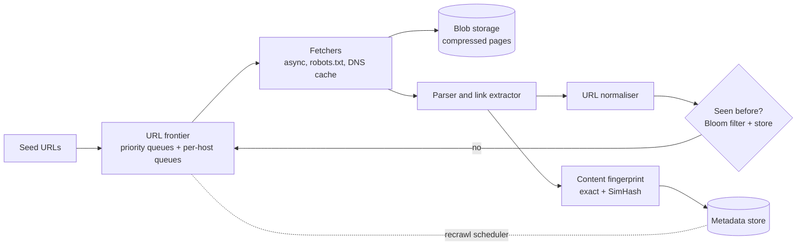

# Web crawler

## Statement

**Tier:** Core · **Suggested time:** 40 min · **Topics:** queues, deduplication, politeness, large-scale batch

> Design a web crawler that collects one billion pages per month to feed a search index, without hurting the sites it visits.

## Self-check questions

Answer these after your design, or in the debrief:

- What is the URL frontier and how does it enforce politeness and priority at the same time?
- How do you know you have seen a URL or a page before, at billions of items?
- How do you escape an infinite calendar or session-ID trap?
- How do you decide when to revisit a page?
- How does the system recover after a crash without starting over?

**Tools the agent can run to test your claims afterwards** (they live in `runner/tools/`; just ask): `runner/tools/estimate.py` for fetch rate and storage; the Bloom filter arithmetic is in the calculation note under this problem.

## Interviewer notes

### Clarifying questions and answers

Give only what is asked, word for word.

| Question | Answer |
|---|---|
| Scope? | HTML pages first. Images and JavaScript rendering are out of scope unless time permits. |
| Scale? | 1 billion pages per month, average 100 KB uncompressed, stored compressed for a year. |
| Politeness? | Respect robots.txt and a per-host rate (default one request per second per host, slower if the site responds slowly). |
| Freshness? | News sites hourly, most pages monthly, stable pages less often; pages must be revisited by priority. |
| Duplicates? | Avoid refetching the same URL and avoid storing near-identical content. |
| Output? | Raw pages and metadata for the indexer to consume. |
| How many distinct URLs does the crawler know about? | Assume about 5 billion discovered over the first year; it fetches only a subset. |

### Reference estimate

Computed from the assumptions in the `## Reference estimate` section by `runner/tools/estimate.py`.


| Quantity | Value |
|---|---|
| write QPS (average) | 385 |
| read QPS (average) | 385 |
| write QPS (peak) | 578 |
| read QPS (peak) | 578 |
| bytes written per day | 3.33 TB |
| total storage over the retention period | 3.65 PB |
| peak ingress | 57.8 MB/s |
| peak egress | 57.8 MB/s |
| cache size (upper bound) | 666 GB |
| app servers at the stated server_qps | 5 |

Here 'users' are pages per day: 33M fetches/day is 385 pages/s on average. Raw volume is 3.3 TB/day (about 1 PB/year before compression; compressed text is typically several times smaller). Each fetcher doing 50 concurrent fetches at about 200 ms each sustains 250 pages/s, so 3 to 6 fetcher machines cover the average and peak rates with headroom (the estimate's server count uses 250 pages/s per fetcher). Network bandwidth (385 x 100 KB, about 40 MB/s, 300 Mb/s) is modest.

*Calculation.* Bloom filter bits per element for false-positive rate p: m/n = -ln(p) / (ln 2)^2. For n = 5 billion URLs and p = 1%: 9.59 bits per URL, which is 6.0 GB.

### Reference design

- **Pipeline.** Seed URLs enter the frontier. Fetchers download pages, a parser extracts text and links, links are normalised and filtered through the seen-set, new URLs go back into the frontier, pages go to blob storage.
- **URL frontier (the heart).** Two layers: front queues order URLs by priority (page importance, expected change rate); back queues hold URLs for exactly one host each, and a heap of 'next allowed time per host' picks which back queue a fetcher may use. This gives priority and per-host politeness together.
- **Partitioning.** Assign hosts to crawler nodes by hash of the host name. One node owns a host, so politeness is a local decision with no coordination; add nodes with consistent hashing.
- **robots.txt and DNS.** Cache robots.txt per host with a TTL; cache DNS results; resolve asynchronously because DNS can dominate fetch time.
- **Seen-set.** The crawl discovers many more URLs than it fetches; assume about 5 billion distinct known URLs after the first year. A Bloom filter at about 10 bits per URL is roughly 6 GB for a 1% false positive rate (see the calculation note under this problem); false positives mean a few new URLs are skipped, which is acceptable. Exact checks use a sharded key-value store of URL hashes.
- **Content dedupe.** Exact: checksum of normalised content. Near-duplicate: SimHash or shingling. Store only one copy and link the URLs.
- **Traps.** Limits on URL length and depth, per-host page budgets, detection of repeating path patterns, parameter normalisation (drop session IDs, sort query parameters).
- **Recrawl policy.** Estimate each page's change rate from past fetches and schedule by priority; use conditional requests (`If-Modified-Since`, ETag) to save bandwidth.
- **Failure.** The frontier and seen-set are persisted (log-structured or in a replicated store); fetchers are stateless; a crashed node's hosts are reassigned and its in-flight URLs time out and return to their queues.



### Deep-dive probes

| Probe | What a strong answer contains |
|---|---|
| Describe the frontier so that one host is never hit twice in a second, but all fetchers stay busy. | Back queues per host plus a time-ordered heap of next-allowed times; fetcher takes the earliest eligible host; priority decides which URLs move from front to back queues; hosts hashed to nodes. |
| Size the seen-set. | States the item count, the bits per item for a target false-positive rate, and the effect of false positives on coverage; mentions the exact store alternative and its size (hashes of 8 to 16 bytes times billions). |
| How do you detect duplicates and traps? | Normalisation, content fingerprints, near-duplicate detection, budgets per host; recognises that traps are heuristics and need monitoring. |
| How do you set revisit frequency? | Adaptive: shorten the interval when the page changed since last time, lengthen when not; combine with importance; bound by the fetch budget. |

### Failure injections

| Injection | Strong response |
|---|---|
| A site starts returning 503s. | Back off per host (exponential), reduce rate, retry later; do not hammer; the per-host queue isolates the problem. |
| A node dies with 2 million URLs in memory. | URLs were persisted before assignment; in-flight work returns on timeout; reassign hosts. |
| The crawler finds 50 million URLs on one host. | Per-host budget and priority limit; the rest wait. |

### Common mistakes

- A single global FIFO queue (no politeness, no priority).
- Forgets robots.txt and DNS.
- Stores the seen-set in memory on one machine with no sizing.
- No story for traps or duplicates.
- Hashes URLs to nodes, so one host is hit by many nodes at once.
- Ignores recrawling entirely.

### Level calibration

| Level | What the answer looks like |
|---|---|
| Mid-level | Fetch loop with a queue and a seen-set. |
| Senior (the target) | Frontier with priority and politeness, host-based partitioning, Bloom filter sizing, content dedupe, trap handling, adaptive recrawl, recovery. |
| Stretch | JavaScript rendering, distributed DNS, link-graph based prioritisation, legal and ethical constraints. |

### Probe ladder

Use one rung at a time and record the highest rung reached; only the highest rung is deducted.

- P0 (free): a neutral question, for example: What happens when this component fails?
- P1 (-5): What stops ten of your fetchers from asking the same site for pages at the same moment?
- P2 (-10): How many URLs will you have seen, and how much memory does a plain set of them need?
- P3 (-20): What do you do when a site generates infinite URLs?

## Reference estimate

```json estimate
{"dau": 33300000.0, "writes_per_user_day": 1, "reads_per_user_day": 1, "bytes_per_write": 100000, "bytes_per_read": 100000, "peak_factor": 1.5, "retention_years": 1, "replication": 3, "server_qps": 250}
```
