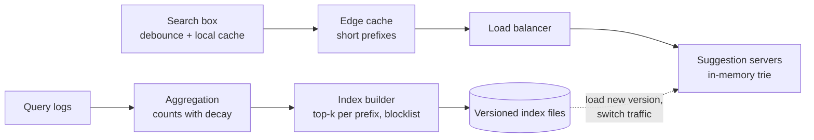

# Search autocomplete (typeahead)

## Statement

**Tier:** Core · **Suggested time:** 35 min · **Topics:** tries, top-k, latency, data pipeline

> Design the suggestion box of a search engine: as a user types, show the five most likely completions of what they have typed so far.

## Self-check questions

Answer these after your design, or in the debrief:

- What data structure answers 'top 5 completions of this prefix' fastest, and what do you store at each node?
- How do the suggestions get fresh as new queries become popular?
- How many requests per second reach the service, and how do you reduce them before they reach your servers?
- How do you split the data over machines without one hot shard for the letter 's'?
- How do you roll out a new version of the index safely?

**Tools the agent can run to test your claims afterwards** (they live in `runner/tools/`; just ask): `runner/tools/sim_cache.py` for the edge cache hit ratio.

## Interviewer notes

### Clarifying questions and answers

Give only what is asked, word for word.

| Question | Answer |
|---|---|
| Scale? | 100 million daily users, 10 searches per user per day, about 5 suggestion requests per search after client debounce. |
| Latency? | Under 100 ms end to end; the server part under 20 ms. |
| Freshness? | Suggestions reflect query logs with a delay of about an hour. Real-time trending is a follow-up. |
| Ranking? | By popularity (frequency) with recency weighting. Personalisation is a follow-up. |
| Content rules? | Offensive and legally removed queries must not be suggested. |
| Languages? | English first; mention what changes for other scripts. |

### Reference estimate

Computed from the assumptions in the `## Reference estimate` section by `runner/tools/estimate.py`.


| Quantity | Value |
|---|---|
| write QPS (average) | 11.6 K |
| read QPS (average) | 57.9 K |
| write QPS (peak) | 23.1 K |
| read QPS (peak) | 116 K |
| bytes written per day | 100 GB |
| total storage over the retention period | 10.9 TB |
| peak ingress | 2.31 MB/s |
| peak egress | 34.7 MB/s |
| cache size (upper bound) | 300 GB |
| app servers at the stated server_qps | 7 |

Reads: 100M x 50 = 5 billion suggestion requests/day, 58K/s average, 116K/s at peak. Each node serving from memory can handle tens of thousands of requests per second, so single-digit replicas per shard suffice. Query logs: 1 billion searches/day of 100 bytes is 100 GB/day of raw log.

### Reference design

- **Offline/online split.** Suggestions are *precomputed*. Query logs flow to a stream or batch aggregation that counts queries per period (with time decay); a build job produces an index; the online service only reads it.
- **Index structure.** A trie where every node stores the top-k (k=5 to 10) completions for its prefix, so a lookup walks the prefix and returns the stored list: O(length of prefix). Alternative: a hash map from prefix to top-k list, only for prefixes of queries above a count threshold. Trade-off: memory for lookup speed.
- **Size.** 100 million distinct frequent queries of about 25 bytes is 2.5 GB of strings; the prefix lists multiply that, on the order of tens of GB: fits in memory on a handful of machines.
- **Serving.** Replicated in-memory index nodes behind a load balancer. Short prefixes (1 to 3 characters) are hot and extremely cacheable: cache them at the CDN or edge with a TTL of minutes.
- **Client side.** Debounce keystrokes (wait about 100 to 200 ms), cancel in-flight requests, cache results for prefixes already typed, send only after a minimum length.
- **Sharding.** Shard by a hash of a prefix of fixed length (or range-split with measured load), not by the first letter alone, which makes 's' much hotter than 'x'. With a fully replicated in-memory index (it fits), skip sharding and replicate instead.
- **Fresh data.** Rebuild hourly; for trending, add a small separate real-time component (count-min sketch over a short window) merged at query time.
- **Deployment.** Build a new immutable index version, load it on a standby set, switch traffic atomically, keep the previous version for rollback.
- **Filtering.** A blocklist applied at build time and a runtime filter for emergency removals.



### Deep-dive probes

| Probe | What a strong answer contains |
|---|---|
| Where do you store the top-k, and why not compute it per request? | Precomputed per prefix node; computing by traversing all descendants is too slow for a 20 ms budget; discusses memory cost and the update path (rebuild vs incremental). |
| How do you cut request volume 10x? | Client debounce and caching, edge caching of short prefixes with skewed popularity (use `runner/tools/sim_cache.py`), longer minimum prefix, cancel stale requests. |
| How do you add trending queries? | A small streaming counter (windowed counts or count-min sketch) feeding a second, tiny index merged at read time; bounded memory; tolerates approximation. |
| How do you shard, and what goes wrong with first-letter sharding? | Skew; propose hash-of-prefix or measured ranges; or avoid sharding since the index fits in memory and replicate for QPS. |

### Failure injections

| Injection | Strong response |
|---|---|
| A bad index build is deployed. | Versioned indexes with validation (size, sample queries, regression of top suggestions) and instant rollback. |
| A breaking-news term spikes 1000x in 10 minutes. | The hourly build misses it; the trending component picks it up; or shorten the build interval for the head of the distribution. |
| An offensive suggestion is reported. | Runtime blocklist applies within seconds; fix the pipeline so it does not reappear. |

### Common mistakes

- Queries a database with `LIKE 'prefix%'`.
- Computes top-k at request time.
- No client-side optimisation.
- Shards by first letter.
- Ignores the pipeline that keeps the index fresh.
- No deployment or rollback story for the index.

### Level calibration

| Level | What the answer looks like |
|---|---|
| Mid-level | A trie with top-k, served from a few servers. |
| Senior (the target) | Precomputed top-k, memory sizing, edge caching with a hit-ratio argument, debounce, safe index rollout, trending component. |
| Stretch | Personalisation, typo tolerance, multilingual input, learning-to-rank. |

### Probe ladder

Use one rung at a time and record the highest rung reached; only the highest rung is deducted.

- P0 (free): a neutral question, for example: What happens when this component fails?
- P1 (-5): What must be true about the answer to be returned in under 20 ms?
- P2 (-10): Which prefixes get most of the traffic?
- P3 (-20): How does a query typed today ever become a suggestion?

## Reference estimate

```json estimate
{"dau": 100000000.0, "writes_per_user_day": 10, "reads_per_user_day": 50, "bytes_per_write": 100, "bytes_per_read": 300, "peak_factor": 2, "retention_years": 0.1, "replication": 3, "server_qps": 20000}
```
