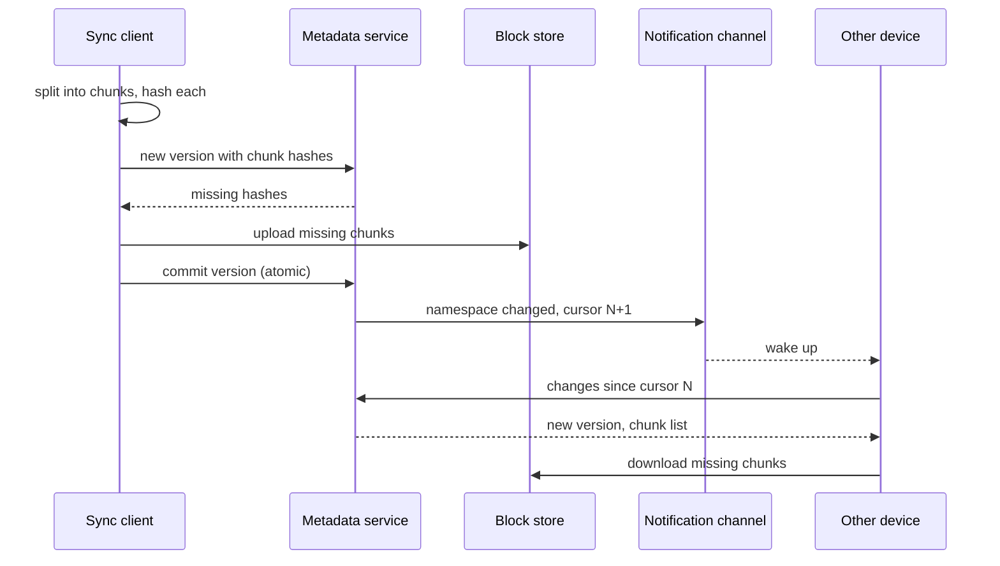

# File storage and sync

## Statement

**Tier:** Senior · **Suggested time:** 45 min · **Topics:** chunking, deduplication, metadata consistency, sync protocol

> Design a cloud file storage service where users keep folders in sync across their laptops and phones and can share folders with others.

## Self-check questions

Answer these after your design, or in the debrief:

- Why split files into chunks, and how big should a chunk be?
- How does a client know what to upload and what to download?
- Two devices edit the same file offline. What does the user see afterwards?
- How do you delete a chunk that is no longer used, safely?
- What does the metadata store need to guarantee that the blob store does not?

**Tools the agent can run to test your claims afterwards** (they live in `runner/tools/`; just ask): `runner/tools/estimate.py` for storage and bandwidth.

## Interviewer notes

### Clarifying questions and answers

Give only what is asked, word for word.

| Question | Answer |
|---|---|
| Scale? | 100 million registered users, 20 million daily active; each active user uploads about 5 changed files per day (average 1 MB of changed data) and syncs 10 files per day. |
| File size? | Up to 10 GB per file; most are small documents and photos. |
| Sync latency? | A change appears on the user's other online devices within 10 seconds. |
| Offline? | Devices edit offline and reconcile when back online. |
| Versions? | Keep 30 days of history per file. |
| Sharing? | Share folders with view or edit permission. End-to-end encryption is out of scope. |

### Reference estimate

Computed from the assumptions in the `## Reference estimate` section by `runner/tools/estimate.py`.


| Quantity | Value |
|---|---|
| write QPS (average) | 1.16 K |
| read QPS (average) | 2.31 K |
| write QPS (peak) | 3.47 K |
| read QPS (peak) | 6.94 K |
| bytes written per day | 100 TB |
| total storage over the retention period | 27.4 PB |
| peak ingress | 3.47 GB/s |
| peak egress | 6.94 GB/s |
| cache size (upper bound) | 40 TB |
| app servers at the stated server_qps | 6 |

About 1.2K uploads/s and 2.3K downloads/s on average, with a peak factor of 3. 100 TB/day of uploaded chunks, of which only about 10% is new data after delta sync and chunk-level deduplication (`new_data_fraction`), which gives roughly 27 PB after 5 years. Replication 1.5 stands for erasure coding (for example 6 data plus 3 parity pieces) instead of 3 full copies. Tens of petabytes means the blob store, not the metadata, drives the cost.

### Reference design

- **Client.** A sync agent watches the filesystem, splits changed files into chunks (about 4 MB fixed, or content-defined chunking using a rolling hash so an insertion in the middle changes only nearby chunks), and hashes each chunk (SHA-256).
- **Upload protocol.** (1) Client sends the list of chunk hashes for the new version to the metadata service. (2) The service answers with the hashes it does not already have. (3) Client uploads only those chunks directly to the blob store with pre-signed, resumable requests. (4) Client commits the file version (the ordered list of hashes) in one atomic metadata transaction.
- **Block store.** Content-addressed: the key is the chunk hash, so identical chunks are stored once (cross-file, and optionally cross-user). Erasure-coded across failure domains. Reference counts or mark-and-sweep garbage collection reclaim chunks no version references, with a safety delay.
- **Metadata store.** Relational and strongly consistent, sharded by user or by shared namespace: file tree, versions, permissions, and a per-namespace change journal with a monotonically increasing cursor.
- **Change notification.** Clients hold a long-poll or WebSocket per device; on notification they call `changes?cursor=N`, receive entries after N, and fetch missing chunks. The cursor makes missed notifications harmless.
- **Conflicts.** Commit carries the base version. If the server's current version differs, the commit is rejected and the client creates a 'conflicted copy' next to the file rather than overwriting silently.
- **Sharing.** A shared folder is its own namespace with an ACL; members' journals include it.
- **Privacy detail.** Cross-user deduplication can leak whether someone already holds a file (a hash probe); restrict it to a user's own data or require proof of possession.
- **Large files.** Resumable multipart uploads; chunk-level retry; only changed chunks are re-sent.



### Deep-dive probes

| Probe | What a strong answer contains |
|---|---|
| Fixed or content-defined chunks? | Fixed is simple and fast; an insertion shifts all later chunks so everything after it re-uploads. Content-defined chunking keeps boundaries stable; costs more CPU and has variable sizes. Chunk size trade-off: small means more metadata and requests, large means worse deduplication and larger re-uploads. |
| What must the metadata commit guarantee? | Atomicity (a version references only chunks that exist), optimistic concurrency on the base version, and a journal entry visible to other devices in order; hence a transactional store per namespace. |
| How do you garbage-collect chunks? | Reference counting with delayed deletion or periodic mark and sweep from live versions; danger: deleting a chunk that a concurrent upload is about to reference, so use a grace period and re-check at commit. |
| How do you keep about 27 PB durable and cheap? | Erasure coding versus replication, tiering cold versions to cheaper storage, background scrubbing and repair. |

### Failure injections

| Injection | Strong response |
|---|---|
| The client crashes in the middle of a 5 GB upload. | Resumable upload: chunks already stored are skipped on retry because the server answers with missing hashes. |
| Two laptops rename the same folder differently. | Journal order decides; the loser sees its change rebased or as a conflict entry; no silent loss. |
| The notification channel is down. | Clients poll the changes endpoint on an interval as a fallback. |

### Common mistakes

- Uploads whole files through the application servers.
- No chunking or no deduplication story.
- Last-writer-wins without conflict copies.
- Mixes blob and metadata concerns in one store.
- Forgets garbage collection.
- Notifications as the only sync mechanism (no cursor).

### Level calibration

| Level | What the answer looks like |
|---|---|
| Mid-level | Upload to blob storage, metadata in a database, download on demand. |
| Senior (the target) | Chunking, content-addressed storage, upload negotiation, transactional metadata commit, cursor-based sync, conflict handling, garbage collection, erasure coding. |
| Stretch | Selective sync, real-time co-editing, end-to-end encryption with deduplication, regional residency. |

### Probe ladder

Use one rung at a time and record the highest rung reached; only the highest rung is deducted.

- P0 (free): a neutral question, for example: What happens when this component fails?
- P1 (-5): What if the user only changed one paragraph of a 2 GB file?
- P2 (-10): How does a second laptop find out about a change it was offline for?
- P3 (-20): What stops a half-finished upload from showing up as a file?

## Reference estimate

```json estimate
{"dau": 20000000.0, "writes_per_user_day": 5, "reads_per_user_day": 10, "bytes_per_write": 1000000.0, "bytes_per_read": 1000000.0, "peak_factor": 3, "retention_years": 5, "replication": 1.5, "new_data_fraction": 0.1, "server_qps": 2000}
```
