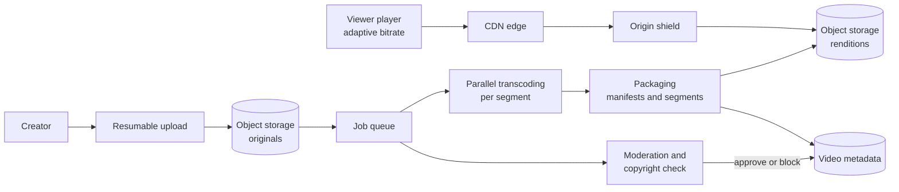

# Video streaming platform

## Statement

**Tier:** Senior · **Suggested time:** 45 min · **Topics:** media pipeline, CDN, adaptive bitrate, cost

> Design a video sharing platform where creators upload videos and viewers around the world watch them.

## Self-check questions

Answer these after your design, or in the debrief:

- What happens between the moment a creator finishes uploading and the moment a viewer can watch?
- Why do viewers get video in small segments at several qualities?
- What fraction of traffic must the CDN serve, and what is the origin protected from?
- How do you keep one slow transcode from blocking the others?
- Where does the cost go, and what do you do about it?

**Tools the agent can run to test your claims afterwards** (they live in `runner/tools/`; just ask): `runner/tools/estimate.py` for egress and storage.

## Interviewer notes

### Clarifying questions and answers

Give only what is asked, word for word.

| Question | Answer |
|---|---|
| Scale? | 100 million daily viewers, 5 video starts each; 1 million uploads per day averaging 300 MB. |
| Playback? | Starts in under 2 seconds, adapts to network speed, works on phones and TVs. |
| Processing? | A typical upload is watchable within 10 minutes of finishing. |
| Content rules? | Copyright and abuse checks happen before publication. |
| Out of scope? | Recommendations, comments, ads, live streaming (mention what changes). |

### Reference estimate

Computed from the assumptions in the `## Reference estimate` section by `runner/tools/estimate.py`.


| Quantity | Value |
|---|---|
| write QPS (average) | 11.6 |
| read QPS (average) | 5.79 K |
| write QPS (peak) | 23.1 |
| read QPS (peak) | 11.6 K |
| bytes written per day | 600 TB |
| total storage over the retention period | 1.64 EB |
| peak ingress | 13.9 GB/s |
| peak egress | 1.27 TB/s |
| cache size (upper bound) | 11 PB |
| app servers at the stated server_qps | 3 |

Writes: 1M uploads/day is 12 per second; each stored as 300 MB original plus about 300 MB of transcoded renditions (`bytes_per_write` = 600 MB). Reads: 5.8K video starts/s on average; if a view averages 5 minutes at 3 Mbit/s that is about 110 MB, so peak egress is on the order of 1.3 TB/s (10 Tbit/s): no origin could serve that, which is the entire argument for a CDN. Storage over 5 years comes out near 1.6 EB, which is why tiering and not pre-generating every rendition for unpopular videos matter.

### Reference design

- **Upload.** Client gets a pre-signed URL and uploads in resumable parts straight to object storage. An 'upload complete' event creates a processing job.
- **Processing pipeline (a DAG).** Validate and probe the file; split into time segments; transcode segments in parallel on a worker fleet into a ladder of resolutions and bitrates (for example 240p to 4K); extract thumbnails; run moderation and copyright fingerprinting; package into adaptive-streaming formats (HLS or DASH segments plus manifests); mark published. Jobs are idempotent and retried per segment.
- **Metadata.** A video record (id, owner, title, status, available renditions) in a sharded relational or key-value store; search and recommendations live elsewhere.
- **Playback.** The player fetches a manifest listing the renditions; **adaptive bitrate** logic picks the next segment's quality from measured throughput and buffer level, so playback continues when the network degrades.
- **CDN.** Segments are static, immutable and cacheable. Edge caches serve most requests; a mid-tier or 'origin shield' collapses misses so the origin sees each segment rarely. Popular new videos can be pre-warmed; the long tail is pulled on demand.
- **Storage tiers.** Keep originals in cheaper storage; hot renditions in standard storage; evict rarely watched high-bitrate renditions and regenerate on demand if needed.
- **Counters.** View counts and watch time are events aggregated by a stream job, not synchronous database increments.
- **Live (follow-up).** Ingest over a low-latency protocol, transcode continuously into short segments, tolerate a few seconds of latency; the CDN path is the same.



### Deep-dive probes

| Probe | What a strong answer contains |
|---|---|
| Why segment-based parallel transcoding? | A two-hour video transcodes in minutes when split into independent segments across many workers; failures retry per segment; the pipeline is a DAG with idempotent steps; cost of splitting (keyframe alignment) is small. |
| Explain adaptive bitrate streaming. | Client-driven; manifest with multiple renditions; segments of a few seconds; switch quality at segment boundaries; trade-off between segment length (latency, request count) and adaptation speed. |
| Where is the money, and how do you lower it? | Egress dominates, then storage and transcoding. Levers: CDN hit ratio and shielding, better codecs for popular videos (extra encoding effort pays off when views are high), tiered storage, not pre-generating every rendition for unpopular videos. |
| What happens when a video goes viral in the first minute? | Pre-warm or fast-propagate to edges, request collapsing at the shield, origin protected by rate limits; metadata and counters absorb spikes via caching and async aggregation. |

### Failure injections

| Injection | Strong response |
|---|---|
| The transcoding fleet is overloaded. | Queue grows; prioritise by creator tier and length; short videos first; autoscale; communicate 'processing' state to the creator. |
| A CDN region fails. | Traffic shifts to other regions with lower hit ratio for a while; shield protects the origin; capacity planning must allow for that. |
| A rendition is corrupted. | Checksums on segments; regenerate from the original; the player falls back to another rendition. |

### Common mistakes

- Serves video from application servers.
- Transcodes a whole file on one machine.
- One quality only (no adaptive bitrate).
- Forgets the origin shield, so a viral video melts the origin.
- Stores view counts with synchronous increments.
- No cost reasoning.

### Level calibration

| Level | What the answer looks like |
|---|---|
| Mid-level | Upload, transcode, serve through a CDN. |
| Senior (the target) | Pipeline as a DAG with parallel segments, adaptive bitrate, CDN hierarchy, storage tiers, event-based counters, cost levers, failure handling. |
| Stretch | Live streaming, DRM, per-title encoding, global traffic steering. |

### Probe ladder

Use one rung at a time and record the highest rung reached; only the highest rung is deducted.

- P0 (free): a neutral question, for example: What happens when this component fails?
- P1 (-5): Who serves the bytes to 10 Tbit/s of viewers?
- P2 (-10): What if the video is 2 hours long: does one machine process it?
- P3 (-20): What does the player do when the connection gets worse mid-video?

## Reference estimate

```json estimate
{"dau": 100000000.0, "writes_per_user_day": 0.01, "reads_per_user_day": 5, "bytes_per_write": 600000000.0, "bytes_per_read": 110000000.0, "peak_factor": 2, "retention_years": 5, "replication": 1.5, "server_qps": 5000}
```
