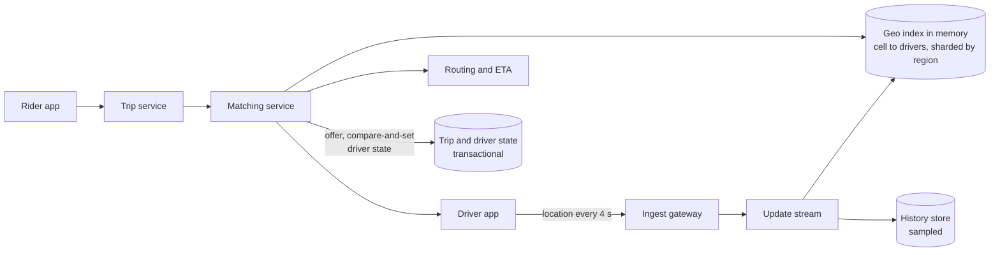

# Ride hailing and nearby search

## Statement

**Tier:** Senior · **Suggested time:** 45 min · **Topics:** geospatial index, real-time location, matching, state machines

> Design the backend that matches riders with nearby drivers in real time: drivers continuously report their location, riders request a ride, and the system assigns exactly one driver.

## Self-check questions

Answer these after your design, or in the debrief:

- How do you find the drivers near a point without comparing against every driver?
- Where do you keep 250,000 location updates per second, and do you need to store them durably?
- How do you make sure two riders never get the same driver?
- A rider is at the edge between two index cells or two shards. What do you query?
- What does the trip state machine look like, and who owns each transition?

**Tools the agent can run to test your claims afterwards** (they live in `runner/tools/`; just ask): `runner/tools/estimate.py` for update rate; `runner/tools/sim_booking.py` for the atomic-assignment idea.

## Interviewer notes

### Clarifying questions and answers

Give only what is asked, word for word.

| Question | Answer |
|---|---|
| Scale? | 1 million drivers online at peak, sending a location every 4 seconds; 20 million trips per day, 3x peak-to-average. |
| Matching latency? | A driver is offered within 5 seconds of the request; driver positions are at most 5 seconds stale. |
| Matching rule? | Closest by estimated pickup time among available drivers; offer to one driver at a time with a 10-second timeout. |
| Out of scope? | Routing engine, pricing and payments (treat as black boxes), though surge pricing may come up as a follow-up. |
| Regions? | Many cities; a trip never crosses regions. |

### Reference estimate

Computed from the assumptions in the `## Reference estimate` section by `runner/tools/estimate.py`.


| Quantity | Value |
|---|---|
| write QPS (average) | 125 K |
| read QPS (average) | 694 |
| write QPS (peak) | 250 K |
| read QPS (peak) | 1.39 K |
| bytes written per day | 1.08 TB |
| total storage over the retention period | 59.1 TB |
| peak ingress | 25 MB/s |
| peak egress | 694 KB/s |
| cache size (upper bound) | 6 GB |
| app servers at the stated server_qps | 13 |

3M drivers online about 4 hours a day each, one update every 4 seconds, gives 125K location updates/s on average and 250K/s at peak. Updates only need the latest position in memory (100 bytes x 1M drivers = 100 MB of live state per global peak); history is optional and is the part that costs storage (`new_data_fraction` keeps the sampled history small).

### Reference design

- **Location ingestion.** Drivers send updates through persistent connections (or a lightweight protocol) to ingest gateways, which publish to a partitioned stream. Updates are not transactional: the next one arrives in 4 seconds.
- **Geo index.** Divide the world into cells (geohash, S2 or hexagonal cells) at a fixed resolution; keep `cell -> set of available drivers` in memory, sharded by cell range or by city. An update moves a driver from the old cell to the new one. A nearby query reads the rider's cell and the surrounding ring, expanding if there are too few results; boundary queries are handled by always including neighbouring cells, across shard boundaries too.
- **Why not a database with a spatial index?** At 250K writes/s of ephemeral data an in-memory structure is simpler and faster; the durable store receives only a downsampled history for analytics and disputes.
- **Adaptive resolution.** Dense areas (airports, stadiums) overload one cell; use a quadtree-like subdivision or smaller cells there.
- **Matching service.** Takes the candidates, ranks by estimated pickup time (a routing service gives ETAs), then offers to one driver at a time. **Assignment must be atomic**: marking the driver 'offered to trip T' is a compare-and-set on the driver's state (available to offered), so two concurrent matchers cannot claim the same driver (the same issue as `runner/tools/sim_booking.py`).
- **Trip state machine.** requested, driver offered, accepted, arrived, in progress, completed or cancelled; every transition is a conditional update in a transactional store keyed by trip ID, and each is idempotent so retries are safe.
- **Sharding by region.** Each city or region has its own index, matcher and trip store; traffic and failures are contained.
- **Failure.** If an index shard dies, drivers reappear within one update interval (about 4 seconds) because they keep sending; no data migration is needed.



### Deep-dive probes

| Probe | What a strong answer contains |
|---|---|
| Geohash, quadtree, S2 or H3? | Compares uniform cells (simple, neighbour lookup, uneven density) with adaptive trees (balanced load, more complex updates); mentions the edge cases of cell boundaries and the poles/antimeridian only if relevant. |
| How do you avoid assigning one driver twice? | Atomic state transition with compare-and-set; offers have expiry; the trip store is the source of truth, not the in-memory index; retries are idempotent. |
| Size the location pipeline. | Updates per second, bytes per update, memory per driver, partitions in the stream, why the index can be rebuilt from the stream or the next heartbeat. |
| How do you handle a hot area? | Finer cells there, more shards for that region, rate-limit rider requests, batch matching in short windows so a global best assignment replaces greedy per-request matching. |

### Failure injections

| Injection | Strong response |
|---|---|
| A matching service instance crashes after offering to a driver. | Offer has an expiry; a sweeper returns the driver to available and the trip to requested; the rider's request is retried. |
| Network partition: a driver app sends updates to a stale shard. | Region routing is by cell ownership with a versioned map; the gateway re-resolves; updates carry timestamps and old ones are dropped. |
| GPS jumps (a driver teleports 5 km). | Server-side sanity filtering by speed and accuracy. |

### Common mistakes

- Stores live locations in a relational table and queries with a distance function.
- Scans all drivers per request.
- No atomic assignment (double-booking).
- Handles only the rider's own cell.
- Persists every location update synchronously.
- Single global index for the whole world.

### Level calibration

| Level | What the answer looks like |
|---|---|
| Mid-level | Geohash cells, query neighbours, assign nearest driver. |
| Senior (the target) | In-memory sharded index with sizing, boundary and density handling, atomic assignment and idempotent state machine, regional isolation, recovery by heartbeat. |
| Stretch | Batch matching, pooled rides, dynamic pricing, ETA accuracy, fraud detection. |

### Probe ladder

Use one rung at a time and record the highest rung reached; only the highest rung is deducted.

- P0 (free): a neutral question, for example: What happens when this component fails?
- P1 (-5): Which of the 250K updates per second need to survive a crash?
- P2 (-10): What if two riders request at the same instant and the same driver is closest to both?
- P3 (-20): A rider is standing exactly on a cell boundary.

## Reference estimate

```json estimate
{"dau": 3000000.0, "writes_per_user_day": 3600, "reads_per_user_day": 20, "bytes_per_write": 100, "bytes_per_read": 500, "peak_factor": 2, "retention_years": 1, "replication": 3, "new_data_fraction": 0.05, "server_qps": 20000}
```
