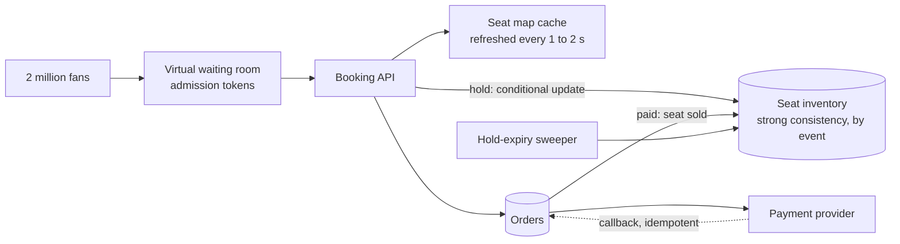

# Ticket sales under a flash crowd

## Statement

**Tier:** Senior · **Suggested time:** 45 min · **Topics:** contention, inventory, waiting room, idempotency

> Design a ticketing system for concert sales where two million fans rush to buy 50,000 seats the moment sales open.

## Self-check questions

Answer these after your design, or in the debrief:

- What guarantees that a seat is never sold twice, even under thousands of concurrent requests?
- How long is a seat held during checkout, and what happens when the hold expires?
- How do you stop two million users from taking down the checkout path?
- What does the seat map show, how fresh must it be, and what is the source of truth?
- How do you cope with bots?

**Tools the agent can run to test your claims afterwards** (they live in `runner/tools/`; just ask): `runner/tools/sim_booking.py`, and `runner/tools/estimate.py` with a large `peak_factor` for the flash crowd arithmetic.

## Interviewer notes

### Clarifying questions and answers

Give only what is asked, word for word.

| Question | Answer |
|---|---|
| Scale? | 2 million users arrive within the first 10 minutes; 50,000 seats; normal days are much quieter and many events run concurrently. |
| Holds? | Choosing seats holds them for 10 minutes while the user pays. |
| Payment? | An external provider; treat it as a service that responds later through a callback and sometimes fails. |
| Fairness? | Roughly first-come first-served; no one should be locked out by refreshing faster. |
| Consistency? | Selling a seat twice is unacceptable; a stale seat map is acceptable. |

### Reference estimate

Computed from the assumptions in the `## Reference estimate` section by `runner/tools/estimate.py`.


| Quantity | Value |
|---|---|
| write QPS (average) | 23.1 |
| read QPS (average) | 1.39 K |
| write QPS (peak) | 3.33 K |
| read QPS (peak) | 200 K |
| bytes written per day | 1 GB |
| total storage over the retention period | 7.67 TB |
| peak ingress | 1.67 MB/s |
| peak egress | 4 GB/s |
| cache size (upper bound) | 480 GB |
| app servers at the stated server_qps | 68 |

Averaged over a day this looks tiny (about 1.4K reads/s), but all of it lands in 10 minutes: the peak factor is about 144 (a day is 144 ten-minute slots). The right framing: 2M users x 60 requests over 600 s is about 200K reads/s of seat-map traffic, and at most a few thousand writes/s (hold attempts). Reads are served from caches; only writes need strong consistency.

### Reference design

- **Virtual waiting room.** Users enter a queue and receive a token; the system admits only as many as the checkout path can handle (admission rate chosen from capacity, using the same logic as backpressure). The queue lives at the edge or in a cheap, scalable store and is the main protection against the flash crowd.
- **Seat inventory.** One row (or record) per seat per event, in a strongly consistent store, partitioned by event. Hold = a conditional update: `status='available' -> 'held', holder=?, hold_expires=now()+10m` with `WHERE status='available' OR (status='held' AND hold_expires < now())` (the `status='held'` guard matters: a sold seat must never match); the row count affected says whether you won. Purchase = a second conditional update from held by this holder to sold. No application-level check-then-write (see `runner/tools/sim_booking.py`).
- **Hold expiry.** Lazy: an expired hold counts as available on the next attempt. A background sweeper releases expired holds and updates caches.
- **Seat map reads.** Served from a cache or CDN snapshot refreshed every second or two; the client treats it as a hint, and the hold attempt is authoritative.
- **Payment.** Create an order with an idempotency key; call the provider; on callback, move the order to paid and seats to sold in one transaction. If payment fails or the hold expires first, release. Unknown payment outcome: do not release until reconciled.
- **Sharding.** An event's 50,000 seats fit on one primary comfortably. Scale across events by sharding on event ID; the hot event can have its own dedicated shard.
- **Bots and fairness.** Per-account and per-IP limits, challenge steps at admission, purchase limits per account, randomised admission within a time bucket to blunt refresh races.
- **Alternative locking choices.** Pessimistic row locks (simple, hold connections, deadlock risk), optimistic versioning (retries under contention), a distributed lock (adds a failure mode and needs fencing tokens). The conditional-update or unique-constraint approach is the usual answer.



### Deep-dive probes

| Probe | What a strong answer contains |
|---|---|
| Show me the exact statement that prevents double-selling. | A single atomic conditional update (or unique constraint on (event, seat)) whose affected-row count decides the winner. Explains why read-then-write fails and ties to isolation levels from the fundamentals guide. |
| What do you do about 200K reads/s? | Cache or CDN the seat map with short TTL and stale tolerance; the waiting room caps who reaches the write path; precompute sections and counts. |
| The payment callback arrives twice, and once after the hold expired. | Idempotent order state machine; late success after expiry: if the seat is still free, sell it; if sold to someone else, refund and apologise; never silently double-sell. |
| How do you make the waiting room fair? | Arrival order within a bucket randomised; tokens expire; one token per account; trade-off between strict order and resistance to bots. |

### Failure injections

| Injection | Strong response |
|---|---|
| The inventory primary fails mid-sale. | Synchronous replica promoted; holds are in the database so they survive; short write unavailability is acceptable, wrong data is not. |
| A user closes the browser after holding 8 seats. | Hold expiry returns them; limit seats per hold. |
| Bots hold all the best seats and never pay. | Hold limits per account, short holds for suspected bots, challenge before hold, analytics to ban. |

### Common mistakes

- Check-then-update in application code.
- Distributed lock without fencing or expiry.
- Sends all traffic to the database.
- No waiting room or admission control.
- Treats the cached seat map as authoritative.
- No payment failure or timeout handling.

### Level calibration

| Level | What the answer looks like |
|---|---|
| Mid-level | A table of seats and a transaction that books one. |
| Senior (the target) | Waiting room, conditional update as the correctness core, hold expiry, cache for reads, idempotent payment callbacks, bot mitigation, quantified peak. |
| Stretch | Dynamic pricing, resale, multi-region for global artists, accessibility seat rules. |

### Probe ladder

Use one rung at a time and record the highest rung reached; only the highest rung is deducted.

- P0 (free): a neutral question, for example: What happens when this component fails?
- P1 (-5): What is the one statement that decides who gets seat 14B?
- P2 (-10): How many of the 2 million requests must reach your database?
- P3 (-20): What if the payment succeeds after the hold expired?

## Reference estimate

```json estimate
{"dau": 2000000.0, "writes_per_user_day": 1, "reads_per_user_day": 60, "bytes_per_write": 500, "bytes_per_read": 20000, "peak_factor": 144, "retention_years": 7, "replication": 3, "server_qps": 3000}
```
