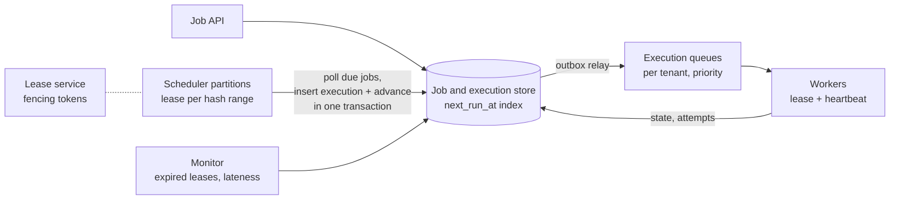

# Distributed job scheduler

## Statement

**Tier:** Senior · **Suggested time:** 45 min · **Topics:** leases, at-least-once, scheduling, fairness

> Design a service where teams register jobs to run once at a given time or repeatedly on a cron schedule, and a fleet of workers executes them reliably.

## Self-check questions

Answer these after your design, or in the debrief:

- How does the system find the jobs due in the next few seconds among ten million?
- Two scheduler nodes see the same due job. How do you make sure it is triggered once?
- A worker dies halfway through a job. What happens?
- What guarantee do you give: at most once, at least once or exactly once, and what must job authors do?
- How do you stop one team's burst from starving everyone else?

**Tools the agent can run to test your claims afterwards** (they live in `runner/tools/`; just ask): `runner/tools/sim_queue.py` for backlog and drain after an outage.

## Interviewer notes

### Clarifying questions and answers

Give only what is asked, word for word.

| Question | Answer |
|---|---|
| Scale? | 10 million registered jobs, 20 million executions per day on average, with a burst at the top of each hour (cron jobs at minute zero). Executions run from seconds to an hour. |
| Timeliness? | An execution starts within 30 seconds of its scheduled time at p99. |
| Guarantees? | At-least-once. Exactly-once is not promised; job authors must be idempotent. Say how you would help them. |
| Features? | Retries with backoff, cancellation, per-tenant concurrency limits, priorities, execution history for 90 days. |
| Execution? | Workers run containers or functions; the scheduler's job is to dispatch and track, not to define the sandbox. |

### Reference estimate

Computed from the assumptions in the `## Reference estimate` section by `runner/tools/estimate.py`.


| Quantity | Value |
|---|---|
| write QPS (average) | 231 |
| read QPS (average) | 116 |
| write QPS (peak) | 1.62 K |
| read QPS (peak) | 810 |
| bytes written per day | 40 GB |
| total storage over the retention period | 10.9 TB |
| peak ingress | 3.24 MB/s |
| peak egress | 810 KB/s |
| cache size (upper bound) | 2 GB |
| app servers at the stated server_qps | 3 |

Here 'users' are registered jobs: 20M executions/day is 231/s on average, with a burst factor of about 7 at the top of the hour (about 1.6K/s). The dispatch rate is modest; the hard parts are correctness (no lost or duplicated triggers), timeliness, fairness and failure handling, not raw throughput.

### Reference design

- **Data model.** `job(id, tenant, schedule, payload, next_run_at, status, version)` and `execution(job_id, scheduled_time, state, attempt, worker, lease_expires_at)`. The pair (job_id, scheduled_time) is the natural idempotency key for one run.
- **Finding due jobs.** Index `next_run_at`; each scheduler partition (hash range of job IDs) polls `next_run_at <= now + lookahead` in batches. Alternatives: a timer wheel in memory rebuilt from the table, a Redis sorted set, delayed-message features of a queue; the database poll is simplest and survives restarts.
- **Trigger exactly one enqueue.** In one transaction: insert the execution row for (job_id, scheduled_time) under a unique constraint, advance `next_run_at`, and write an outbox record for the queue. If two scheduler nodes race, the unique constraint lets only one succeed.
- **Partition ownership.** Each partition is owned by one scheduler at a time through a lease (in a coordination service or a database row with expiry and a fencing token). If the owner dies, the lease expires and another takes over; the fencing token prevents the old owner's late writes.
- **Dispatch.** Executions go to a queue; workers pull, take a lease (visibility timeout) and send heartbeats. A worker that stops heartbeating loses the lease; the execution becomes eligible again and the attempt count increases. This is why delivery is at-least-once.
- **Retries.** Exponential backoff with jitter, a maximum attempt count, a dead-letter state and alerts.
- **Fairness.** Per-tenant queues or weighted fair queuing, per-tenant concurrency limits, priorities for urgent jobs; protects the fleet from one tenant's burst.
- **Thundering herd at the top of the hour.** Pre-fetch with lookahead, pre-warm workers, allow optional jitter for jobs that do not need exact timing.
- **Observability.** Per-job lateness (start time minus scheduled time), queue depth, lease expirations, retry counts.
- **Long jobs.** Heartbeats and checkpoints; cancellation signals; a hard timeout.



### Deep-dive probes

| Probe | What a strong answer contains |
|---|---|
| How do you prevent two schedulers from triggering the same run? | A unique constraint on (job_id, scheduled_time) in the same transaction as the schedule advance, plus partition leases with fencing tokens; explains that leases reduce duplicates but only the constraint makes it correct. |
| What is your delivery guarantee and how do you help job authors? | At-least-once; give every run an idempotency key (job ID plus scheduled time) and the attempt number; explain why exactly-once is not achievable end to end with arbitrary side effects. |
| How do you keep lateness under 30 seconds at the top of the hour? | Lookahead polling, batching, enough pre-warmed workers, queue priorities, and a lateness metric with alerts; considers the arithmetic of backlog and drain. |
| How do you share the fleet fairly? | Per-tenant queues with weighted dispatch, concurrency caps, burst credits; contrast with a single FIFO. |

### Failure injections

| Injection | Strong response |
|---|---|
| A scheduler node is paused for 60 seconds by a garbage collection pause and wakes up believing it still owns the partition. | Fencing token: its writes are rejected; its lease had expired and another node took over. |
| A worker hangs without crashing. | Heartbeats and a hard timeout; the lease expires; a retry starts; the zombie's late results are ignored (attempt number check). |
| The database is read-only for two minutes. | No new triggers; on recovery, catch up by scanning `next_run_at <= now`; missed runs follow a per-job misfire policy (run once now, skip, or run all). |

### Common mistakes

- In-memory timers only, lost on restart.
- One scheduler (single point of failure) or many with no coordination.
- Promises exactly-once.
- No misfire policy.
- Single FIFO queue with no tenant isolation.
- No lease or heartbeat, so crashed jobs hang forever.

### Level calibration

| Level | What the answer looks like |
|---|---|
| Mid-level | Table of jobs, a poller, a queue and workers. |
| Senior (the target) | Idempotent trigger via unique constraint, leases with fencing, at-least-once semantics, retry and misfire policies, fairness, lateness SLO. |
| Stretch | Workflow DAGs, calendar rules and time zones, cross-region failover, cost-aware autoscaling. |

### Probe ladder

Use one rung at a time and record the highest rung reached; only the highest rung is deducted.

- P0 (free): a neutral question, for example: What happens when this component fails?
- P1 (-5): What prevents a run from being created twice if two nodes poll at once?
- P2 (-10): What does a worker do every few seconds while running a 1-hour job, and why?
- P3 (-20): What if the scheduler was down for ten minutes: what runs afterwards?

## Reference estimate

```json estimate
{"dau": 10000000.0, "writes_per_user_day": 2, "reads_per_user_day": 1, "bytes_per_write": 2000, "bytes_per_read": 1000, "peak_factor": 7, "retention_years": 0.25, "replication": 3, "server_qps": 1000}
```
