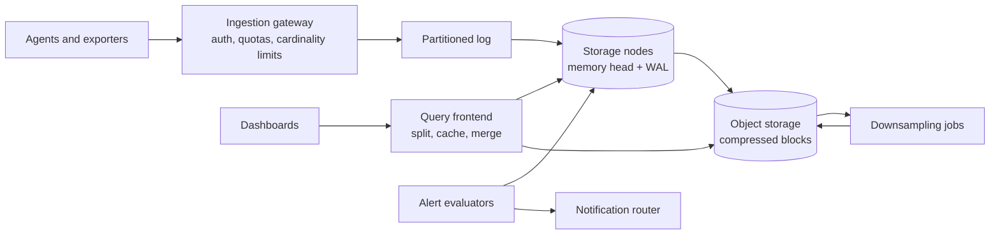

# Metrics and monitoring platform

## Statement

**Tier:** Senior · **Suggested time:** 45 min · **Topics:** time series, ingestion, downsampling, alerting

> Design a metrics platform for about ten thousand services: ingest time series, store them, answer dashboard queries and evaluate alert rules.

## Self-check questions

Answer these after your design, or in the debrief:

- How many samples per second arrive, and how many bytes does one sample take on disk?
- What happens to your cost if someone adds a user ID as a label?
- How do you answer a dashboard query for the last 30 days quickly?
- How does an alert fire within about two minutes and still not flap?
- Who monitors the monitoring system?

**Tools the agent can run to test your claims afterwards** (they live in `runner/tools/`; just ask): `runner/tools/estimate.py` for samples per second and storage; `runner/tools/sim_queue.py` for ingestion backlog.

## Interviewer notes

### Clarifying questions and answers

Give only what is asked, word for word.

| Question | Answer |
|---|---|
| Scale? | 10 million active time series (100,000 hosts x 100 metrics), one sample per series every 10 seconds. |
| Retention? | Raw samples 15 days, 1-minute rollups 1 year, 1-hour rollups 5 years. |
| Queries? | Dashboards: p95 under 2 seconds for the last 24 hours. Alert rules: 100,000 rules evaluated every 30 seconds. |
| Alert latency? | Under two minutes from the event to the notification. |
| Tenancy? | Hundreds of teams share the platform; one team must not harm the others. |

### Reference estimate

Computed from the assumptions in the `## Reference estimate` section by `runner/tools/estimate.py`.


| Quantity | Value |
|---|---|
| write QPS (average) | 1 M |
| read QPS (average) | 1 K |
| write QPS (peak) | 1.5 M |
| read QPS (peak) | 1.5 K |
| bytes written per day | 1.38 TB |
| total storage over the retention period | 4.14 TB |
| peak ingress | 24 MB/s |
| peak egress | 3 MB/s |
| cache size (upper bound) | 34.6 GB |
| app servers at the stated server_qps | 16 |

Here 'users' are series: 10M series sampled every 10 s is 1M samples/s. At 16 bytes raw per sample that is 16 MB/s; time-series compression (delta-of-delta timestamps, compressed values) commonly reduces samples to a few bytes or less each, modelled here as 10% (`new_data_fraction`, 1.6 bytes per sample), giving about 1.4 TB/day raw, about 140 GB/day compressed, and roughly 4 TB for the 15-day raw window with 2 replicas. Reads are queries per second where each query touches many series.

### Reference design

- **Collection.** Agents push (or the platform scrapes) samples; an ingestion gateway authenticates, applies tenant quotas and **cardinality limits** (maximum series per tenant, label value limits) and writes to a durable partitioned log keyed by series hash.
- **Storage nodes.** Consume their partitions; keep the most recent hours in memory ('head'), with a write-ahead log for recovery; every couple of hours cut an immutable compressed block and upload it to object storage. Replicate each series to 2 nodes in different zones.
- **Compression.** Timestamps as deltas of deltas, values with XOR or similar encodings; typical result is a few bytes or less per sample.
- **Downsampling.** A background job rolls raw data into 1-minute and 1-hour aggregates (min, max, sum, count) so long-range queries read far fewer points.
- **Query path.** A query frontend splits a range query into time shards, fans out to storage nodes and object storage, merges, caches results by time range, and chooses the right resolution for the requested range and step.
- **Alert evaluation.** An evaluator runs each rule on a schedule against recent in-memory data, with a state machine (inactive, pending for a duration, firing, resolved) to avoid flapping. Run evaluators in redundant pairs with deterministic rule ownership and de-duplicate notifications downstream. A notification router groups, silences and routes. **Alert latency budget:** ingestion delay + up to one evaluation interval (30 s) + the rule's `for` duration + notification delivery, which is why the target is two minutes and not one.
- **Failure isolation.** Per-tenant rate limits and cardinality quotas; query timeouts and per-query series limits; separate pools for alerting reads and dashboard reads so a heavy dashboard cannot delay an alert.
- **Meta-monitoring.** A small independent system watches the platform (heartbeat 'dead man's switch' alerts) so a failure of the platform is itself detected.
- **Push versus pull.** Pull gives the platform control of the rate and a built-in liveness signal (a failed scrape); push suits short-lived jobs and firewalled networks. Many platforms offer both.



### Deep-dive probes

| Probe | What a strong answer contains |
|---|---|
| What is cardinality and why is it the main operational risk? | The number of distinct series is the product of label value counts; one unbounded label (user ID, request ID) multiplies memory, index size and cost; mitigations: quotas, limits, dropping labels, aggregating at the agent, alerting on growth. |
| Why a memory head plus write-ahead log plus immutable blocks? | Writes are append-only and fast; recent data (the queried part) is in memory; blocks are cheap to store, replicate and compact; recovery replays the WAL. |
| How do you make long-range queries fast? | Downsampling, choosing resolution from the step, caching by time shard, block-level indexes, parallel fan-out. |
| How do you avoid duplicate or missed alerts when evaluators fail over? | Deterministic ownership, redundant evaluation, de-duplication by alert fingerprint at the router, 'for' durations; accepts a possible duplicate over a missed alert. |

### Failure injections

| Injection | Strong response |
|---|---|
| A team deploys a bug that emits 5 million new series. | Cardinality limit rejects or drops the excess for that tenant only, an alert fires, other tenants are untouched. |
| A storage node is lost. | Replica serves queries; the new node replays the log from the last block; queries may show brief gaps flagged as partial. |
| A dashboard query asks for 1 year at 1-second resolution. | Query limits and automatic resolution selection protect the cluster. |

### Common mistakes

- General-purpose relational database for samples.
- No cardinality control.
- Raw data for all retention windows (no downsampling).
- Alert evaluation sharing resources with dashboards.
- No meta-monitoring.
- Treats metrics, logs and traces as one storage problem.

### Level calibration

| Level | What the answer looks like |
|---|---|
| Mid-level | Agents, a time-series database, dashboards. |
| Senior (the target) | Quantified ingestion and compression, log-buffered ingestion, head/WAL/blocks, downsampling, query fan-out and caching, cardinality control, alert state machine and HA, tenant isolation. |
| Stretch | Exemplars and tracing links, multi-region query, cost attribution, anomaly detection. |

### Probe ladder

Use one rung at a time and record the highest rung reached; only the highest rung is deducted.

- P0 (free): a neutral question, for example: What happens when this component fails?
- P1 (-5): How many bytes does one sample need on disk, and what makes that small?
- P2 (-10): What single mistake by one team could blow up your memory?
- P3 (-20): Which part of the system fires the alert that says the alerting system is down?

## Reference estimate

```json estimate
{"dau": 10000000.0, "writes_per_user_day": 8640, "reads_per_user_day": 8.64, "bytes_per_write": 16, "bytes_per_read": 2000, "peak_factor": 1.5, "retention_years": 0.041, "replication": 2, "new_data_fraction": 0.1, "server_qps": 100000}
```
