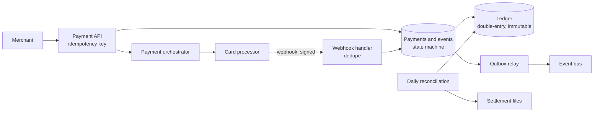

# Payment processing (optional)

## Statement

**Tier:** Optional · **Suggested time:** 45 min · **Topics:** idempotency, ledger, state machines, reconciliation

> Design the backend that lets merchants charge cards online: create a payment, confirm it with a card processor, refund it, and keep correct books.

**Optional.** Domain-specific. Skip this problem unless the role you are preparing for involves payments, billing or financial ledgers; the transferable ideas (idempotency keys, outbox, state machines) also appear in S6, S12 and S13.

## Self-check questions

Answer these after your design, or in the debrief:

- A request to the card processor times out. Was the customer charged? What do you do?
- How does the same payment request, sent twice, produce one charge?
- How do you record money so the books always balance?
- What do you store about the card, and what do you deliberately not store?
- How do you find and fix differences between your records and the processor's?

**Tools the agent can run to test your claims afterwards** (they live in `runner/tools/`; just ask): `runner/tools/estimate.py` for the load; the ideas behind `runner/tools/sim_booking.py` (conditional writes) apply to state transitions.

## Interviewer notes

### Clarifying questions and answers

Give only what is asked, word for word.

| Question | Answer |
|---|---|
| Scale? | 1 million payments per day, 3x peak; mostly card payments through external processors. |
| Guarantees? | Never charge twice; never lose a recorded payment; consistency matters more than availability for the ledger. |
| Card data? | The platform must minimise exposure to card numbers (tokenisation through a vault or the processor). |
| Flows? | Authorise, capture, refund (full or partial), asynchronous notifications from the processor, daily settlement. |
| Out of scope? | Fraud model internals, currency conversion, payouts to merchants (mention as extensions). |

### Reference estimate

Computed from the assumptions in the `## Reference estimate` section by `runner/tools/estimate.py`.


| Quantity | Value |
|---|---|
| write QPS (average) | 11.6 |
| read QPS (average) | 34.7 |
| write QPS (peak) | 34.7 |
| read QPS (peak) | 104 |
| bytes written per day | 2 GB |
| total storage over the retention period | 15.3 TB |
| peak ingress | 69.4 KB/s |
| peak egress | 104 KB/s |
| cache size (upper bound) | 600 MB |
| app servers at the stated server_qps | 1 |

About 12 payments/s on average and 35/s at peak: the load is small. The difficulty is correctness, not scale: exactly-once effects over unreliable calls, an auditable ledger, long retention (7 years), and reconciliation.

### Reference design

- **API.** `POST /v1/payments` with a client-supplied **idempotency key** (unique per merchant); the same key returns the same result without creating a second payment. Amounts are integers in minor units (cents) with a currency code, never floating point.
- **Payment state machine.** created, authorised, captured, settled; failed; refunded (partially). Each transition is stored as an append-only event, and the current state is derived or stored with a version; illegal transitions are rejected.
- **Calling the processor.** Send an idempotency reference to the processor too. On a timeout, the outcome is *unknown*: do not retry blindly and do not mark failed. Query the processor by reference, or wait for its webhook, or hand over to reconciliation.
- **Webhooks.** Verify signatures, dedupe by event ID, apply idempotently, and tolerate out-of-order delivery by checking the state machine.
- **Ledger.** Double-entry: each movement is a set of entries that debit one account and credit another for the same amount, written atomically in one transaction; entries are immutable (corrections are new entries); an invariant check (the sum of entries is zero) runs continuously. Balances are derived or maintained as checkpoints.
- **Outbox pattern.** Write the state change and the 'event to publish' in the same transaction, then a relay publishes to the message bus; this avoids the dual-write problem between database and queue.
- **Card data.** Collect card details in the processor's hosted fields or a vault so the platform stores only tokens; this shrinks compliance scope.
- **Reconciliation.** A daily job compares the processor's settlement files with ledger entries, flags missing, extra and mismatched payments, and creates tasks or automated adjustments.
- **Consistency.** The ledger lives in a strongly consistent relational store partitioned by merchant or account; reads for dashboards can come from replicas; the payment path favours correctness and accepts brief unavailability.



### Deep-dive probes

| Probe | What a strong answer contains |
|---|---|
| The call to the processor times out. Walk through what you do. | Mark the payment pending-unknown; do not retry with a new reference; look up by the original reference; accept the webhook; reconcile. Explain the harm of both wrong answers (double charge, or lost payment). |
| How do idempotency keys work, precisely? | Unique constraint on (merchant, key) storing the request fingerprint and the response; same key and same payload returns the stored response; same key and different payload is an error; keys expire after a long window; concurrent duplicates are serialised by the constraint. |
| Why double-entry and immutable entries? | Invariant that debits equal credits detects bugs; audit trail; corrections via compensating entries; derived balances can be rebuilt. |
| What is the dual-write problem? | Updating the database and publishing to a queue as two separate actions can leave them inconsistent after a crash; the outbox pattern turns it into one transaction plus an at-least-once relay. |

### Failure injections

| Injection | Strong response |
|---|---|
| The same webhook arrives three times, out of order. | Event ID dedupe, state machine rejects stale transitions. |
| The processor is down for an hour. | Accept payments into a pending state with limits, or fail fast with a clear error; do not queue indefinitely; circuit breaker and optional second processor. |
| Reconciliation finds a captured payment with no ledger entry. | Investigate via event log; post the missing entries through a controlled correction process, not by editing rows. |

### Common mistakes

- Floating point for money.
- Retries without idempotency keys.
- Treats a timeout as a failure.
- Mutable balance column as the only record.
- Publishes events outside the transaction.
- Stores raw card numbers.

### Level calibration

| Level | What the answer looks like |
|---|---|
| Mid-level | Table of payments, call to the processor, status field. |
| Senior (the target) | Idempotency design, unknown-outcome handling, immutable double-entry ledger, outbox, webhooks, reconciliation, tokenisation. |
| Stretch | Multi-currency and FX, payouts, multi-processor routing, fraud scoring integration. |

### Probe ladder

Use one rung at a time and record the highest rung reached; only the highest rung is deducted.

- P0 (free): a neutral question, for example: What happens when this component fails?
- P1 (-5): What does the customer see if your server crashes right after the processor said yes?
- P2 (-10): What must be true about the request when the same key arrives again?
- P3 (-20): How would you prove at the end of the day that the books are right?

## Reference estimate

```json estimate
{"dau": 1000000.0, "writes_per_user_day": 1, "reads_per_user_day": 3, "bytes_per_write": 2000, "bytes_per_read": 1000, "peak_factor": 3, "retention_years": 7, "replication": 3, "server_qps": 500}
```
