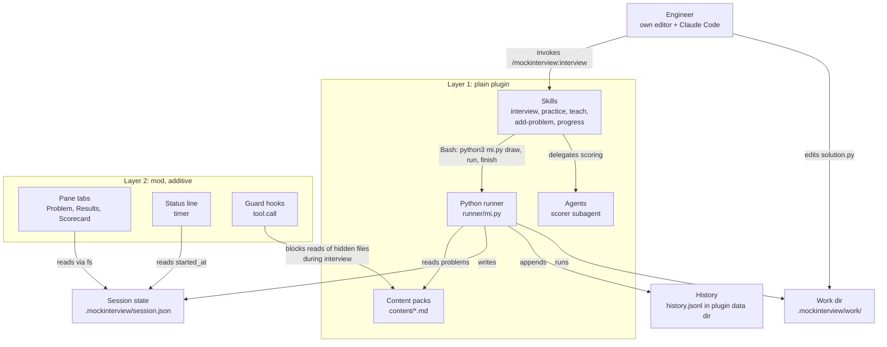
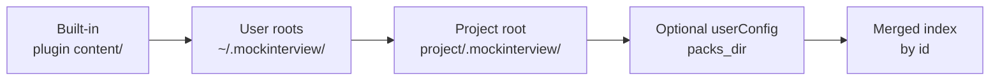
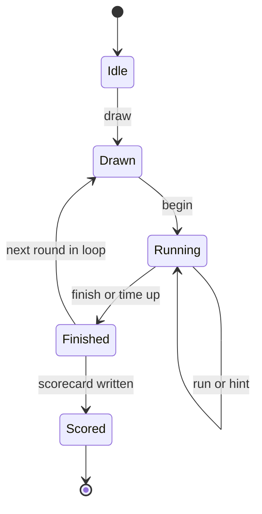
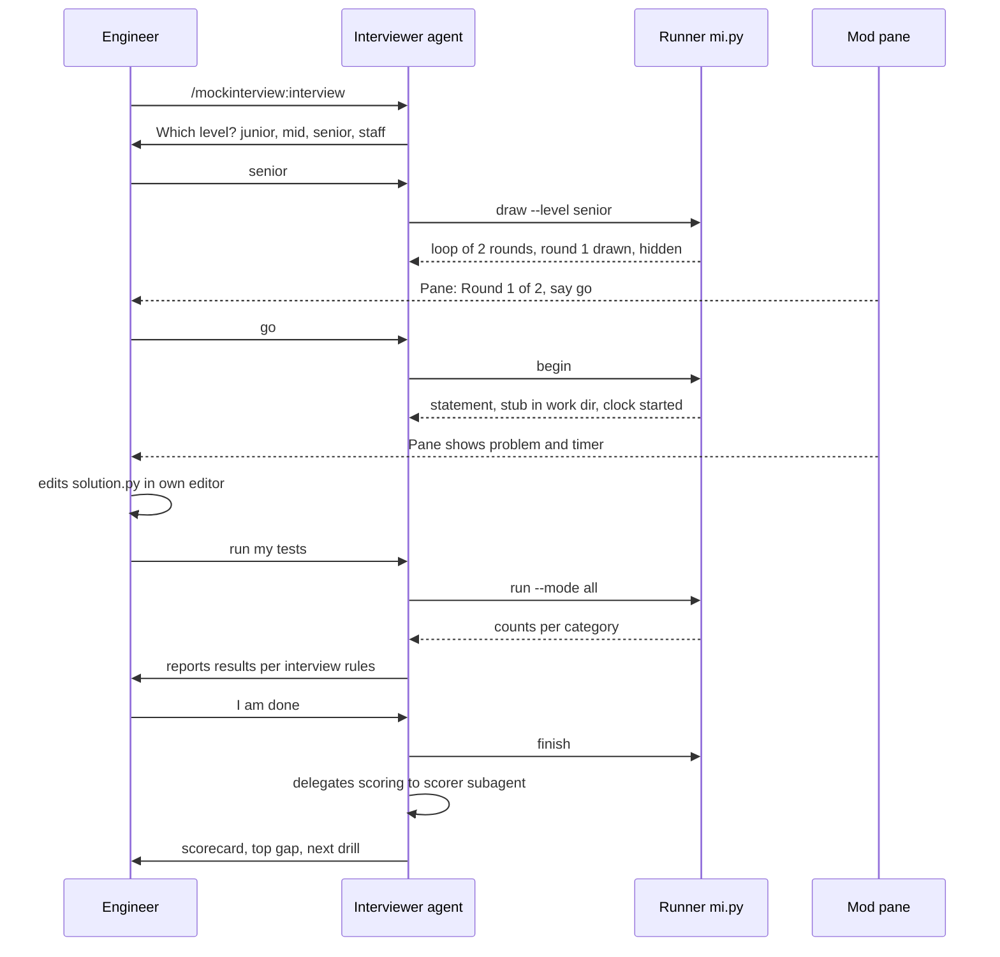
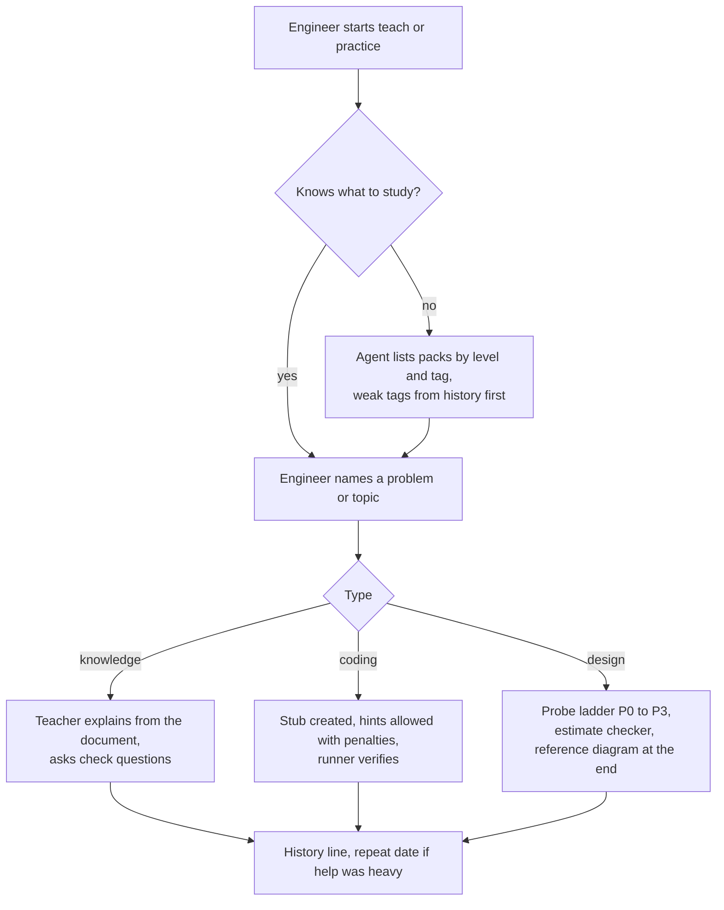
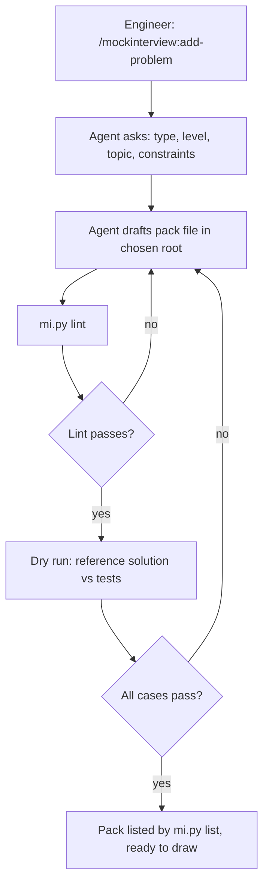
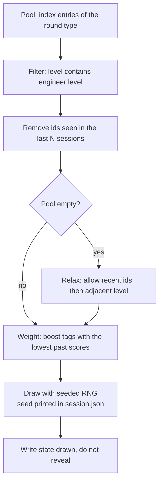

# mockinterview — Design Document

| | |
|---|---|
| **Status** | Draft v0.1, for review before any code is written |
| **Plugin name** | `mockinterview` (repo folder: `mockinterview`) |
| **License** | MIT |
| **Target** | Claude Code plugin with an optional Claude Mods layer, published through a marketplace |
| **Runner language** | Python 3, standard library only |
| **Last updated** | 2026-10-21 |

---

## 0. As built: where the code differs from this design

This document was written before the code. Where they disagree, [runner.md](runner.md) and [authoring.md](authoring.md) describe what exists. The differences, in one place:

| Topic | Design said | As built |
|---|---|---|
| Test sections | `Visible tests`, `Hidden tests`, `Oracle` with a `check()` function | One `## Tests` block (every case tagged `visible`, `edge` or `hidden`, with its stored `expected` value), a language-neutral `## Signature`, and a `## Reference solution` that `selftest` checks the expected values against |
| Running code | the runner runs `solution.py` per case | Since 0.4.0 the runner never runs the engineer's code: they solve in any language with their own toolchain, the agent writes a native test file from `tests`, runs their test command and reports failures with `record`. No fuzz or timing tests; complexity is judged in the conversation |
| Extra pack roots | `~/.mockinterview/` and `<project>/.mockinterview/` | The `packs/` subfolder of each, so `work/` and `session.json` are never scanned |
| Runner commands | `list`, `draw`, `begin`, `run`, `hint`, `finish`, `lint`, `selftest`, `history` | `tests` and `record` instead of `run`; also `show`, `status`, `pick`, `notes`, `score`, `abandon`, `repeat`, `estimate-check`, `design-lint`. No pack trust: sessions never execute pack code |
| Hidden notes for the interviewer | not specified | `mi.py notes --section clarify, followups, traps, reference`; the agent never reads pack files during a round |
| Hint penalties | cumulative | Cumulative for live coding; only the highest probe step for system design (as in the original kit) |
| Rating dimensions | named in prose | Fixed keys: `framing approach implementation quality testing communication adaptability` and `scoping estimation architecture deep_dives reliability communication` |
| Existing work files | "ask before overwriting" | `begin` moves everything in `work/` into `work/archive/<time>/`; nothing is deleted |
| "To repeat" marks | in `history.jsonl` only | Also `repeat` writes `.mockinterview/repeat.md` and `repeat --list` shows what is due |
| Mod tools | optional `$.tool.register` wrappers | Not built: the mod only reads `session.json` and `work/PROBLEM.md`, which avoids depending on `$.process` (CLI only) |
| Library tab | not specified | A fourth pane, Library: the mod walks the pack roots with `$.fs.list` and reads only frontmatter (`hooks/lib/library.ts`, a port of the runner's parser). A button fills the prompt box with `/mockinterview:practice ID` or `/mockinterview:teach ID`; nothing is sent until the engineer presses Enter. Hidden during an interview round |
| Content | all tiers A to G and S1 to S15 | Tiers A, B, C (57 coding problems), S1 to S16 and 6 knowledge documents; concurrency (D), debugging (E), SQL (F) and the multiple-choice bank (G) are deferred because each needs its own checker |

What was verified: the runner has unit tests (`python3 -m unittest discover -s tests`), all packs pass `lint --all` and `selftest --all`, `claude plugin validate` passes, and a full two-round interview, a practice session and a teach session were run through the real skills with `claude -p` and `--plugin-dir`. The mod passes `claude plugin validate` and its tests (`claude plugin test .`), and its parser was checked against a real `session.json` written by the runner. Not verified: the mod drawing in a live terminal, VS Code or the Desktop app, which has not been looked at yet.

---

## 1. Summary

`mockinterview` turns Claude Code into a practice platform for software-engineering interviews, in the spirit of TestGorilla or Codility. An engineer installs one plugin and gets live-coding problems, system-design problems and knowledge documents (CS fundamentals). An AI agent plays two personas: an **Interviewer** who runs a timed, hint-limited session and scores it, and a **Teacher** who explains problems and concepts and coaches the engineer. Engineers and teams can add their own problems and documents as plain Markdown files.

The plugin has two layers, and the first works without the second:

1. **Plain plugin** (skills, agents, a Python runner, content). Runs wherever plugins run. It is the product.
2. **Mod** (a hooks module using the Claude Mods API). Adds a pane with the problem, timer and test results, a status-line timer, and guard hooks that make cheating harder. It is additive, and the early-access API means it may break between releases [2].

The content of the plugin is the existing kit we already produced: 14 `lc-*` files and 11 `sd-*` files plus `cs-interview-fundamentals.md`. This document describes how that content is migrated into a pack format, and what has to be built around it.

---

## 2. Goals and non-goals

### Goals

- One install gives a complete experience; no extra download for content.
- **Interview mode** behaves like a real assessment: the system draws the problem for the engineer's level, hides it until the engineer says "go", and does not allow re-rolling.
- **Practice and teach modes** let the engineer choose a problem, ask for hints and read explanations.
- Anyone can add problems and documents without touching plugin code.
- Correctness is checked by running code, never by the model reading the code and guessing.
- Plugin layer works without the mod; the mod makes it nicer.

### Non-goals (v1)

- Multi-language runners. Python solutions only; the runner is Python stdlib (D7).
- Anti-cheating that is secure. Guards are friction, not security (section 9.5).
- A behavioural round for staff candidates (deferred).
- Hosting, accounts, leaderboards or any server. Everything is local files.
- A built-in code editor. The engineer uses their own editor.

---

## 3. Decisions

These come from the discussion so far. Each row is final unless it appears again in section 16.

| # | Decision | Reason |
|---|---|---|
| D1 | Name is `mockinterview` | The prefixes `cc-plugin-`, `claude-` and `anthropic-` are reserved for plugin names and rejected by `claude plugin validate` [1] |
| D2 | Two layers: plain plugin plus additive mod | Mods API is early access [2]; the product must survive its changes |
| D3 | Interview mode: system draws, seeded random per level, hidden until "go", no re-roll | Realism; the engineer cannot cherry-pick |
| D4 | Practice and teach mode: engineer chooses | Learning needs control |
| D5 | Tests run only when the engineer explicitly asks the agent to run them | No file watcher; simple and predictable |
| D6 | Engineer uses their own editor on a stub file in `./.mockinterview/work/` | Real editor habits; no editor to build. Created automatically by `mi.py begin`, not at install; default location still to be confirmed (section 16) |
| D7 | Python stdlib runner, Python-only solutions in v1 | One dependency, already on most machines |
| D8 | Content ships inside the plugin | Installing a plugin copies its files, so no second step |
| D9 | Optional extra content roots: `~/.mockinterview/` and `<project>/.mockinterview/` | Teams add custom problems without forking |
| D10 | One `.md` file per problem; frontmatter plus hidden tests and notes inside | Easy to author, diff and review |
| D11 | Existing `lc-` and `sd-` kit is the v1 content | Already tested; audited for originality before publishing |
| D12 | Accept the early-access Mods API risk | User decision; Desktop behaviour to be checked later |
| D13 | MIT license | User decision |

---

## 4. Architecture

The runner CLI is the **single source of truth** for session state and for running code. Skills tell the agent which runner commands to call through its normal Bash tool. The mod, when present, is a *view* over the same state: it reads the session file and draws it, and offers a few shortcuts.

This matters because `$.process.run` is documented as CLI only [2]. If the mod cannot launch the runner on the Desktop app, the plugin layer still works, and the pane can still render by reading the session file.



The diagram shows that the mod never owns data: it observes `session.json`, which only the runner writes.

### Why this split

| Concern | Plain plugin | Mod |
|---|---|---|
| Works in every surface | Yes | Terminal first; Desktop, VS Code and mobile to be verified [2] |
| Survives API changes | Yes | No guarantee, API is early access [2] |
| Can be tested without Claude Code | Runner and pack lint, yes | `claude plugin test` with `*.test.ts` [2] |
| Trust requirement | Normal plugin | Mods run with Claude Code's access, so install only trusted sources [2] |

---

## 5. Repository layout

The repository root is both the plugin root and the marketplace root, so the whole repo is copied when installed; keep it tidy [7]. Skills, agents and hooks sit in the standard plugin directories [5].

```text
mockinterview/
├── .claude-plugin/
│   ├── plugin.json            # name: mockinterview, userConfig
│   └── marketplace.json       # lists the plugin with source "./"
├── skills/
│   ├── interview/SKILL.md     # Interviewer persona and flow
│   ├── practice/SKILL.md      # engineer picks, hints allowed
│   ├── teach/SKILL.md         # Teacher persona
│   ├── add-problem/SKILL.md   # guided authoring and lint
│   └── progress/SKILL.md      # history and next-drill advice
├── agents/
│   └── scorer.md              # independent scoring subagent
├── runner/
│   ├── mi.py                  # CLI entry: draw, begin, run, hint, finish, lint, list, history
│   └── lib/                   # packs, select, sandbox, score (stdlib only)
├── content/
│   ├── live-coding/           # one .md per problem
│   ├── system-design/         # one .md per problem
│   └── knowledge/             # CS fundamentals, building blocks, study guides
├── hooks/
│   ├── hooks.json             # { "modules": ["./register.tsx"] }
│   └── register.tsx           # the mod
├── docs/
│   ├── design.md              # this document
│   └── authoring.md           # how to write a pack file
├── tests/                     # runner tests, pack lint tests, mod *.test.ts
├── README.md
└── LICENSE                    # MIT
```

`skills/` keep each `SKILL.md` under 500 lines and push reference material into supporting files that are read on demand [6]. This is how a large problem library avoids bloating the model's context: the agent reads one problem file at a time, never the whole library.

---

## 6. Content pack format

### 6.1 File anatomy

A pack file is one Markdown document. The frontmatter is machine-read; the body has fixed headings that the runner and the agent rely on.

```yaml
---
id: lc-lru-cache                 # unique, kebab-case, stable forever
title: LRU Cache
type: live-coding                # live-coding | system-design | knowledge
level: [mid, senior]             # junior | mid | senior | staff
tags: [hash-map, linked-list, design]
time_minutes: 35
languages: [python]
entry: LRUCache                  # function or class the tests call
runs_code: true                  # packs that run code must declare it
source: adapted                  # original | adapted | third-party
author: mockinterview
---
```

| Heading in body | Audience | Content |
|---|---|---|
| `## Statement` | Engineer | The problem as an interviewer would say it |
| `## Constraints` | Engineer | Input limits and rules |
| `## Examples` | Engineer | Two or three worked examples |
| `## Stub` | Engineer | A fenced `python` block copied to `solution.py` at start |
| `## Visible tests` | Engineer | A fenced `json tests` block of cases |
| `## Hidden tests` | Interviewer only | Cases, plus optional `oracle` and `gen` blocks for fuzz tests |
| `## Interviewer notes` | Interviewer only | Clarifying answers, hint ladder H0 to H3, follow-ups, traps |
| `## Reference` | Teacher and scorer | Strong solution or diagram and rubric notes |

For system-design problems the engineer sections are `Statement`, `Constraints` and `Scale hints`; the interviewer-only sections are the probe ladder P0 to P3, curveballs, a reference diagram and a reference estimate checked by an estimation script.

For knowledge documents there are no tests and no hidden sections; they are plain study material that the Teacher persona reads and explains.

### 6.2 Test block contract

```json
[
  { "name": "basic",    "args": [["a", "b"]], "expect": "ab" },
  { "name": "empty",    "args": [[]],         "expect": "" }
]
```

- `args` is the argument list for the entry function; `expect` is compared with deep equality.
- Where the answer is not unique, an `oracle` block (a Python function `check(args, got) -> bool`) replaces `expect`.
- A `gen` block yields random cases for the fuzz category; the seed is printed so a failure is reproducible.
- Cases are tagged `visible`, `edge`, `hidden`, `fuzz` or `perf`, matching the categories of the existing kit.

### 6.3 Discovery and precedence



`~/.mockinterview/` and `<project>/.mockinterview/` are **optional**: they exist only when a person or team adds custom problems or documents. Without them, the plugin still has every built-in problem (D8, D9). If two packs share an `id`, the later root wins and the runner prints which one it chose, so a team can deliberately override a built-in problem.

### 6.4 Trust

A pack that declares `runs_code: true` makes the runner execute Python from a Markdown file. The runner therefore:

- never runs hidden or oracle code from a root the engineer has not seen listed by `mi.py list --roots`;
- prints a one-time warning for non-built-in roots and records the acknowledgement in the plugin data directory;
- runs all code in a subprocess with a timeout and, on POSIX, memory limits through `resource`; Windows gets the timeout only (documented limitation).

Content from teammates is untrusted code; this is stated in `docs/authoring.md`.

---

## 7. Skills and personas

Skills are invoked as `/mockinterview:<skill>` [6]. The persona lives in the skill because the interview happens in the main conversation; only scoring is delegated.

| Skill | Persona | What it does |
|---|---|---|
| `interview` | Interviewer | Asks the level, draws a loop, runs timed rounds, scores, writes history |
| `practice` | Partner | Lists packs, lets the engineer pick, allows hints with the same penalties, no loop |
| `teach` | Teacher | Explains a problem or a knowledge document, quizzes, checks understanding |
| `add-problem` | Assistant | Interviews the author, writes a pack file, runs lint and a dry run |
| `progress` | Coach | Reads history, shows trends, proposes the next three drills |

### 7.1 Interviewer behaviour contract

- Neutral and terse. No praise during the round, no hints unless asked, then only the next rung of the ladder.
- Never shows hidden tests or notes. Calls `mi.py run` and reports only what the interview rules allow: visible results in full, hidden results as counts.
- Time comes from the runner (`started_at`), never from the model's guess.
- Hint ladder H0 to H3 costs 0, 5, 10 and 20 points; design probes P0 to P3 follow the same idea [kit].
- Hands the transcript summary and the engineer's artefacts to the `scorer` subagent, so the persona that watched the session is not the only grader.

### 7.2 Teacher behaviour contract

- Starts from what the engineer already knows; asks before explaining.
- Uses the problem's `Reference` section and the knowledge documents; cites the document file in its answers.
- May show solutions, but only after the engineer attempted or explicitly asks; marks the problem "to repeat" in history when it had to give the full idea.

### 7.3 Scorer subagent

`agents/scorer.md` receives the rubric, the problem's `Reference`, test results and a short transcript summary, and returns a JSON scorecard (dimension ratings 0 to 4 with one evidence line each). Keeping this in a separate agent follows the rule that work should not grade itself.

---

## 8. Python runner

### 8.1 Commands

| Command | Purpose | Notes |
|---|---|---|
| `mi.py list [--type T] [--level L] [--roots]` | Show merged index and roots | JSON on stdout |
| `mi.py draw --level L --type T [--seed N]` | Interview draw; writes `session.json` in state `drawn` | Does not print the title or statement |
| `mi.py begin` | State `running`; starts clock; creates `.mockinterview/work/` if missing and copies the stub there; prints the statement | One-way; cannot re-draw afterwards. Never overwrites an existing `solution.py` without asking |
| `mi.py run [--mode visible\|all]` | Imports `solution.py` in a subprocess, runs cases | Prints the result schema |
| `mi.py hint` | Next rung; records the penalty | Interview mode limits rungs |
| `mi.py finish` | Stops clock; finalises; appends `history.jsonl` | Scorecard merged later |
| `mi.py lint PATH` | Validates a pack file | Used by `add-problem` and CI |
| `mi.py history [--last N]` | Reads history | Used by `progress` |

Every command returns JSON and uses exit codes: 0 success, 1 user error (bad id, wrong state), 2 internal error. The data directory is passed as `--data ${CLAUDE_PLUGIN_DATA}` and the plugin root as `${CLAUDE_PLUGIN_ROOT}`; both are substituted in skill text and persist across plugin updates [1].

### 8.2 Session file

```json
{
  "session_id": "2026-10-21T09-30-00Z-4f2a",
  "mode": "interview",
  "level": "senior",
  "state": "running",
  "loop": ["lc-lru-cache", "sd-url-shortener"],
  "round": 0,
  "seed": 918273,
  "started_at": "2026-10-21T09:31:12Z",
  "limit_minutes": 35,
  "hints_used": [],
  "last_run": null
}
```

The mod and skills read this file; only `mi.py` writes it.

### 8.3 Result schema

```json
{
  "problem": "lc-lru-cache",
  "passed": 17, "failed": 2, "total": 19,
  "by_category": { "visible": "3/3", "edge": "5/6", "hidden": "6/7", "fuzz": "2/2", "perf": "1/1" },
  "first_failure": { "name": "capacity-one", "shown": true },
  "elapsed_seconds": 1184,
  "timeout": false
}
```

In interview mode `first_failure.shown` is `false` for hidden cases: the agent sees only counts, matching the kit's rule that hidden results are reported as counts or a final percentage.

### 8.4 Limits

| Limit | Value | Reason |
|---|---|---|
| Per-case timeout | 2 s default, per-problem override | Catches infinite loops |
| Whole run | 30 s | Keeps the session responsive |
| Output cap | 64 KiB | Prevents flooding the context |
| Python version | 3.10 or newer, checked at start | Clear error instead of odd failures |

---

## 9. The mod

The mod is `hooks/hooks.json` with `{ "modules": ["./register.tsx"] }` and a `register` function that receives `on` and `options` [2]. Hooks have the form `($, e, next)`, and a hook that does not handle an event calls `next(e)`. The mod runs in a sandbox without DOM or Node [2], so it uses `$.fs`, `$.ui`, `$.state`, `$.clock` and `$.command` and nothing else.

### 9.1 What the mod registers

| Piece | API | Behaviour |
|---|---|---|
| Command `mockinterview-pane` | `$.command.register` in `session.start` | Toggle the pane |
| Pane `mockinterview` | `$.ui.open`, `ui.render` hook | Tabs: Problem, Results, Scorecard |
| Status entry | `$.ui` status | Remaining time, from `started_at` and `limit_minutes` |
| Guard | `tool.call` hook | Refuses reads of pack files during an interview |
| Optional tools | `$.tool.register` as `mcp__mockinterview__*` | Convenience wrappers around `mi.py`, only when `$.process.run` works |

### 9.2 Pane design

Panes can dock beside the chat or sit inline, each pane has tabs, and the pane opens automatically only when the viewport is wide enough (144 columns docked, 110 inline) [3]. Rendering must be pure: `ui.render` reads from `$.state` atoms and `$.fs` and never performs side effects; redraws are throttled to about 10 per second, 30 on the terminal [3]. To stay portable the mod uses only the common element subset: `Box`, `Text`, `Button`, `Markdown`, `Code`, `Input` and `Select` [3][4].

| Tab | Shows | Source |
|---|---|---|
| Problem | Statement, constraints, examples (Markdown) | `session.json` plus the pack's engineer sections |
| Results | Last run: counts per category and visible failures | `last_run` in `session.json` |
| Scorecard | Rubric ratings, score, next drill | Written by `finish` |

In interview mode before `begin`, the Problem tab shows only "Round 1 of 2 — say go when ready" and the level.

### 9.3 Session state machine



There is deliberately no transition from `Drawn` back to `Idle` or to another `Drawn`: the engineer cannot re-roll (D3). Abandoning a session is allowed and recorded as `abandoned` in history, so it is not a free re-roll either.

### 9.4 Pane enable and disable

The engineer can close the pane at any time, reopen it with `/mockinterview-pane`, and turn auto-open off with the `pane_auto_open` option. The plugin as a whole is enabled or disabled by Claude Code's plugin controls; disabling it removes the mod too.

### 9.5 Guard hooks: friction, not security

During an interview a `tool.call` hook inspects the tool name and its path arguments. If the session is in `drawn` or `running` state and a `Read`, `Grep`, `Glob` or `Bash` call targets the pack roots, the hook returns a refusal instead of calling `next(e)`. The exact refusal return shape is confirmed against the type declarations in milestone M2.

This is **friction only**. The engineer owns the machine and can read the files in a terminal, edit the hook or switch the mod off. The README says so plainly. The purpose is to stop *accidental* spoilers and to make the interview feel honest, not to defeat a determined person.

### 9.6 Options

`userConfig` entries appear as rows in `/config`, and changing one reloads the mod with new `options` [1][2].

| Key | Type | Default | Meaning |
|---|---|---|---|
| `default_level` | string with options | none | Skips the level question when set |
| `packs_dir` | directory | none | Extra content root |
| `pane_auto_open` | boolean | `true` | Open the pane on session start |
| `strict_guard` | boolean | `true` | Enable guard hooks during interviews |

### 9.7 Surface support

| Surface | Plugin layer | Mod layer |
|---|---|---|
| Terminal | Supported | Primary target |
| Desktop | Supported | **Unverified**; check pane placement and `$.process` (CLI only) |
| VS Code | Supported | Unverified |
| Mobile | Skills only | Unverified, probably limited |

---

## 10. Flows

### 10.1 Interview



The engineer chooses nothing but the level; tests run only when the engineer asks (D5).

### 10.2 Teach and practice



### 10.3 Adding a problem



The dry run is what stops a broken hidden test from failing an honest engineer: the pack must pass against its own `Reference` solution before it can be drawn.

---

## 11. Selection algorithm

For interview mode the runner builds a **loop** from a template by level, then draws each round at random from the matching pool.

| Level | Loop template | Notes |
|---|---|---|
| junior | live-coding, live-coding | Tier A and B problems |
| mid | live-coding, live-coding, system-design (light) | Tier B and C; S1 to S8 |
| senior | live-coding, live-coding, system-design | Tier C and D; S1 to S15 |
| staff | system-design, system-design, live-coding (optional) | Mostly design; behavioural round deferred |



Mapping of the existing kit to levels (used when the pack frontmatter is generated during migration):

| Existing content | Levels |
|---|---|
| Live coding Tier A | junior |
| Tier B | junior, mid |
| Tier C and D | senior, some staff |
| Tier E, F, G | all levels |
| System design S1 to S8 | mid, senior |
| System design S9 to S15 | senior, staff |

The seed is stored so an interviewer-side bug can be reproduced; the engineer never sees it before `begin`. Content for junior, mid and staff is thinner than for senior, and the relax step (adjacent level) exists because some pools will be small at launch.

---

## 12. Scoring and scorecard

Both scorecards reuse the weights from the existing kit; the thresholds are this project's own calibration, not an industry standard.

**Live coding:** problem framing 15, approach and complexity 15, implementation and correctness 25 (computed from test counts), code quality 10, testing and debugging 15, communication 10, adaptability and follow-ups 10.

**System design:** scoping and requirements 15, estimation 10, API, data model and architecture 25, deep dives and trade-offs 30, reliability and operations 10, communication and time 10.

`score = sum(weight × rating / 4) − hint penalties`. Readings: 85 or more means ready for senior rounds on this kind of problem; 70 to 84 means close, repeat with a different problem; 55 to 69 means repeat in 3 days after reviewing the pattern; below 55 means go back one level or study the building blocks first.

Only the *Implementation and correctness* line is mechanical. The rest are judgements by the scorer subagent from the rubric, and the scorecard shows one line of evidence for each so the engineer can disagree with a rating.

History line (`history.jsonl`): date, session id, problem id, mode, level, score, minutes, hints used, highest probe step, top gap, repeat-by date.

---

## 13. Migration from the existing kit

The 26 existing Markdown files (14 `lc-`, 11 `sd-`, and the CS fundamentals document) become packs and knowledge documents. The migration is a one-time script plus manual review, not a runtime feature.

| Source | Target |
|---|---|
| `lc-02` to `lc-05` (problems, tiers A to G) | `content/live-coding/*.md`, one file per problem, `Statement`, `Constraints`, `Examples`, `Stub` |
| `lc-tests-1` to `lc-tests-4` | `Visible tests` and `Hidden tests` of each pack |
| `lc-agent-2`, `lc-agent-3` (notes) | `Interviewer notes` of each pack |
| `lc-agent-1` (instructions) | `skills/interview/` and `skills/practice/` text |
| `lc-tools-code` | `runner/` (runner, timer, shims) rewritten into the CLI |
| `sd-05-problems` plus `sd-agent-2` to `sd-agent-4` | `content/system-design/*.md` with probe ladder, references and curveballs |
| `sd-02`, `sd-03`, `sd-01`, `lc-01` | `content/knowledge/` |
| `sd-agent-5-tools-code` | `runner/lib/` (estimation and design lint) |
| `cs-interview-fundamentals.md` | `content/knowledge/cs-fundamentals.md` |
| `lc-00`, `sd-00` (start here) | `README.md` and `docs/` |

### Originality audit (before first public release)

Problems in the kit are classic patterns, which are common across platforms and not protected as ideas; what must be avoided is copying a platform's *text* or a company's proprietary question set. Before publishing the repository:

- Rewrite any statement that reads like a specific platform's wording; keep the pattern, change the story and the data.
- Mark each pack `source: original` or `adapted`, and keep an `ATTRIBUTIONS.md` for ideas drawn from named public sources.
- Do not include questions attributed to a named company's real interview.
- Check the references kept in the kit still resolve.

---

## 14. Distribution

### 14.1 Marketplace

The repository root hosts `.claude-plugin/marketplace.json` with `name`, `owner` and a `plugins` array whose entry has `name: "mockinterview"` and `source: "./"` [7]. `plugin.json` holds the manifest and `userConfig` [1]. Validate with `claude plugin validate` before each tag [1].

### 14.2 Versioning

If `plugin.json` sets `version`, it overrides the marketplace entry and users update only when it changes; if omitted, each commit counts as a new version [1][7]. Proposal: set `version` explicitly and tag releases using semantic versioning, because content changes (new problems) are frequent and an engineer should not receive a changed interview mid-preparation without a version bump.

### 14.3 README install lines

The README documents three paths: terminal (`/plugin install mockinterview --marketplace <owner>/<repo>`), shell (`claude plugin install …`), and the Desktop app (open Plugins, add the marketplace, install). The exact commands are rechecked against the marketplace reference at milestone M5 [7].

### 14.4 License

MIT, with `LICENSE` at the root and `"license": "MIT"` in `plugin.json`. Content under `content/` is also MIT unless a pack states otherwise in `ATTRIBUTIONS.md`.

---

## 15. Testing and validation

| Layer | Check | Tool |
|---|---|---|
| Manifest and layout | Name rules, schema, paths | `claude plugin validate` [1] |
| Mod | Hook behaviour with fakes | `claude plugin test` running `*.test.ts` [2] |
| Packs | Lint: frontmatter, headings, test JSON, unique ids | `mi.py lint` in CI |
| Packs | Reference solution passes its own tests | `mi.py selftest`, run for every pack in CI |
| Runner | Unit tests: select, sandbox timeouts, scoring maths | `python -m unittest` |
| Whole flow | Scripted interview with a stub solution, no model | `tests/e2e.sh` calls `mi.py` in sequence |
| Live | Load the plugin with `--plugin-dir`, use `/reload-plugins` while iterating | Manual [2] |

The runner and the packs are testable without Claude Code at all, which is the main reason they are separate from the mod.

---

## 16. Risks and open questions

| # | Risk or question | Impact | Mitigation |
|---|---|---|---|
| R1 | Mods API is early access and changes between releases [2] | Mod breaks | Layer 1 works alone; pin tested Claude Code version in README; keep mod small |
| R2 | `$.process.run` is documented as CLI only [2] | No wrapper tools on Desktop | Agent calls the runner through Bash; mod only reads `session.json` through `$.fs` |
| R3 | Desktop app behaviour unverified: pane placement, `$.fs` outside the project, status line | Mod looks wrong there | User will check later; keep to the common element subset |
| R4 | Spoiler guard is bypassable | Engineer can read hidden tests | Stated plainly; guard is friction (9.5) |
| R5 | Content for junior, mid and staff is thin | Draw pool small at launch | Relax-to-adjacent-level rule; add packs in v1.x |
| R6 | Staff behavioural round missing | Staff loop incomplete | Deferred; document it |
| R7 | Packs run code from Markdown | Malicious team pack | Trust warning, declared `runs_code`, subprocess limits |
| R8 | Windows: no `resource` limits | Memory exhaustion | Timeout only; document |
| R9 | Reserved-name rules or manifest schema change | Install fails | Validate in CI against current Claude Code |
| R10 | Community guide used during research is not official [8] | Wrong detail | Only official docs [1]–[7] are relied on in this design |

**Open questions for the owner**

1. Is `./.mockinterview/work/` an acceptable default work directory, or should the work directory be configurable first?
2. Should an abandoned interview count against the engineer in history, or just be logged?
3. Do you want the interview loop length to be configurable in v1, or fixed by level as in section 11?
4. Which GitHub owner and repo name will host the marketplace, so the install lines can be written exactly?

---

## 17. Milestones

| M | Deliverable | Exit criteria |
|---|---|---|
| M0 | Skeleton: `plugin.json`, `marketplace.json`, LICENSE, README stub | `claude plugin validate` passes; installs locally with `--plugin-dir` |
| M1 | Runner: `list`, `draw`, `begin`, `run`, `finish`, `lint`, `selftest` | Scripted e2e interview passes without a model |
| M2 | Pack format and migration of tiers A and B plus S1 to S3 | Lint and selftest green in CI |
| M3 | Skills: `interview`, `practice`, `teach`, `add-problem`, `progress`; `scorer` agent | One full manual interview works from install to scorecard |
| M4 | Mod: pane, status timer, guard; `*.test.ts` | Works on terminal; Desktop result recorded in this document |
| M5 | Full migration, originality audit, README, marketplace publish | Public install verified on terminal and Desktop |
| M6 | Feedback round, fix list, v1.0.0 tag | Open questions closed |

Suggested order: M0 to M3 first, because they deliver the product with no early-access dependency; M4 comes after, so its risk cannot block v1 of the plugin layer.

---

## References

1. Anthropic. *Plugins reference* (manifest schema, `userConfig`, version rules, `${CLAUDE_PLUGIN_ROOT}` and `${CLAUDE_PLUGIN_DATA}`, `claude plugin validate`). Claude Code documentation. URL: <https://code.claude.com/docs/en/plugins-reference>
2. Anthropic. *Mods reference* (hooks module, `register`, events, `$` namespaces, `$.process`, `$.store`, sandbox, `claude plugin test`, early-access notice, trust note). Claude Code documentation. URL: <https://code.claude.com/docs/en/plugins/mods/reference>
3. Anthropic. *Draw in the interface* (panes, tabs, placement, auto-open thresholds, pure rendering, redraw throttle, elements per surface). Claude Code documentation. URL: <https://code.claude.com/docs/en/plugins/mods/interface>
4. Anthropic. *Interface gallery* (examples of panes, status line and toasts). Claude Code documentation. URL: <https://code.claude.com/docs/en/plugins/mods/gallery>
5. Anthropic. *Add components to a plugin* (skills, agents, hooks, MCP servers, settings). Claude Code documentation. URL: <https://code.claude.com/docs/en/plugins/components>
6. Anthropic. *Skills* (frontmatter, arguments, `${CLAUDE_SKILL_DIR}`, 500-line guidance, supporting files). Claude Code documentation. URL: <https://code.claude.com/docs/en/skills>
7. Anthropic. *Plugin marketplace reference* (`marketplace.json`, sources, install, versioning). Claude Code documentation. URL: <https://code.claude.com/docs/en/plugins/marketplace-reference>
8. ruvnet. *Community guide to Claude Code plugins* (community material, not official; not relied on for any decision). GitHub Gist. URL: <https://gist.github.com/ruvnet/a485e930b148185197fc53fd38b429ea>

Internal sources: the existing `lc-*`, `sd-*` and `cs-interview-fundamentals.md` kit, whose scorecards, hint ladders H0 to H3, probe ladders P0 to P3 and tier mapping are reused here [kit].
